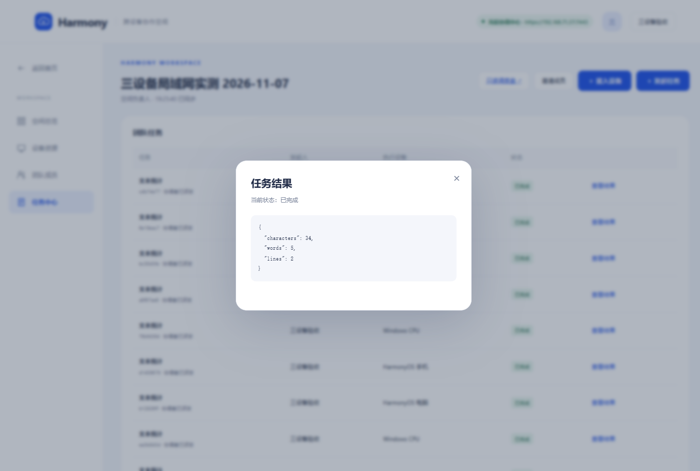
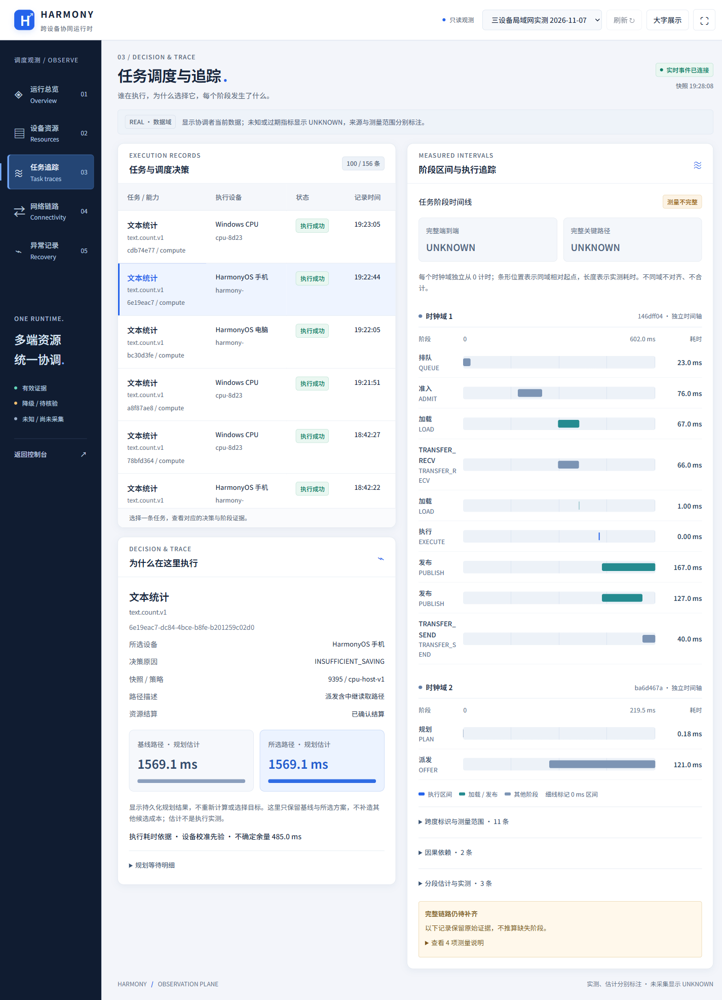

# 三设备可见页面演示记录 · 2026-11-07

本轮在用户已确认局域网证书的独立可见 Chrome 中，通过 Playwright 操作真实页面。协调中心位于 Windows，三个设备均在同一局域网；数据域为 REAL。演示沿用已安装、已配对的设备身份，没有重置设备或创建虚假画像。

## 实际演示顺序

1. 登录、打开“加入空间”，通过现有空间的成员邀请码进入。当前账号本身已是负责人，此步不代表新增了第二名用户。
2. 打开“接入设备”配置页面。展示现有设备的资源设置；没有执行新的原生设备配对，也没有演示扫码。
3. 调度盘显示 Windows、鸿蒙电脑、鸿蒙手机的真实画像。停止两台鸿蒙代理后观察有效画像由 3 台降至 1 台，再依次启动原生代理，沿用原身份恢复在线及能力。此处是应用停止/重启，不是拔网线或 Wi-Fi 故障测试。
4. 通过控制台任务表单及既有 SchedulerSdk，依次提交一次自动分配及三次指定设备的文本统计任务。
5. 在任务中心打开手机、鸿蒙电脑和 Windows 的真实结果；在调度盘选择手机任务，展示调度决策、资源结算和分时钟域阶段时间线，随后展示网络与总览。

## 本轮新任务

输入为以下两行文本，无末尾换行：

```text
Harmony team
Devices work together
```

| 提交方式 | 实际执行设备 | 任务 ID | 结果 |
| --- | --- | --- | --- |
| 自动分配 | Windows CPU | a8f87ae8-576f-4e6d-a63c-fabf2b361a08 | SUCCEEDED |
| 指定鸿蒙电脑 | HarmonyOS 电脑 | bc30d3fe-5992-46c5-bf13-e3b505c4f2d0 | SUCCEEDED |
| 指定鸿蒙手机 | HarmonyOS 手机 | 6e19eac7-dc84-4bce-b8fe-b201259c02d0 | SUCCEEDED |
| 指定 Windows | Windows CPU | cdb74e77-d512-4614-a6df-4f968d68c37c | SUCCEEDED |

四次均返回 `characters=34, words=5, lines=2`。只读核查持久化回执，每项恰有一份 committed 回执。脱敏结果与阶段证据见 [THREE-DEVICE-WALKTHROUGH.json](THREE-DEVICE-WALKTHROUGH.json)。这四项是顺序提交的独立任务，不是同一任务拆分后在三台设备上并行执行，也不是吞吐或加速对照。

## 演示期间修复

- 将“发起任务”放到空间固定操作栏；控制台和调度盘在渲染内容未变时保留 DOM，解决实时刷新期间按钮反复被替换、难以点击的问题。修复后实际打开任务结果及切换追踪通过。
- 空间任务接口先按真实提交时间倒序排列，再取最近 100 条。原先数据库先截取 100 条，导致新增任务被历史记录挤出。
- 正确标注图像裁剪能力；没有明确手动标记的记录显示“协调者已派发”，避免把 SDK 指定目标误标为自动选择。
- 为加载任务列表修复重启了本机协调服务；原数据、证书、任务结果保留，三端恢复在线。当前服务进程信息记录在本机私有 `.test/real-device-20261107/processes.json`。

验证：协调器 TypeScript 编译通过；任务窗口回归 1/1、DOM 刷新及追踪恢复回归 1/1、空间与 SDK 集成 1/1、调度盘遥测 3/3 通过；前端脚本语法检查通过。

## 证据边界与后续

四项均有 PLAN / OFFER / ADMIT / QUEUE / EXECUTE / PUBLISH 等阶段记录；跨时钟间隙和 SDK 根区间尚未完整，完整端到端及关键路径继续显示 UNKNOWN。原生执行该微小文本的记录为 0 ms，不能解读为计算没有成本。

这次完成了页面接入入口、重新上线、真实调度、设备执行、结果查看的操作演示。首次扫码配对、三端并行拆分负载、稳定协同加速仍需分别落实。此前性能对照的 NO_SPEEDUP 结论不被本轮正确性结果改变。

演示截图保存在本机 `.test/walkthrough-tools/screenshots`，其中邀请或配置截图可能包含短期接入信息，不应整体提交。归档的截图只保留结果和调度观测页面。协调中心与代理继续运行；鸿蒙设备需要解锁并保持代理前台贡献。




