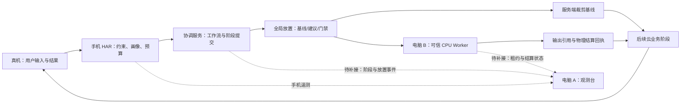

# 多设备协同调度演示流程与录制脚本

适用设备：一台 HarmonyOS NEXT 真机、一台 DevEco 模拟器、两台电脑。核对日期：2026-09-29。

本文依据当前 `harmony-agent` 源码、9 月 29 日架构验收记录和 9 月 28 日真机记录编写。“历史真机通过”指记录中的隔离测试包，不能直接代表今天重新编译的版本或当前线上服务。本文交付的是演示方案，没有安装应用、修改调度盘、部署服务或开启优化派发。

## 1. 演示结论与执行路线

**推荐主题：让 AI 工作流按任务需求、数据位置和设备状态选择执行位置，并用执行回执确认结果与资源释放。**

电脑展示调度盘是合理的：手机负责用户操作，电脑负责解释系统为什么这样调度。新版需要补充跨设备观测视图，已有手机监控页可以继续使用，但它目前不足以证明整条多设备执行链。

建议按三档准备，达到哪一档就录制哪一档，镜头上明确标注：

| 档位 | 可录内容 | 必须先满足的条件 | 可据此说明的成果 |
|---|---|---|---|
| A：当前主线 | 真机文字购物任务、电脑真实遥测、taskId/runId 关联、前后台遥测变化；本机 Worker/策略自动化演示 | 最新 HAP 与服务端兼容，文字能力就绪，配对成功 | 真机端云业务和调度观测；独立执行协议与算法行为 |
| B：真实双机补充 | 电脑 A 上的协调服务通过受信链路调用电脑 B 的真实 CPU 裁剪，核对输出 hash | 两台物理电脑部署成功、身份与通道就绪、校准接口通过 | 跨物理设备执行、数据完整性和目标端资源准入；此片段属于显式校准 |
| C：完整业务协同 | 真机发起图片任务，服务端按阶段评估并在门禁通过后把裁剪派到电脑 B，后续云阶段完成并回手机 | 图片能力/数据/模型就绪、新协议开关验收、同规模样本与质量/非劣证据、跨设备观测接通 | 真实购物工作流中的按阶段跨设备调度 |

**最终建议录成 8–10 分钟主视频，另留 3–5 分钟故障与算法补充片段。** 如果只能完成 A，视频标题使用“多设备协同调度架构与端云闭环演示”；完成 B 可增加“真实双机执行”；完成 C 才把“完整图片业务跨设备调度”作为主标题。

这里的关键取舍是：正式手机购物当前注册云执行器，手机不是图片裁剪的全局协调器，也不会自动把模型推理迁到模拟器。多设备裁剪由服务端 `DeviceDispatchService` 选择和派发。

## 2. 当前项目到底调度了什么

### 2.1 从用户动作到物理执行的五个层次

| 层次 | 当前入口 | 做什么决定 | 录制时应展示什么 |
|---|---|---|---|
| 业务意图 | `ShoppingTaskService`、ShoppingResult | 用户是否等待、质量要求、150 秒截止/新鲜度、最新请求与会话修订 | 真机输入、结果、请求替换与错误 |
| 手机 HAR 调度 | `SchedulerClient`、`SchedulerService` | 前置准备与网络画像、队列/生命周期、合法执行配置、取消与预算 | 手机真实状态、计划/实际回执、保护原因 |
| 服务端工作流 | `RuntimeRunnerService`、图片阶段服务、WorkflowStore | 阶段依赖、剩余预算、输入输出引用、阶段提交与版本 | 工作流阶段时间线、Artifact、attempt、提交状态 |
| 跨设备放置 | `DeviceDispatchService`、`WorkflowPlacementPlanner` | 当前裁剪留在服务端还是交给可信 CPU Worker；估算后续总成本并经过独立灰度门禁 | 基线路径、建议路径、实际执行位置、拒绝/回退原因 |
| 目标执行与操作系统 | Worker、Sharp、Node worker thread；系统线程调度器 | 原子槽位/内存准入、实际计算、检查点与物理结算；OS 最终调度线程 | lease/fence、运行/停止/settled、输出校验 |

层数增加不意味着要开五个仪表盘。观众只需要先看到“用户请求”，再看到“在哪执行、为什么、是否真的完成”。



图中的“云业务”可以由真实云部署承载，也可以由配置齐全的隔离 API 环境承载。启动一份空本地 API 不会自动获得线上商品库、模型和对象存储。

### 2.2 策略的真实顺序

**先保证合法，再比较成本，最后决定是否允许实际优化执行。**

1. **提取任务约束。** 当前正式购物为 `REMOTE_CLOUD`，允许远端，要求高质量，`allowLocalFallback=false`；最新任务替换采用 `KEEP_LATEST`。弱网下不能直接承诺转本地购物。
2. **获取有效状态与网络证据。** 电量、热等级、内存、可用后端、网络测量带时间和来源。网络变化使画像失效，prepare/上传/探测也消耗原任务预算。
3. **本地策略过滤。** 截止到期、临界高热或临界内存可拒绝；可用内存低于 192 MiB 是当前代码的临界保护条件之一。HOT、内存压力或未充电且电量不高于 20% 时倾向已声明的安全配置；未知状态保守处理。不是每个任务都会自动降低质量。
4. **本地配置评分。** 受约束策略综合等待、可见性、业务重要度、时限压力、新鲜度、质量损失、相对能耗、热/内存风险和反馈。质量底线仍是约束，分数不能越过它。
5. **全局候选过滤。** 受信且 REAL、能力匹配、模型/索引兼容、画像不过期、有槽位/内存、质量可验证、允许传输、成本可估计，才进入候选。此处不是按“电脑配置最高”直接派发。
6. **计算数据与阶段成本。** 方向传输、数据副本、计算、排队、冷启动、发布与不确定性共同参与；把剩余阶段和最终数据回到协调端的成本纳入比较。
7. **抑制频繁切换。** 当前规划器默认最多 8 个候选、16 个待规划节点、beam width 8，搜索循环预算 20 ms；默认切换成本 5 ms、收益迟滞 10 ms。它是有界启发式规划，不能称为全局最优或严格实时求解。
8. **执行门禁。** OBSERVE/SHADOW 保持合法基线。CANARY/ACTIVE 还检查版本/有效期、kill switch、能力与设备允许列表、流量组、样本、质量、非劣和失败率。手机配置门禁与服务端放置门禁分别生效。
9. **目标端再次准入并结算。** 取得租约和 fence 后执行，输出引用核对 hash。取消不等于释放槽位，底层实际结束并发布回执后才 settled。
10. **用合格样本更新预测。** 真实确认执行才能作为性能依据；影子建议、注入数据、先验和未知计时不能当实测训练样本。恢复使用原截止时间，取消不自动复活。

观众可理解的公式是：

> 预计完成代价 ≈ 尚未发生的数据搬运 + 排队 + 冷启动 + 计算 + 发布/必要回传 + 不确定性余量。

这里的输入、结果大小有实测或上界口径，不能把预测图里的每个数字都说成已经测量。当前裁剪输出规模使用上界估计，后续阶段固定在云侧；规划器在现有正式路径中并没有把 12 个阶段分散执行到多台设备。

### 2.3 能力与验收边界

| 内容 | 当前事实 | 演示口径 |
|---|---|---|
| 真机文字业务 + 电脑遥测 | 9 月 28 日记录中隔离测试包通过，能关联手机与云 runId | 可作为历史真机证据；录制前复验当前包 |
| 图片业务 12 阶段 | 代码包含 receive → asset → quality-check → crop → category → product-profile → embedding → vector-search → price-stock → rank → answer → result | 阶段是串行链；录屏必须来自真实执行，不能把结构图当已跑通 |
| 真实 CPU Worker | 支持 `image.crop.v1`、`vector.normalize.v1`；后者实际产出分块向量范数和检查点 | 能演示 CPU 裁剪、分块范数计算；不称为 GPU/NPU 推理或完整向量检索 |
| 正式业务跨机派发 | 裁剪能力接入服务端选路；默认不开优化 | 完成双机/门禁前只展示评估或显式校准 |
| 任意设备自动加入 | 配置式可信设备目录，每次读取启用配置并探测；无通用自动发现界面 | 新电脑可配置接入；不是“接入 Wi-Fi 即成为节点” |
| Worker 逻辑恢复 | 有块边界、模型/索引/输入校验和持久回执 | 用协议测试或专用 harness 演示；不是进程内存/GPU 上下文透明迁移 |
| 用户反馈 | 条件触发、限频、有界积累 | 不要求一条评价立刻改变调度；正式片段可省略 |
| 手机 NPU/GPU/功耗/帧卡顿 | 当前正式路径不具备完整对应实测 | 不展示原型模拟数字；未知保持未知 |

**旧入口风险：** 最新 `ShoppingTaskService.warmup()` 直接抛出 `OFFLINE_DIAGNOSTIC_ONLY`，`setShadowPlacement()` 也拒绝正式购物仿真；`ExperimentService` 仍调用 warmup，因此旧“运行真实采样实验”不适合作为最新版主视频入口。`EntryAbility` 默认 `enableDebugInjection=false`，调试按钮存在也不等于可用。正式启动不加载本地商品与模型作为购物回退。需要本地前后台演示时，先建立独立离线诊断入口并复验；本次未做这项代码改造。

## 3. 与原操作系统调度的差异怎样讲

### 3.1 先讲职责，再讲创新

推荐开场原话：

> “操作系统负责把线程放到处理器上运行。我们的中间件在更上层接收完整 AI 任务：用户在等什么、结果什么时候失效、数据在哪里、哪台设备有兼容能力。它先决定哪个阶段在哪里执行、允许使用什么配置，再把真实计算交给设备和操作系统。这里演示的是业务语义和多设备成本进入调度决策的过程。”

| 比较维度 | 内核线程调度 | 鸿蒙已有分布式应用能力 | 本项目增加的决策与协议 |
|---|---|---|---|
| 主要对象 | 可运行线程/调度实体及 CPU 时间 | 跨设备应用协作、远程能力调用、应用接续等平台能力 | 带约束的 AI 任务与工作流阶段 |
| 业务语义 | 应用可提供优先级等提示，内核不直接解析商品任务图 | 提供跨设备机制，具体选择仍依赖应用与平台接口 | 用户等待、质量底线、截止/新鲜度、会话修订进入契约 |
| 执行位置 | CPU/核心选择，公平性与延迟等 | 具备跨设备执行/协作能力 | 当前裁剪路径比较基线与 Worker，并计入数据和后续阶段成本 |
| 网络与数据 | 不直接求解业务 Artifact 在设备间的搬运计划 | 分布式平台提供相关通信与数据基础能力 | 方向成本、引用/hash、兼容性、TTL 和隐私限制参与评估 |
| 停止与重试 | 线程/进程生命周期机制 | 提供平台级生命周期与协作接口 | 逻辑取消、目标结算、幂等提交和迟到 fence 的业务协议 |
| 验证与上线 | 系统自身策略与治理机制 | 平台机制及应用接入规范 | 建议/实际分列、独立 OBSERVE/SHADOW/CANARY/ACTIVE 门禁 |

避免“原系统没有多设备调度”“原系统完全不懂优先级/能耗”的说法。现代操作系统已有公平性、延迟和容量/能耗相关机制；Linux EEVDF 和 capacity-aware 文档可作为职责对比参考，**不能用 Linux 实现推断这台 NEXT 真机的内核算法**。鸿蒙官方也已有分布式任务调度说明，项目的差异是这里的 AI 任务画像、阶段成本、数据兼容和执行闭环组合，而非首次发明跨设备。

参考：[Linux EEVDF 官方文档](https://docs.kernel.org/scheduler/sched-eevdf.html)、[Linux Capacity Aware Scheduling](https://docs.kernel.org/scheduler/sched-capacity.html)、[华为分布式任务调度 Codelab](https://developer.huawei.com/consumer/cn/codelab/HarmonyOS-hap5/index.html)。华为该 Codelab用于说明平台既有能力，不作为当前 NEXT API 接入指南。

### 3.2 用疑难问题组织创新点

| 疑难 | 本项目的解决思路 | 最有说服力的镜头 | 可讲的创新贡献 |
|---|---|---|---|
| 远端算得快，传过去却更慢 | 联合考虑数据规模、方向链路、数据位置和剩余阶段 | 同一任务改变链路条件，基线/建议变化；实际门禁状态清楚 | 从单阶段计算耗时转到端到端放置成本 |
| 多设备看似空闲，真实执行时抢同一槽 | 目标原子准入，租约与内存配额 | 两个来源同时申请，第二个收到 CAPACITY_FULL | 把“建议可用”与“实际拿到资源”分开 |
| 点了取消，后台计算仍占资源 | STOP_REQUESTED 与 settled 分离，未结束保留占用 | 停止未确认时第二任务仍不能入场；结束后才恢复容量 | 以执行事实管理资源释放 |
| 重试产生重复结果或旧结果覆盖新请求 | task/attempt、幂等提交、epoch fence、session revision | 重复派发复用回执；旧版本拒绝；当前 UI 保持新结果 | 将调度可靠性和业务一致性一起设计 |
| 同维度向量来自不同模型，结果无法复用 | 模型/预处理/索引指纹和实际内容 hash | 改动索引内容后 CHECKPOINT_INCOMPATIBLE | 把兼容性纳入调度与恢复条件 |
| 长后台任务压住前台，或者长期饿死 | 检查点让出、保护重评估、公平老化 | 专用本地诊断的前后台时间线或算法测试 | 业务紧迫度与公平性组合；当前正式 App 入口需补齐 |
| 新策略看起来更快，质量或可靠性却退化 | 先影子、再按能力灰度，质量/非劣与失败门禁 | 有建议但实际保持基线，并展示原因 | 把“优化可用”做成可审计的上线过程 |

这些是工程与策略上的创新点表达，未进行论文/专利检索，不使用“全球首次”“最优算法”等学术新颖性结论。

## 4. 四个设备如何分工

### 4.1 推荐布置

| 设备 | 角色 | 运行内容 | 拍摄安排 |
|---|---|---|---|
| NEXT 真机 | 用户终端与真实状态来源 | 最新签名 HAP、正式购物任务、手机 HAR、遥测推送 | 手机录屏；保留一次手持操作画面说明是真机 |
| 电脑 A | 演示主控与观测台 | DevEco/HDC、8765 手机监控、浏览器、录屏；可运行隔离 API 协调服务 | 主屏 70% 给观测，30% 给手机画面；凭据窗口不录 |
| 电脑 B | 独立计算节点 | `services/device-worker/server.mjs`，CPU 裁剪与分块范数 | 小窗显示设备名/实例/回执和输出；不依赖只拍 CPU 波形证明执行 |
| DevEco 模拟器 | UI 排练、协议/故障对照 | 同源测试 HAP；如需注入另用明确开启的诊断构建 | 加“模拟器/诊断”标识，不参与真机性能比较 |

模拟器运行在某台电脑上，与宿主共享物理资源。两份 App 不等于两套独立算力，也不能直接把模拟器当第二个已注册 Worker。现有手机监控服务只保留一份最新快照，真机和模拟器同时推送会互相覆盖；录制主线只开真机推送，模拟器另起端口或改成分设备存储后再并列展示。

### 4.2 两种真实双机拓扑

**优先排练：电脑 A 的隔离协调服务 → 电脑 B Worker。** 不依赖公网反向连入个人电脑，校准片段可先独立验证。正式商品流程还需要该 API 环境真实配置齐全。

Worker 默认 loopback HTTP。适配器接受 HTTPS，或 loopback HTTP，直接填写 `http://电脑B局域网IP:3020` 会被 `DEVICE_CONFIG_INVALID` 拒绝。保留这个检查，采用以下一种受信通道：

| 拓扑 | 做法 | 注意 |
|---|---|---|
| A 本地协调、B 计算 | B 有 OpenSSH Server 时，在 A 建本地 SSH 隧道，A 的 loopback 3021 转到 B 的 loopback 3020 | SSH 服务/账号/防火墙须事先准备；用隧道会增加真实传输成本 |
| 云协调、B 计算 | 给 B Worker 设置云服务可访问的可信 HTTPS 入口，配置 token 和受控访问 | 仅同一局域网不够；浏览器能打开不等于云端能访问 |

本地隧道命令模板（替换账号和 B 地址；初次建立前核对主机身份）：

```powershell
# 电脑 A，保持此终端运行；要求电脑 B 的 SSH 服务已可访问
ssh -N -L 127.0.0.1:3021:127.0.0.1:3020 <B的SSH账号>@<B的IP>
```

此时 A 的 `RUNTIME_DEVICES_JSON` 使用 `http://127.0.0.1:3021`。虽然 endpoint 是 loopback，计算仍通过加密隧道到 B；录制要显示两台主机的设备 ID/进程实例和回执，避免误认为同机测试。

## 5. 录制前准备与验收

### 5.1 固定版本和演示资产

准备一个隔离演示配置，记录 Git 版本、未提交源码改动、HAP hash/安装时间、服务端版本、B 的 Worker 版本、Node 版本。原真机记录中独立包名是 `Micro.12.myapplication.codextest`；更新时确认签名/profile 与该包匹配，保留现有正式应用及数据。

固定三个输入：文字“跑鞋 500元以内”；一张取得使用许可且可稳定识别的图片；一份小规模公开向量测试输入。图片小于 Worker 8 MiB 上传上限且不超过 16,777,216 像素解码限制。使用真实拍摄素材时先排练，不在主视频临时换图。

建立证据目录，例如 `artifacts/demo-20260929/`，按用例保存脱敏快照、回执、输入 hash、输出 hash、计时和录屏。测试素材、业务数据、凭据分别管理。每次录制用同一身份贯通 App 与 Runtime 查询；用另一个访客 token 查询手机 run 会被所有权校验拒绝。

### 5.2 手机与电脑调度盘

电脑 A：

```powershell
Set-Location 'E:\learning_resource\Harmony_Creation\HarmonyOS\Cixin\Cixin\harmony-agent'
npm run monitor:dev
```

浏览器打开 `http://localhost:8765`，使用终端配对码。手机“我的 → 电脑实时监控”填接收地址和同一配对码，开推送。

可使用同一可信局域网的 `http://电脑A的IPv4:8765`。USB 更适合稳定录制，以下命令需 DevEco 的 hdc 已在 PATH，且先选定真机：

```powershell
hdc list targets
hdc -t <真机设备ID> rport tcp:8765 tcp:8765
```

手机接收地址填 `http://127.0.0.1:8765`。这里的 USB 转发只解决监控连接；手机访问云 API 的网络仍需单独验证。

通过标准：快照序号连续更新至少 60 秒；状态源 REAL；电量/热等级/内存来源可解释；完成一条搜索后出现真实终态、手机 taskId 与云 runId；退后台暂停遥测，回前台恢复。监控断连不等于计算节点掉线，也不等于任务停止。

### 5.3 Worker 与双机校准

在 B 同步同版本 `harmony-agent`，安装项目依赖，Node.js 22+。首次环境准备在录制前完成。B 的 `.env.worker.local` 是私有文件，填写独立随机 token，至少 32 字符：

```dotenv
WORKER_TOKEN=<本机随机密钥，不出现在录屏中>
WORKER_DEVICE_ID=pc-b-cpu
WORKER_PORT=3020
WORKER_HOST=127.0.0.1
WORKER_DATA_DIR=artifacts/demo-worker-b
```

启动命令：

```powershell
node --env-file=.env.worker.local services/device-worker/server.mjs
```

A 协调服务配置示例（仅录制前配置，不展示密钥值）：

```dotenv
RUNTIME_DEVICES_JSON=[{"deviceId":"pc-b-cpu","endpoint":"http://127.0.0.1:3021","tokenEnv":"CPU_WORKER_TOKEN","enabled":true,"qualityVerified":false,"cropPriorMs":500}]
CPU_WORKER_TOKEN=<与B的Worker匹配>
MAINTENANCE_API_TOKEN=<独立维护密钥>
```

500 ms 是配置先验示例，不是机器成绩；测量后使用实际证据解释。`qualityVerified=false` 保持未验质量状态，显式校准仍可运行，正式优化派发则受门禁限制。

A API 需正常启动且能获得合法用户 JWT。若使用隔离本地 API，按项目 README 配置隔离数据库、生成 Prisma 并启动；不拿生产数据库做初始化，不为演示重跑商品全量上传。API 的启动就绪与模型能力就绪分别检查。

校准 HTTP 操作：使用同一代表性图片，调用 `POST /api/v1/runtime/devices/pc-b-cpu/calibrate`，multipart 字段 `file`，同时携带 `Authorization: Bearer <JWT>` 与 `x-maintenance-token`。以下模板从环境变量取凭据，不应展开打印：

```powershell
# 电脑 A；提前在本地配置这些环境变量；BASE_URL 不带末尾斜杠
curl.exe --fail-with-body -X POST "$env:DEMO_API_BASE_URL/api/v1/runtime/devices/pc-b-cpu/calibrate" -H "Authorization: Bearer $env:DEMO_USER_JWT" -H "x-maintenance-token: $env:DEMO_MAINTENANCE_TOKEN" -F "file=@E:/demo/input.jpg"
```

将文件路径换成实际素材。成功回执关注 `matchesLocalReference=true`、输入/输出字节数，且 `qualityGateChanged=false`、`businessStateChanged=false`。该接口固定使用全图框、512 尺寸、JPEG 90；正常业务裁剪参数不同，**全图校准不自动形成业务区域裁剪所需的同参数成本桶**。

当前样本 key 包含输入大小桶和裁剪参数摘要；传输与计算样本驻留协调进程内存。正式选路要求至少 3 条基线样本、同桶传输样本及后续云阶段样本，其中传输 TTL 30 秒、后续阶段样本检查 5 分钟。这不是“校准三次就能 ACTIVE”。如果真实业务参数桶不匹配，需要同参数的受信校准 harness；这项录制辅助工具当前需补充。重启 A 会丢这些内存样本，需要重新采集。

### 5.4 C 档业务协同的开场门禁

| 检查 | 必须看到的结果 | 未满足时采用的片段 |
|---|---|---|
| 图片 capability、对象存储和向量目录 | 按图片能力健康检查通过，真实图片能形成完整结果 | 文字业务 + 独立裁剪校准 |
| 数据/工作流协议 | 隔离增量迁移完成，ARTIFACT_PROTOCOL_ENABLED/WORKFLOW_PROTOCOL_ENABLED 按兼容版本启用并验收 | 旧兼容业务主线，不讲新协议已贯通 |
| B 能力与通道 | descriptor 的 deviceId/capability/instanceId 正确，真实双机上传/执行/取回通过 | 本机协议演示，镜头标注 |
| 正式成本桶 | 本地基线、双方向传输、裁剪、后续阶段有有效样本 | 展示 SHADOW/拒绝原因 |
| 质量与上线证据 | 质量/非劣/失败率与样本门槛经真实实验验收，policy 未过期 | 保持 OBSERVE/SHADOW |
| 跨设备可视化 | 同 workflow/run 能看到建议、实际 B 执行、物理 settled 与最终提交 | 分屏展示脱敏原始 API 回执，不冒称统一调度盘已完成 |

PLACEMENT_POLICY_JSON 示例默认 `OBSERVE`、kill switch 开启、有效期为 0、允许列表为空、最少样本 30。不要把 sampleCount/qualityPassed 等改成好看的数字来绕开验收。CANARY/ACTIVE 只开放验证过的设备与 `image.crop.v1`；当前归一化能力不属于正式购物全局派发主线。

历史记录显示 9 月 28 日图片能力因视觉探针和部分视觉向量缺失而不可用。9 月 29 日架构实现记录没有提供新的线上图片通过证据，因此录制前必须重新检查；不能依据文字成功推断图片成功。

## 6. 调度盘是否需要改：具体结论与补充需求

### 6.1 三类页面不要混用

| 页面 | 现状 | 用途 |
|---|---|---|
| `调度盘/code.html` | 历史静态原型，含示意硬件数字 | 视觉参考，不能作为实时证据 |
| `apps/harmony/monitor`，8765 | 手机快照、状态/队列、最近事件、网络预测与云关联 | 当前主视频的真机观测 |
| `cixin-agent/web/dashboard.html`，3200 | 另一 Runtime 的节点/真实执行页面 | 此芯/host 节点演示；未经适配不能监控本次 Harmony CPU Worker |

主视频使用 8765。**保留机架风格，增加一页“工作流与设备”，不必重做整套外观。** 当前 monitor 后端只存最后一份手机快照，白名单没有透传服务端 `placementDecisions`、完整 Artifact/lease/StageCommit；前端也没有对应组件。仅调整前端文案不够，需要新增脱敏聚合数据链。

### 6.2 最小可录版补充清单（本次为需求，未实施）

| 优先级 | 增加的视图 | 字段/行为 | 数据来源 |
|---|---|---|---|
| P0 | 关联条 | HAR taskId、业务 taskId、runId、workflowId、attemptId；按一次请求锁定视图 | 手机 actual + 服务端 run/阶段 metadata |
| P0 | 阶段泳道 | 12 阶段、服务端/B 的实际位置、状态与耗时；待执行不预填成功 | Runtime telemetry、metadata.placementDecisions、WorkflowStore |
| P0 | 决策对照卡 | baseline/suggestion/actual 分列，总预测、传输/计算、拒绝码、门禁原因 | WorkflowPlacementDecision + 实际目标回执 |
| P0 | 节点卡 | deviceId、instanceId、能力、可用槽/内存、采样年龄、已注册/可达/繁忙 | 受信协调端探测 Worker descriptor，不把 token 发浏览器 |
| P0 | 结算卡 | leaseId、fence、STOP_REQUESTED、settled、输出 hash 摘要、提交状态 | Worker query/持久回执 + StageCommit |
| P0 | 来源标识 | REAL/INJECTED/MOCK、预测/先验/实测/未知；离线回放全屏标注 | 原始字段及保存的来源元数据 |
| P1 | 录制辅助 | 暂停显示但继续采集、事件自动定位、脱敏导出、错误样例保留 | 新观测聚合服务；现有 monitor 不自动写文件 |
| P1 | 多来源隔离 | 按设备和运行保存，真机/模拟器不覆盖；明确鉴权与所有权 | 新缓存结构和接收协议 |

建议新增独立观测聚合模块，版本化接口同时接入手机 schema 与服务端 run，不把服务端事件硬塞成手机传感器快照。浏览器只读；设备接入、门禁开启、恢复、取消等控制动作走受信管理入口并记审计。

服务端已有 `GET /api/v1/runtime/runs/:runId`、`snapshot` 和 SSE `events`，受 JWT/所有权保护；阶段 telemetry metadata 包含 workflowId、attemptId 和 placementDecisions。Worker 回执需要额外脱敏聚合，现有公开页面没有通用租约浏览器。Runtime run 目前主要内存保留最近 20 条，不能当持久全历史；阶段/工作流存储与 Worker 回执是另一层证据。

来不及做统一页时，电脑 A 左侧开现有手机监控，右侧开按同一 runId 查询的脱敏 JSON/阶段证据，电脑 B 小窗显示真实输出。给镜头加“现有手机监控 / 服务端原始回执”标签，依然可以形成可信链路。

### 6.3 推荐录制布局

```text
┌──────────────────────────────────────────────────────────────┐
│ 版本/REAL 标识          本次请求关联条            已用/剩余预算 │
├───────────────┬──────────────────────────┬───────────────────┤
│ 真机画面      │ 工作流阶段泳道           │ 节点 A / 节点 B   │
│ 输入→结果     │ 每阶段实际位置与状态     │ 能力/槽位/TTL     │
├───────────────┼──────────────────────────┼───────────────────┤
│ 手机状态      │ 基线 / 建议 / 实际       │ 目标执行与结算    │
│ 网络画像      │ 成本分解、过滤原因       │ lease/fence/hash  │
└───────────────┴──────────────────────────┴───────────────────┘
```

这张是布局建议，不是已有界面截图。不要用动画线路自动点亮来代替实际派发事件。

## 7. 主视频逐镜头脚本（8–10 分钟）

以下可直接作为提词稿。S3–S6 根据 A/B/C 档选择，提前剪成固定版本，现场不临时调整门禁。

### S0｜00:00–00:35：问题与作品定位

**画面：** 手机、两台电脑的实物全景，随后切手机输入和电脑调度盘。字幕“AI 任务语义与多设备协同调度中间件”。

**操作：** 展示设备角色标签，停在待机状态，不先播放成功动画。

**解说：**

> “这是一台 NEXT 真机和两台电脑。手机负责交互，电脑 A 展示调度过程，电脑 B 提供独立计算能力。我们关注三个问题：远端算力强，搬运数据是否划算；取消以后资源是否真的释放；重试和设备变化会不会让旧结果覆盖新结果。购物应用是验证这些机制的业务载体。”

**成功信号：** 观众理解手机不是唯一计算资源，调度盘是观测端。A 档补一句“跨设备计算部分今天展示独立执行协议，完整图片业务仍在验收”。

### S1｜00:35–01:20：五层职责与系统差异

**画面：** 第 2.1 节简图，突出“做什么 → 在哪做 → 如何做 → 是否完成”。

**操作：** 依次点亮业务、手机 HAR、服务端阶段、全局放置、目标执行；这是讲解图，标注“架构”。

**解说：**

> “内核调度最后负责线程运行。我们提供任务级信息：用户是否正在等待、结果的质量和有效期、输入在哪里、目标是否有兼容能力。全局策略决定阶段的位置，目标端负责实际资源准入，设备上的操作系统完成底层线程调度。算法建议与实际执行回执会分开展示。”

**要强调：** 操作系统和中间件的职责关系。不要把线程配置说成直接控制 CPU 频率。

### S2｜01:20–02:35：真机文字业务与请求关联

**前置：** 文字能力就绪、真机无调试注入、监控 REAL 且新鲜。使用最新兼容安装包。

**操作：** 真机输入“跑鞋 500元以内”并提交；电脑观察网络准备/任务出现/终态；结果展示后打开一件商品详情并返回。放大 HAR taskId、业务 taskId 和 cloudRunId 对应关系。

**解说：**

> “先运行一条真实业务。提交前系统检查网络和依赖，这些准备时间也计入等待预算。任务完成后，手机结果和电脑日志可以沿着 taskId、runId 找到同一次执行。这个闭环让我们能分辨时间花在前置准备、云端执行还是结果返回，而不是只看到一个旋转图标。”

**观察：** SUCCEEDED 与真实结果一致；未测 upload/download 显示未知；页面展示等待与执行时长分开解释。

**录制处理：** 如等待超过镜头预算，保留开始和结束，字幕“中间等待加速，原始耗时见回执”，不删除原始计时。历史两次 25.7/24.4 秒属于端到端 UI 等待，不作为 P95 或新版指标。

### S3｜02:35–03:35：第二设备真正执行

**B 档操作：** 从 A 调用 B 的裁剪校准接口，显示 B 的 descriptor/实例与真实输出；核对 matchesLocalReference、字节数、hash。放大两台物理电脑和 SSH/HTTPS 通道标识。

**B 档解说：**

> “现在把一项真实 CPU 裁剪交给另一台电脑。输入先形成带 hash 的数据引用，目标申请实际槽位后计算，输出回传再校验。这里是显式校准，不修改商品会话，也不会自动打开优化派发。它证明执行协议已经跨过两台物理设备。”

**C 档替换操作：** 真机选择已验收图片并提交；在阶段泳道中定位 crop，展示实际 B 执行和随后回云阶段。只显示服务端真实回执，不把父级 cloud executor 标签误读为所有子阶段都在云。

**C 档解说：**

> “这次输入从真机进入同一工作流。我们保留已完成阶段，在裁剪阶段评估 Worker 路径；目标执行后把结果回到协调端，后续识别、向量检索与业务结果继续完成。这是按能力分阶段协同，当前开放的跨机业务能力是裁剪。”

**A 档替代：** 播放当前 worker:test 的独立 HTTP 进程测试与裁剪 hash 校验，字幕“同一电脑，真实 CPU/HTTP 协议测试”；不能使用 B 档解说宣称真实双机。

### S4｜03:35–04:45：为什么远端更快也不一定派过去

**操作：** 先展示一次真实评估的基线/建议/实际。按同输入、同参数测试正常链路与受控弱网，收集新证据后展示第二次评估。未配置真实限速时改为播放 `placement:test` 确定性场景，字幕“算法条件测试，非双机实测”。

**解说：**

> “决定位置不能只看裁剪计算时间。把数据送过去、把输出取回来，以及后续阶段在哪运行，都可能抵消远端算力的收益。这里分别显示基线、建议和实际。链路成本较高、质量未知或样本过期时，策略会保留合法基线或拒绝不可行路径。”

**成功信号：** 成本/拒绝码发生可解释变化；建议与实际的差别有门禁原因。若两次都保持基线，解释真实原因，不强行制作选路翻转。

**实际限制：** 浏览器网络限速只影响该浏览器请求，不能改变 Node 协调服务到 B 的链路。手机 Wi-Fi 切换检验手机路由失效；B 限速/隧道条件检验服务端→Worker 成本。两条链路分别记录。

### S5｜04:45–06:00：资源准入与取消物理结算

**操作：** 使用隔离 Worker 协议 harness：来源 1 取得槽位并运行可控长任务，来源 2 申请同节点被 CAPACITY_FULL 拒绝；来源 1 请求取消后先展示 STOP_REQUESTED/settled=false，确认退出后展示 settled=true，再允许来源 2 取得槽。这个时序需要专用可控任务工具，不能期待极短图片任务稳定捕捉全部瞬态。

**当前可直接播放的替代：** `npm run worker:test` 第一项“不协作任务仍占物理槽”测试。标注“受控生命周期测试”；第二项 HTTP 测试展示实际 CPU 计算与槽位竞争。不能把第一项模拟非协作生命周期说成真机后台实测。

**解说：**

> “上层发出了取消，底层可能还没退出。如果现在把槽位交给下一任务，实际计算就会超额并行。我们把停止请求和物理结算分开：没确认结束，就保留占用；确认线程结束后才允许释放。这个机制处理的是多设备协同中的实际资源事实。”

**成功信号：** 未结算不能 release 或取得新槽；迟到输出不发布。展示取消后的资源状态，不只展示 UI 提示“已取消”。

### S6｜06:00–07:10：恢复、重复请求与旧结果保护

**操作：** 展示 Worker 归一化测试输入和完整块检查点；同兼容输入恢复后达到相同最终 cursor；改同数量索引的内容则 CHECKPOINT_INCOMPATIBLE；重复派发同 attempt 返回已有回执。当前测试使用 600 行、256 行块，形成 3 块，此数值属于固定测试输入。

**解说：**

> “恢复必须知道哪些块已经完整提交、输入和模型是否仍兼容。这里恢复的是业务逻辑检查点，不是把整个进程内存搬走。同样数量的索引，只要内容变了也不能盲目续跑。重复请求会复用既有回执，迟到写入还需要 fence 和会话版本保护。”

**C 档扩展：** 如果已完成工作流持久化/恢复验收，展示同请求查询已提交阶段、恢复未提交后缀和最终会话修订；重启后要区分持久 StageCommit 与丢失的内存 run/网络样本。

**成功信号：** 相容恢复有正确结果，不相容明确拒绝；没有重复业务效果。取消后的工作流不自动重启。

### S7｜07:10–08:00：手机状态与保护的诊断对照

**操作：** 使用模拟器或独立诊断构建演示 HOT/临界内存/质量不足，画面持续标注 INJECTED。正式 App 默认注入关闭，未建立诊断入口就展示确定性策略测试。不要临时加热真机来追求截图。

**解说：**

> “设备状态会影响合法配置，但优化必须服从质量和安全约束。这里用明确标记的故障输入验证分支：临界状态拒绝，承压状态选择已声明的安全配置。注入验证的是规则正确性，真实收益还需要真机实验。”

**可选前后台片段：** 专用本地诊断建立后，再展示后台在检查点让出、前台结束后恢复以及超过 30 秒的可运行任务公平轮转。主 App 当前 warmup 不可用，先不录这个片段。

### S8｜08:00–08:45：总结项目贡献与下一步

**画面：** 同请求的完整证据条：输入 → 约束 → 决策 → 执行设备 → 输出校验 → 结算/提交 → 手机结果。展示已通过项，不使用虚构百分比。

**解说：**

> “这个项目把 AI 任务语义、数据位置、设备能力和执行事实连接起来。它为算力孤岛、传输抵消收益、取消后资源残留、重试和结果一致性提供了一套可审计的处理路径。当前展示范围是〔按本次档位填写：真机文字闭环/双机真实裁剪/图片阶段协同〕。后续会按能力扩展真实执行器，并用质量、可靠性和端到端实验决定是否开放优化。”

## 8. 补充用例与异常时的解说

| 用例 | 操作 | 预期与证据 | 失败时怎么讲 |
|---|---|---|---|
| 监控服务停止 | 仅关闭 A 的 monitor，保持业务 API 不动 | 监控过期；业务是否继续由结果/云回执证明 | “现在观测通道中断，不能据此判断计算节点失效。” |
| Worker 关闭 | 隔离环境停止 B，提交新任务 | 目标不可达被排除，基线是否合法取决于依赖/预算 | “离线目标不能继续被视为可派发设备。” |
| Worker 在途失联 | 在已确认 B 开始后中断通道 | 保留未确认结算；默认恢复关闭时明确失败，不承诺自动接管 | “源端无法确认目标结束，资源与提交按不确定状态对账。” |
| 身份错误 | 测试身份/配对码错误 | 401/403 或 owner 拒绝，不泄露其他用户结果 | “设备可达与请求有权执行是两个条件。” |
| TTL 过期 | 等画像过期后再次提交 | 重新探测或排除陈旧候选，原因有据 | “旧网络测量不能继续当实时能力。” |
| KEEP_LATEST | 确认旧业务 POST 已发出后，再提交新输入 | UI 只展示新 revision，旧任务终态/结算分别检查 | “最新输入保护已生效；远端取消是否确认还要看回执。” |
| 图片能力不可用 | 查询健康能力，暂不发送收费图片业务 | 明确 unavailable；可独立演示 CPU 裁剪 | “当前视觉依赖未就绪，裁剪协议与完整识别能力分开验收。” |
| 质量门禁不足 | 用真实设备但未认证质量配置评估 | QUALITY_UNKNOWN_OR_LOW 或门禁保持基线 | “更快的候选也必须先满足质量要求。” |

恢复开关默认关闭。纯裁剪失败的合法云端重算还需 `maximumRecoveryAttempts>0`、剩余预算和恢复策略允许；不能把它扩写为所有阶段的自动容灾。原云模型调用的取消回执也并非都可观测，必须与新 CPU Worker 的物理结算能力分别说明。

## 9. 对比实验与性能镜头

### 9.1 比较哪两条链路

主对比设为“同业务、同图片和裁剪参数、同质量目标的服务端裁剪基线”与“允许 Worker 优化的分阶段路径”。把 OBSERVE/SHADOW 下的建议用于策略解释，把真实 CANARY 执行用于性能比较。显式校准和购物会话不是同一工作量，不能直接相减算加速比。

本项目与 OS 的差异用职责和真实决策证明。性能实验应与应用固定配置基线比较，不能把“关闭中间件的应用”和“原操作系统调度”画等号，也不绕过 OS 制造对照。

### 9.2 记录和报告

| 指标 | 应记录什么 | 口径 |
|---|---|---|
| 用户等待 | 提交→结果交给页面；如采屏测出帧另记 | App responseReadyMs 不等于实际屏幕出帧 |
| 阶段计算/传输 | 双方向输入/输出字节与实测耗时、裁剪执行 | 单调本地计时；跨机墙钟不推导单程 |
| 可靠性 | 成功/失败/取消/超时、旧结果覆盖、重复提交 | 失败样本保留，不只统计成功 |
| 质量 | 同图裁剪参考 hash；完整业务另测召回/相关性与筛选 | 裁剪 hash 一致不等于识别质量已验收 |
| 资源 | 槽位使用、取消到物理 settled、可用内存 | stage finish RSS 不是实测峰值；CPU 波形不等于功耗 |
| 调度开销 | 规划耗时、探测/prepare 成本、回退比例 | 中间件开销也计入端到端 |
| 预测效果 | predicted/actual、样本数/桶/TTL、误差 | 先验与已测样本分列 |

建议每个正常/弱网场景收集至少 30 条可用对照记录并交错顺序，登记全部失败；这只是起步设计，不保证足以证明 P95 或统计显著性。受控版本的样本量还须满足项目实际门禁和预先定义的实验要求。录制挑代表性任务展示，附全量实验文件，不能用挑选镜头代替统计。

表格模板：

```text
caseId / 时间 / Git与HAP版本 / API与Worker版本 / policyVersion
设备ID与实例 / 输入hash与大小 / 参数摘要 / 质量目标
workflowId / runId / HAR taskId / 业务taskId / attemptId
基线、建议、实际位置 / 拒绝与门禁原因 / TTL与样本桶
prepare / 传输 / 执行 / responseReady / planning 耗时及来源
终态 / 取消请求时间 / settled时间 / 最终提交与session revision
输入、输出、检查点hash / 是否兼容 / 证据文件 / 失败说明
```

## 10. 录制与排练清单

**先完成一次不剪辑排练，再录正式镜头。** A 屏 1920×1080，放大关键 ID/原因/时间；录屏以可读性为主。手机竖屏放右侧或左侧，避免将大量源码作为主画面。B 可远程观测其脱敏回执，保留一次实体双机镜头。

录制前逐项确认：

- [ ] 本次档位 A/B/C 写在脚本和视频标题中。
- [ ] 真机安装的是同源最新兼容 HAP，不沿用未知旧包；签名与现有应用处理方案已确认。
- [ ] 文字业务、手机网络、监控配对和 REAL 标签通过。
- [ ] 不同时把模拟器与真机推到同一份 latest 快照。
- [ ] B 的实际主机、Worker deviceId/instanceId、版本和通道通过。
- [ ] 校准片段与正式自动派发分别标识。
- [ ] 图片未通过时采用 A/B 档替代，不播放伪造图片成功记录。
- [ ] 旧 warmup 实验、关闭的注入按钮、三档兼容模式不作为自动闭环证明。
- [ ] 准备正常、弱网、取消、重复/不兼容各一份脱敏证据。
- [ ] token、Authorization、签名文件、私有图片 URL 不出现在画面中。
- [ ] 测试失败与未知数字可见，讲解与实际画面一致。
- [ ] 开始/结束原始耗时保留；加速片段有字幕。
- [ ] 出现 ACTIVE/CANARY 时能提供真实质量/可靠性/样本验收依据。
- [ ] 录制结束关闭监控推送与临时通道，归档本次配置与证据。

建议剪辑成：问题 35 秒 → 架构 45 秒 → 真机业务 75 秒 → 双机执行 60 秒 → 成本解释 70 秒 → 结算 75 秒 → 恢复 70 秒 → 保护 50 秒 → 结尾 45 秒。等待和切换按排练微调，完整原始录像作为附件保留。

## 11. 本文的核对依据与本次验证

### 11.1 关键源码与现状依据

下列相对链接均以本文件位置为基准，方便直接进入项目核查。

| 要点 | 来源 |
|---|---|
| 正式云路径、质量/截止、warmup 禁用 | [ShoppingTaskService](../apps/harmony/entry/src/main/ets/services/ShoppingTaskService.ets)、[EntryAbility](../apps/harmony/entry/src/main/ets/entryability/EntryAbility.ets)、[ExperimentService](../apps/harmony/entry/src/main/ets/services/ExperimentService.ets) |
| 受约束过滤、评分、保护与灰度 | [ConstrainedPolicy](../apps/harmony/scheduler/src/main/ets/policy/ConstrainedPolicy.ets)、[TaskQueue](../apps/harmony/scheduler/src/main/ets/queue/TaskQueue.ets) |
| 有界规划、传输成本、候选过滤与门禁 | [WorkflowPlacementPlanner](../services/api-server/src/core/runtime/workflow-placement-planner.ts) |
| 实际裁剪派发、同桶样本、后缀成本、取消与回退 | [DeviceDispatchService](../services/api-server/src/core/runtime/device-dispatch.service.ts) |
| 12 阶段及串行依赖 | [图片任务图](../services/api-server/src/core/runtime/image-search-task-graph.ts)、[图片阶段实现](../services/api-server/src/modules/sessions/application/shopping-image-stages.service.ts) |
| Worker 能力、原子租约、范数与裁剪 | [Worker README](../services/device-worker/README.md)、[compute](../services/device-worker/compute.mjs)、[lease-manager](../services/device-worker/lease-manager.mjs) |
| 显式校准、双重鉴权与固定参数 | [校准 Controller](../services/api-server/src/modules/runtime/controllers/device-calibration.controller.ts)、[维护鉴权](../services/api-server/src/modules/runtime/runtime-maintenance.guard.ts) |
| 实际 observability 来源与限制 | [monitor server](../apps/harmony/monitor/server.mjs)、[monitor app](../apps/harmony/monitor/public/app.js)、[Runtime Runner](../services/api-server/src/core/runtime/runtime-runner.service.ts)、[run 存储](../services/api-server/src/core/runtime/runtime-run.service.ts) |
| 最新本地改造与待真机验收 | [架构改造验收](architecture-change-acceptance.md) |
| 真机文字、监控通过与图片阻塞的历史证据 | [真机联合调试进度](真机联合调试进度.md) |
| 网络探测、TTL、画像失效的实现边界 | [网络画像实施与验收](网络画像驱动调度实施与验收.md) |

9 月 28 日的全景梳理包含演进蓝图和较早多设备现状；其“毫秒级热接管”“动态调频”等表述不能直接当当前代码能力。本文以实际源码与 9 月 29 日验收边界为准。README 中旧云 404/旧范围描述也不能替代最新运行检查。

### 11.2 本次实际复验（2026-09-29，本电脑 Node v24.16.0）

| 命令 | 本次结果 | 能证明什么 |
|---|---|---|
| `node --test services/device-worker/worker.test.mjs` | 2/2 通过 | 受控未停止占槽；独立 HTTP 进程、真实 CPU/Sharp、准入、引用校验、检查点、重复派发与重启回执 |
| `node scripts/test-placement.mjs` | 10/10 通过 | 手机影子放置不派发、隐私/权限、TTL、网络/冷启动成本、真实样本准入、云基线等确定性行为 |
| `node scripts/test-network-monitor.mjs` | 通过 | 手机监控保留网络预测与实际耗时，裁剪网络标识和任意附加字段 |

本次未运行真机、模拟器、双物理电脑或线上业务验收；上述同机测试不作为跨物理设备效果或整体验收结论。本次只新增本演示文档，未修改已有项目代码、调度盘、凭据与用户现有文档。
