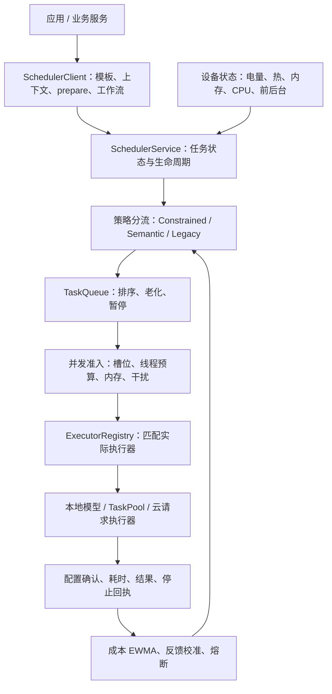
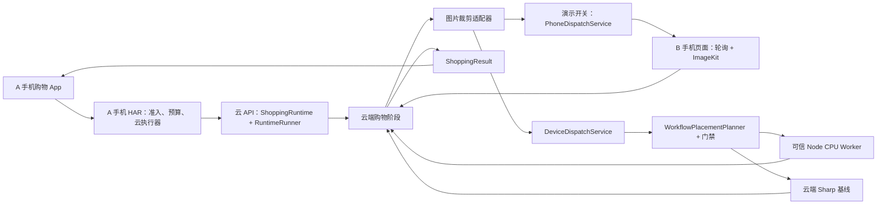

# 智调鸿枢：复赛项目系统审查与调度架构详解

审查日期：2026-10-20  
审查对象：当前 `harmony-agent` 工作目录中的源码，包括未提交的现有修改。  
用途：理解项目、确定改进顺序、准备比赛答辩。

本文以当前 `apps/`、`services/`、`contracts/` 和 `scripts/` 的实现为依据。提交目录中的多轮复制包、早期设计和历史验收报告作为背景材料，不替代当前源码。代码实现、默认配置、测试结果、真实设备效果分别描述。本次没有操作线上服务、调用收费模型或连接手机进行实测。

## 阅读导航

| 想弄清的问题 | 对应章节 |
|---|---|
| 项目究竟做什么，宏观和微观分别是谁 | 1—3 |
| 一次图片搜索从手机到结果如何流转 | 4 |
| 算法看哪些设备信息，是否汇总所有硬件 | 5 |
| 云端宏观算法的公式、搜索和派发门禁 | 6 |
| 手机微观调度的组成、公式、排队与资源保护 | 7—9 |
| 双手机演示、Worker、多设备算法是什么关系 | 10 |
| 数据、检查点、取消、恢复如何保证一致 | 11 |
| 当前风险和后续修改路线 | 12—13 |
| 怎么展示、怎么回答评委、从哪里读代码 | 14—16 |

## 1. 先建立正确的整体认识

### 1.1 项目定位

当前项目是一个**以鸿蒙智能识物购物 App 为业务载体的应用级任务调度系统**。它包含手机本地调度 HAR、云端购物工作流、可信计算 Worker，以及若干监控和双机演示入口。

它的核心问题可以拆为两句：

1. **宏观调度：某个任务或工作流阶段放到哪个合法执行节点上运行？**
2. **微观调度：选定节点内部，任务何时运行、采用哪套执行配置、占多少应用资源、何时停止？**

系统通过公开应用接口调整推理线程数、TaskPool 分区、分批大小、执行顺序、任务准入和远端路由。当前实现没有操作系统内核调度、CPU 调频、跨设备共享物理内存或任意模型进程热迁移。

### 1.2 最重要的六个结论

**第一，宏观和微观关注的范围不同。** 宏观层比较多个已接入候选节点及数据传输成本；手机微观层读取当前手机的资源状态和应用任务队列。每台设备保留自己的执行与资源准入边界。

**第二，当前并没有一个覆盖所有设备、所有任务、所有硬件的统一调度闭环。** 可复用算法、业务接入和演示路径已存在，但接通程度不一致。尤其需要区分可信 CPU Worker 路径与云端配对手机路径。

**第三，正式购物入口固定使用云端执行器。** `ShoppingTaskService` 的 `product_search` 声明为 `REMOTE_CLOUD`，150000 ms 预算，`allowLocalFallback: false`。手机有本地模型和检索能力，但它们主要用于 `offline_diagnostic`，不能据此声称正式购物已实现自动端云切换。[S01]

**第四，真实跨设备成本规划目前重点接入图片裁剪。** `DeviceDispatchService.crop()` 调用 `WorkflowPlacementPlanner`，比较云运行时与可信 CPU Worker，并计入裁剪后剩余云阶段。其他阶段仍主要由云业务执行器承担。[S02][S03]

**第五，第二台手机的购物裁剪路径是单独的演示机制。** 它优先选取同一发起用户下、最近轮询且空闲的已配对手机；没有调用上述束搜索规划器，也没有依据手机 CPU、内存、热状态做多设备成本排名。执行端页面直接使用 ImageKit 裁剪，没有提交到 HAR。[S04][S05]

**第六，完整微观调度主要实现在手机 HAR 中。** Node Worker 使用槽位、内存预算、租约与执行线程；云端 Runtime 使用执行器规划、阶段预算和取消管理。三者共享部分协议思想，但没有运行同一套完整微观算法。[S06][S07]

### 1.3 “支持”“启用”“验证”不是同一件事

| 能力 | 源码能力 | 当前入口或默认行为 | 本次可确认的证据 |
|---|---|---|---|
| 手机资源感知 | 电量、热等级、CPU、内存、前后台采集 | 启动状态适配器，每秒刷新资源 | 源码与本地主机回归 |
| 手机执行配置选择 | manifest 配置、质量约束、预测、反馈、门禁 | 有 manifest 的本地任务走受约束策略；默认 OBSERVE | 算法测试 |
| 手机双任务并发 | 允许显式配置 1 或 2 槽 | `EntryAbility` 未设置双槽，默认单槽 | 并发测试证明可选能力 |
| 正式购物本地回退 | 当前正式模板禁止 | 云请求失败不能自动当成本地完整购物 | 模板与执行器检查 |
| 可信 Worker 优化派发 | 裁剪接入真实规划和门禁 | 未配置设备时直接云基线；策略默认关闭优化 | Worker 和规划单测 |
| 第二手机裁剪 | 有配对、轮询、裁剪与回执代码 | 受两个演示开关控制 | 本次源码审查，未做双手机实测 |
| 手机影子放置 | 本地/远端候选估算 | `dispatchAllowed=false` | 影子放置测试 |
| 多阶段恢复 | Artifact、阶段提交、epoch、恢复选择器 | 独立开关控制 | 实现与相关单测；非进程热迁移 |

“默认行为”指源码默认值，不表示当前线上环境变量或已安装 HAP 的状态。

## 2. 项目组织架构与目录职责

```text
harmony-agent/
├─ apps/
│  ├─ harmony/
│  │  ├─ entry/                鸿蒙应用：页面、购物适配、本地诊断、设备演示
│  │  ├─ scheduler/            可复用 HAR：契约、策略、队列、执行与资源状态
│  │  └─ monitor/              PC 调度监控与独立双手机实验服务
│  └─ test-entry-web/          Web 联调、商品管理、Runtime 监控等入口
├─ services/
│  ├─ api-server/              NestJS 云服务、Runtime、购物领域、数据库
│  ├─ device-worker/           独立 Node CPU Worker
│  └─ image-worker/            可选 Python 图像服务
├─ contracts/                 购物与调度共享契约、测试样例
├─ scripts/                   构建、类型检查、协议和算法回归、打包
├─ docs/                      方案、源码导读、验收与操作记录
├─ artifacts/                 构建/实验产物，具体子目录用途不同
└─ 提交文件/                   多个时间点的比赛资料和源码打包快照
```

### 2.1 手机应用 entry

| 模块 | 实际职责 | 不应混淆的职责 |
|---|---|---|
| `EntryAbility` | 初始化调度器、注册业务服务、启动设备采集、处理前后台 | 不是宏观成本算法 |
| `pages/Index` 与组件 | 用户输入、商品结果、业务交互 | 不决定云端执行器内部算力分配 |
| `ShoppingTaskService` | 把业务操作包装为任务，携带上下文、版本和修订号 | 不是本地检索实现 |
| `CloudShoppingExecutor` | 鉴权、独立上传、网络探测、云请求、结果解析和遥测 | 不是云端模型本身 |
| `OfflineDiagnosticService` | 本机编码、向量搜索、归一化诊断负载 | 不是正式云购物的自动离线备用 |
| `NeuralEmbeddingIndex` / `MindSporeEmbeddingEngine` | 本地向量数据与模型执行 | 不具备全局任务放置权 |
| `SchedulerMonitorPublisher` | 将调度状态和日志发给 PC | 观测不等于派发 |
| `CloudPhoneDispatchPage` | B 手机配对、轮询、执行演示任务、回执 | 当前没有通过 HAR 执行外来任务 |

### 2.2 手机 scheduler HAR

HAR 是库，由应用加载并调用，不是独立后台操作系统服务。其他 App 若要复用，需要显式集成 HAR、注册任务模板和执行器，并提供设备状态与生命周期适配。

| 子目录 | 作用 |
|---|---|
| `api/` | 对外客户端、运行时服务、任务类型、跨端协议、时钟与远端路由 |
| `state/` | 采集/保存设备状态、来源与观测时效、资源单位转换 |
| `policy/` | 语义策略、配置选择、成本预测、干扰、反馈、滞回和工作流估算 |
| `queue/` | 优先级、老化、公平出队 |
| `executor/` | 执行器注册、匹配、取消与模拟负载 |
| `placement/` | 手机侧本地/影子放置评估 |
| `network/` | HTTP 网络路由探测 |

### 2.3 云服务

`core/runtime/` 负责通用执行编排、工具和执行器注册、平台发现、候选评分、运行记录、Artifact、工作流提交、恢复与可信 Worker 派发。

`modules/sessions/application/` 负责购物业务语义：图像阶段、商品画像、向量检索、筛选、候选、会话及结果。算法不需要知道“某件鞋的价格是多少”，业务服务也不应该自行实现租约和调度队列。

`modules/runtime/phone-dispatch.service.ts` 是云端配对手机的独立机制。它与 `core/runtime/device-dispatch.service.ts` 名字相似，但协议、选择规则、执行端和灰度条件不同。

Prisma 数据模型同时包含商品/会话等业务数据，以及 `ArtifactRecord`、`WorkflowExecution`、`TaskAttempt`、`StageCommit`、`SessionMutation`、`SessionWriteLock`、`PhoneDispatchJob` 等控制数据。

### 2.4 目录治理现状

同一文件夹里存在多轮 `clean`、`final`、`v2`、`v3` 提交副本。它们可以用于追溯提交，但不能把某个副本的实现自然视为当前主线，也不能仅靠文件名判断谁更新。

README 仍有“手机远端派发未完成”“公开域名 404”等历史日期说明；当前源码已新增手机派发。在线状态也必须重新探测，不能延续历史结论。建议把主 README 改为当前入口与能力摘要，把逐日记录移入历史索引。

## 3. 宏观调度器和微观调度器究竟是谁

### 3.1 宏观层是协作组件，不是一个包办所有事情的类

| 角色 | 当前实现 | 决策或动作 |
|---|---|---|
| 工作流入口 | `ShoppingRuntimeService` | 建图、注册业务执行器、启动运行，关联业务身份与预算 |
| 通用执行器规划 | `ResourceAwareSchedulerService` | 遍历平台执行器，硬约束过滤和多目标评分，输出节点执行计划 |
| 执行编排 | `RuntimeRunnerService` | 按依赖顺序调用执行器，计算剩余预算、处理超时取消 |
| 可信节点放置算法 | `WorkflowPlacementPlanner` | 评估数据位置和剩余阶段成本，输出基线与建议 |
| 实际派发桥梁 | `DeviceDispatchService` | 获取 Worker 描述、形成候选、调用规划器和门禁，上传、租约、执行、取回 |
| 全局优化授权 | `authorizePlacement` | 根据模式、样本、质量、失败率、设备白名单决定能否采用建议 |
| 持久化协调 | `WorkflowStoreService` | 工作流 epoch、尝试记录、阶段提交和恢复资格 |
| 手机演示协调 | `PhoneDispatchService` | 配对关系、在线手机选择、任务领取和回执 |

因此，答辩中可以说“宏观协调者运行在云端 API Runtime 中，内部由规划、派发和持久化组件组成”。进一步介绍算法时，要明确是哪一种：通用执行器评分、可信 Worker 束搜索，还是手机演示派发。

### 3.2 手机微观调度器的构成

`SchedulerService` 是本机调度核心，`SchedulerClient` 是上层接入与工作流包装。其调用关系为：



这些组件共同组成微观调度闭环，单独一个 `ConstrainedPolicy` 只负责配置决策，不负责完成所有排队、执行和停止动作。

### 3.3 多设备全景及当前接通程度



图中的裁剪分支有先后顺序：适配器先尝试已开启的手机演示路径；没有可用结果时才进入可信 Worker/云基线分支。手机演示成功时，不会再进行 Worker 成本规划。这是代码中的真实优先顺序。[S08]

## 4. 一次正式图片购物请求的完整链路

### 4.1 手机端准备和提交

1. 用户选择图片，业务层调用 `ShoppingTaskService.searchImageResult()`。
2. 业务服务构建 `product_search` 任务，携带 `userWaiting`、`userVisible`、质量底线、联网授权、150 秒截止与新鲜度。
3. `SchedulerClient` 进入准备阶段。`CloudShoppingExecutor.prepare()` 获取身份，调用 `ShoppingImageUpload` 独立上传图片，得到 `assetId` 和可用的 Artifact 引用。
4. 网络路由注册表与 `HttpRouteProbe` 探测云路由；网络变更会使已有路由失效。上传、准备和等待消耗原任务预算。
5. HAR 对远程任务做语义评估、隐私检查、网络检查、截止判断与本机资源保护。
6. 云执行器调用 `/api/v1/shopping/tasks`，传入任务、设备画像、网络画像、执行计划和剩余预算。

设备画像随请求发送，只能证明数据被携带；是否参与某个云端选择，还必须看该选择函数实际读取了哪些字段。

### 4.2 云端 12 阶段

`buildImageSearchTaskGraph()` 将阶段串成链，每个阶段依赖前一个阶段；图上的 locality 是 `cloud_only`。这表示顶层 Runtime 把阶段交给云业务执行器。裁剪阶段内部再调用跨设备适配器，因此“顶层 cloud_only”和“裁剪子步骤远端执行”可以同时成立。[S09]

| 阶段 | 当前作用 | 说明 |
|---|---|---|
| `receive` | 建立本次请求的阶段状态 | 请求输入与后续状态的起点 |
| `asset` | 读取、检查图片资产与引用，取得访问所需信息 | 输入是对象引用，不等于图片永远不传输 |
| `quality-check` | 检查图片可解码性、尺寸等 | 当前方法为 `decoded_dimensions_v1`，不是完整清晰度模型 |
| `crop` | 裁剪目标区域，生成后续识别图片 | 当前跨设备业务接入的关键点 |
| `category` | 调用类别识别并规范化类别 | 依赖对应服务或模型就绪 |
| `product-profile` | 建立商品属性画像 | 业务语义，不由调度算法推导商品属性 |
| `embedding` | 生成用于相似度计算的向量 | 必须匹配模型、维度、索引空间 |
| `vector-search` | 检索商品候选 | 模型和索引质量影响最终召回 |
| `price-stock` | 从持久化商品库刷新价格、库存 | 当前来源为云商品目录，不是实时外部商城报价 |
| `rank` | 候选排序 | 属于业务排序，与任务调度排序不同 |
| `answer` | 生成候选数量等结构化说明 | 当前是规则式文本，不能一概描述成 LLM 推理回答 |
| `result` | 提交/返回会话、候选及结果信封 | 承担最终结果落地 |

`RuntimeRunnerService` 当前用 `for ... executionOrder` 逐阶段等待。计划中有 `parallelGroups` 字段，也不意味着已经并行执行这些阶段。[S10]

### 4.3 返回与反馈

结果保留 `ShoppingResult`，包括业务状态、候选、会话和版本等信息。旧 `Product[]` API 是显式投影，无法表达所有非商品列表响应。

手机维护会话版本与修订，避免旧请求结果覆盖新的用户操作。云端遥测和手机端实际请求时长分别记录，不能把上传、服务等待或结果返回时间都称为模型推理时间。

## 5. 调度算法到底看哪些设备和硬件信息

### 5.1 对用户核心问题的直接回答

**宏观层综合多个候选设备的能力与成本，但不把它们的 CPU、内存相加；微观层针对当前设备配置应用任务。**

例如云端比较：

```text
云：输入已在云端 → 预计计算 80 ms
Worker：上传 40 ms + 计算 15 ms + 返回 40 ms = 95 ms
```

即使 Worker 的计算更快，总成本仍可能高于云端。这里的数字仅用于解释机制，不是项目实测。

宏观层不必知道“芯片 A 的每个核心频率”，也能通过实际执行样本判断某个能力在哪个节点更合适。芯片型号是静态描述；可用执行器、实时容量、数据位置与历史耗时更接近当前任务能否完成。

### 5.2 各路径的真实输入范围

| 路径 | 看哪些对象 | 实际使用的信息 | 未形成的闭环 |
|---|---|---|---|
| 手机 HAR | 当前手机、当前应用任务 | 电量、充电、热等级、内存、CPU、前后台、任务语义、历史样本 | 不能直接调度其他 App 的任务 |
| 手机 `GlobalPlacementPolicy` | 调用方提供的候选设备 | 可信/在线、模型、后端、资源、TTL、网络和计算估算 | 只做本地或影子放置，不网络派发 |
| 云通用 Scheduler | 平台适配器发现的执行器 | 工具可用性、计算类别、模型探测、内存、历史性能、隐私和成本 | 不等于任意手机已自动注册成平台 |
| Worker 放置 | 配置注册的 Worker 与云基线 | capability、槽位、内存预算、质量标记、耗时、方向传输、后缀成本 | 不读取所有节点的完整硬件拓扑 |
| 手机购物演示 | 已配对、近期轮询的手机 | 身份、在线时间、未结算任务 | 未按 CPU、热、带宽和执行成本选最优手机 |

### 5.3 手机真实资源采集

`HarmonyDeviceStateAdapter` 使用电量、热管理和 `hidebug` 接口，资源定时刷新为 1000 ms；还监听电池和温度事件。[S11]

| 字段 | 来源/处理 | 策略用途 |
|---|---|---|
| `batteryPercent` / `isCharging` | 电量和充电状态 | 不充电且电量不高于 20% 时保护 |
| `thermalLevel` | 系统热等级映射 | HOT 限制；CRITICAL 拒绝/保护运行任务 |
| `systemCpuUsage` | 系统 CPU 使用率，规范到百分比 | 成本预测中的负载因子 |
| `appCpuUsage` | 应用 CPU 使用率 | 状态与观测 |
| `availableMemoryMb` | 系统可用内存，KB 转 MB | 可行性与并发预算 |
| `memoryPressure` | 可用内存绝对量及占总内存比例 | 中、高、严重压力判断 |
| `availableBackends` | 当前显式报告 CPU | 不自动推断 GPU/NPU 可用 |
| `observations` | 来源、时间、known 标记 | 过期与未知状态采用保守策略 |

内存压力判据依次为：

- 可用内存 `<192 MB` 或可用比例 `<5%`：CRITICAL。
- 否则 `<512 MB` 或 `<12%`：HIGH。
- 否则 `<1024 MB` 或 `<25%`：MODERATE。
- 否则 NORMAL。

这些是应用策略阈值，不是操作系统对全机内存的分配指令。Node Worker 的 256 MiB 则是默认申报预算，也不是自动测得“该机器只有这些内存”。

### 5.4 CPU、GPU、NPU 的边界

协议和枚举可以描述多种后端，但当前手机适配器明确只公布 CPU。本地 MindSpore 引擎设置 `threadNum`，并使用 `NO_AFFINITIES`；因此不能宣称已实现大核/小核绑定或 GPU/NPU 自适应切换。

执行器必须实际支持某后端，设备必须验证该后端可用，模型也必须兼容，才有资格进入候选。增加一个枚举值并不会带来实际硬件执行能力。

## 6. 宏观算法详解

宏观层存在两种不同优化问题：通用 Runtime 的“逐任务执行器选择”和 Worker 分支的“剩余工作流放置”。它们不能用一个公式全部概括。

### 6.1 通用 Runtime：过滤后加权评分

`ResourceAwareSchedulerService.plan()` 先建立拓扑顺序，再枚举每个任务的执行器。[S12]

硬约束包括：工具注册、依赖可用、执行器在线、计算类别匹配、locality、隐私、本地内存、模型可用、质量/时延/能耗/费用约束等。未通过的候选附带拒绝理由。

通过后计算：

```text
总分 = wL × 时延得分
     + wQ × 质量得分
     + wE × 能耗得分
     + wR × 可靠性得分

可靠性得分 = 0.6 × (1 - 失败率) + 0.4 × 无回退率
```

时延和能耗越小越好，质量越高越好；候选间做归一化。权重来自任务或工具默认值，speed/quality/energy 偏好会把对应权重乘以 1.5 后重新归一化。发现资源压力时也会增强能耗权重。

无历史性能样本时只在可得范围内使用时延估计，质量、能耗、可靠性不得伪装成实测值；代码附加 `COLD_START_NO_PERFORMANCE_ESTIMATE`。

执行器切换采用滞回：默认新方案分数不超过当前方案约 5% 的改善时，保留当前执行器。这是启发式阈值，不是全局最优保证。

当前图片购物图的顶层任务限定云端，候选常集中于 `zeabur-shopping-workflow`。拥有通用评分器不代表每个业务阶段都有多个真实可选执行器。

### 6.2 Worker 放置：输入是节点、设备候选、数据副本和有向链路

`WorkflowPlacementPlanner` 的主要输入：

| 输入 | 含义 |
|---|---|
| `nodes` | 待执行阶段、依赖、能力、内存与质量要求、候选执行器 |
| `artifacts` | 输入数据大小和现有副本位置 |
| `links` | 从某设备到另一设备的方向带宽、固定开销和 TTL |
| `remainingBudgetMs` | 当前剩余预算 |
| `committedNodeIds` / `committedArtifacts` | 已完成阶段与已提交输出 |
| `finalDestination` | 最后结果需要返回哪里 |
| `networkAllowed` / `privacy` | 是否允许跨设备传输 |

候选包含 `deviceId`、`executorId`、`capability`、`availableSlots`、`availableMemoryBytes`、质量、计算/排队/冷启动/发布成本、不确定性、观测来源与时效。字段本身并不包含芯片所有参数。

### 6.3 先排除不合法候选

依次检查：

1. 可信且来源为 REAL。
2. capability 与阶段要求一致。
3. 需要模型时，模型/版本/向量类型/维度/数据类型/归一化/预处理/索引空间匹配。
4. 观测时间合法且没有超过 TTL。
5. 远端传输符合网络与隐私要求。
6. 至少一个可用槽位，内存满足任务。
7. 质量已知且达到底线。
8. 成本均为有效非负数。

这是“先保证能做，再比较做得快不快”。即便某节点声称 1 ms 完成，只要模型不兼容或数据不可传，就不能采用。

### 6.4 数据位置与传输成本

对 Artifact 的每个可用副本，计算到目标设备的成本，取最小值：

```text
已有目标设备副本：
Ttransfer = 本地读取时间

需要跨设备：
Ttransfer = 源副本读取时间
          + 数据字节数 / 方向吞吐率 × 1000
          + 固定开销
```

若带宽观测已是包含固定开销的 effective throughput，则固定开销不再加一次。上传和下载使用不同方向链路；只有上传样本不能证明返回路径也同样快。

每个规划分支会保存推演出的副本位置，避免同一输入在同一分支被重复计算传输成本。这个副本表是规划状态，不等于全系统已经实现分布式文件系统。

### 6.5 整体代价

```text
阶段代价 =
  输入传输 + 排队 + 冷启动 + 计算 + 输出发布 + 不确定性余量

路径代价 =
  所有待执行阶段代价之和 + 最终输出回传
```

超过剩余预算的分支淘汰。当前代价是串行累计，适合现有串行图片链；它没有模拟任意 DAG 上多个阶段同时执行的资源时间线。

### 6.6 有界束搜索如何工作

默认参数为：

| 参数 | 默认值 | 目的 |
|---|---:|---|
| 每阶段候选上限 | 8 | 控制组合数量，并保留合法基线候选 |
| 前瞻节点上限 | 16 | 超过时退回基线 |
| beamWidth | 8 | 每扩展一个阶段只保留代价最小的 8 条部分路径 |
| planningBudgetMs | 20 ms | 在阶段边界检查规划耗时，超出退回基线 |
| switchCostMs | 5 ms | 默认切换成本 |
| hysteresisMs | 10 ms | 抑制微小收益切换 |

步骤为：

1. 检查输入规模和拓扑顺序，移除已提交阶段。
2. 为每阶段过滤并截断候选，计算一条完整合法基线路径。
3. 从空路径出发，把当前保留路径分别扩展到每个合法候选。
4. 更新数据副本位置，累计成本，去掉超预算或数据不可达的路径。
5. 只保留成本最低的有限条路径，继续下一阶段。
6. 计入最后回传；若改善不超过 `5+10=15 ms`，保留基线。

这是有界启发式搜索。候选截断、束宽、前瞻和时间预算都可能舍弃某些组合，不能声称数学意义上的全局最优。20 ms 也不是硬实时保证，因为检查发生在外层阶段循环，单轮内部计算仍可能跨过阈值。

### 6.7 算法建议如何变成实际派发

`authorizePlacement()` 是独立门禁。只有 CANARY/ACTIVE 且策略未过期、kill switch 关闭、流量组允许、样本足够、质量和非劣性检查通过、失败率达标、能力和设备在白名单，才返回建议路径；否则返回基线。

默认配置是 OBSERVE、kill switch 开启、样本为 0、质量检查未通过，因而默认不派发优化路径。

**规划器说“Worker 更快”，不等于系统已经把任务发给 Worker。** 必须看实际采用的 assignment、租约、Worker 回执和结果，不能只看 suggestion。

### 6.8 当前裁剪接入的具体规则

`DeviceDispatchService` 额外要求：

- Worker 通过 `RUNTIME_DEVICES_JSON` 配置注册，校验协议、设备身份、能力和访问入口。
- 云基线至少积累 3 次裁剪样本后才进入成本规划。
- 方向传输采用真实上传/下载样本，至少 3 次，链路样本 TTL 为 30 秒；握手 RTT 不冒充带宽。
- 裁剪后的 category 至 result 阶段，每阶段至少 3 次样本，有 P95 且最近 5 分钟内更新。
- 后缀样本不足时把有效门禁降到 SHADOW。
- 实际派发时上传输入、验哈希、申请租约、执行、轮询、下载输出，再验输出哈希和输入对应关系。
- 容量被其他任务占用时可能回到云基线；某些失败只有恢复开关与重算条件满足时才允许云端重算。

因此当前“全局优化”的业务覆盖，应描述为“图片裁剪位置选择结合剩余云流程成本”，不能描述为“12 个阶段已自由分布在任意设备上”。

## 7. 手机微观策略详解

### 7.1 三条策略分支

`SchedulerService.evaluate()` 的分流十分重要：[S06]

```text
有 template + context + manifest → ConstrainedPolicy
有 template + context，无 manifest → SemanticPolicy
没有完整语义契约 → SchedulerPolicy 兼容规则
```

正式 `product_search` 是远程任务且无本地 manifest，主要走 SemanticPolicy；本地诊断检索有 manifest，走 ConstrainedPolicy。不能把受约束配置优化的全部效果归到正式云购物请求上。

### 7.2 任务语义是什么

任务模板描述稳定约束：能力、推理位置、质量档位、模型版本、可暂停/可重启边界、隐私和执行器要求。

任务上下文描述本次需求：用户是否等待、是否可见、业务重要度、目标响应时间、硬截止时间、结果新鲜度、输入规模、联网许可和工作流剩余耗时。

设备状态描述当前环境：热、内存、电量、CPU、前后台及数据时效。

三类输入结合后，调度器才知道“这是什么任务”“这次有多急”“现在设备能否承受”。模型不会自动从任意业务代码理解这些语义，业务接入方必须显式填写。

### 7.3 SemanticPolicy：质量档位与任务效用

它先拒绝被新请求替代、过期、超时、严重热/内存压力、隐私或网络不满足的任务，再遍历声明的质量档位。

本地档位需满足质量底线、后端可用、资源压力和线程上限；云任务不因为手机电量低就擅自改变云模型质量，但仍受关键资源保护和传输限制。

本地线程目标在正常情况为 4，未知状态为 2，压力或固定省电模式为 1；实际线程数只能从执行器声明支持的集合中选取。

质量档位的简化评分是：

```text
档位分数 =
  质量等级 × 模式质量权重
  - 相对能耗 × 0.2
  - 预计时延 / max(1, min(剩余截止时间, 1000))
  - 热风险
```

质量权重按固定性能/固定省电/自适应分别为 5、0.3、2。远端有有效路由时，以路由总时延覆盖本地先验时延。

任务优先级采用另一组效用：

```text
效用 =
  任务类型先验
  + 业务重要度 × 20 × 消费反馈因子
  + 前台可见奖励 15
  + 前台等待奖励 30
  + 工作流时限紧迫度
  + 新鲜度紧迫度
  - 计算成本惩罚
```

按 65、40、20 分阈值映射 CRITICAL/HIGH/NORMAL/LOW。这组分数负责“谁先运行”；档位评分负责“这个任务用哪种配置”，二者含义不同。[S13]

### 7.4 ConstrainedPolicy：选择完整合法配置包

一个 `ExecutionProfile` 可以同时约束模型档位、CPU 后端、workerCount、候选数量、检索维度、batchSize、前后台支持、安全性和质量验证状态。

完整配置包能避免“线程来自方案 A，维度来自方案 B，质量却沿用方案 C”的组合错误。manifest 还声明默认配置、fallback 和允许的相邻转换边。[S14]

流程为：

1. 拒绝替代、过期、截止和严重资源风险。
2. 遍历 manifest，过滤质量底线、后端、前后台、压力安全性。
3. 预测配置耗时和内存；整条剩余工作流超预算或内存超过可用量一半时排除。
4. 正常使用默认基线；未知状态、压力或默认不可行时尝试安全 fallback。
5. 从允许的相邻转换和规则中形成建议。
6. 根据 OBSERVE/SHADOW/CANARY/ACTIVE、样本、实验窗口、冷却和熔断决定实际配置。
7. 运行后核对执行器遥测与计划是否一致。

配置效用为：

```text
配置分数 =
  等待 + 可见性 + 重要度
  - 目标响应压力 - 新鲜度风险 - 质量损失
  - 相对能耗 - 热风险 - 内存风险 - 用户反馈惩罚
```

固定同一任务时，等待与可见性常为各候选共有项；真正区分候选的是预计时延、质量、资源和反馈。优先级在后面独立计算，不应把两个分数混用。

### 7.5 默认模式的真实含义

默认 `local-observe-v1` 为 OBSERVE、rolloutPercent=0、最少样本 10、冷却 30 秒、观测窗口 50、连续失败阈值 3。[S15]

OBSERVE 并不是完全不调度：排队、硬约束、安全 fallback 和审计仍生效。它主要限制未经验证的优化建议直接改变实际配置。

SHADOW 记录建议但执行基线；CANARY 只允许经过约束的小范围试验；ACTIVE 需要显式完成验证标记。CANARY 还要求低风险后台任务且 interruptibility 为 CHECKPOINT。

当前诊断 warmup 虽将 profile 标为 lowRisk，但模板是 `CANCEL_RESTART`，因此不满足上述 CANARY 的 CHECKPOINT 条件。是否要调整，应先使执行器真正暴露可恢复的检查点，再修改模板，不能只改枚举绕过门禁。

### 7.6 当前本地检索配置

| 配置 | workerCount | 检索维度 | 质量声明 | 当前含义 |
|---|---:|---:|---|---|
| SEARCH_HIGH | 2 | 256 | HIGH_ACCURACY、qualityValidated=true | 默认完整维度 |
| SEARCH_SAFE | 1 | 256 | HIGH_ACCURACY、qualityValidated=true | 减少并发，保持维度 |
| SEARCH_BALANCED | 2 | 64 | BALANCED、未标记验证通过 | 需要召回质量验证 |
| SEARCH_FAST | 1 | 16 | LIGHTWEIGHT、未标记验证通过 | 需要召回质量验证 |
| WARMUP_128 | 1 | 不适用 | 固定归一化工作 | 每块 128 行 |
| WARMUP_32 | 1 | 不适用 | 固定归一化工作 | 每块 32 行，改善让出粒度 |

搜索 profile 声明候选数为 2700；实际扫描数量还会回传核对。如果数据集变化而配置仍写死 2700，可能导致计划与执行遥测不一致。

本地诊断搜索的质量底线为 HIGH_ACCURACY，所以 64/16 维配置目前不会因分数更高就自动采用。`modelTier` 标签也不一定意味着更换了一个独立权重文件：这组搜索配置主要改变检索维度与 worker 数。[S16]

## 8. 预测、学习、时限与干扰算法

### 8.1 AdaptiveCostModel：冷启动先验

无实测样本时：

```text
Tprior =
  声明时延 × 输入规模
  × 线程因子 × 维度因子 × CPU 负载因子 × 热因子 × 1.5
```

其中：

- 输入规模取 token、候选数、输入元素相对基线的最大比例，截断在 0.25—64。
- 线程因子为 `sqrt(默认线程数/候选线程数)`，截断在 0.75—1.5。线程翻倍不直接假定速度翻倍。
- 维度因子为 `0.5 + 0.5 × clamp(候选维度/默认维度, 0.0625, 1)`。
- CPU 负载已知时为 `1 + CPU使用率/100`，未知为 1.2。
- HOT 热因子为 1.8，WARM 为 1.2，其他为 1。
- 末尾 1.5 是保守余量。

执行 batchSize 是分块方式，不直接当作总业务量倍数再乘一次。[S17]

### 8.2 执行后更新 EWMA

设本次耗时为 `x`，此前均值为 `m`、偏差为 `d`：

```text
d_new = 0.75 × d_old + 0.25 × |x - m_old|
m_new = 0.75 × m_old + 0.25 × x

预测时延 = max(
  m + max(2d, 0.15m),
  样本足够时的近期 P95
)
```

每个桶保存最多 50 个近期样本，最多 256 个桶。桶键包含能力、模型版本、profile、后端、workerCount、batchSize、维度、候选数、输入规模、热/内存/CPU/前后台及状态来源。

因此某个配置的样本不会直接用作另一个配置的实测证据。预测置信度是代码中的启发式值；`relativeEnergyCost` 是相对成本，不是测得的焦耳或电池 mAh。对外 P95 字段需要至少 20 个样本，内部保守估计使用分位数的门槛另有设置。

这是一种在线统计校准，不是已经训练好的强化学习策略，也没有统计因果收益保证。

### 8.3 工作流时限

`WorkflowPlanner` 同时计算：

- criticalPathMs：依赖图上最长剩余路径。
- serialRemainingMs：当前串行执行方式下所有剩余阶段的耗时和。

当前运行方式优先使用 serialRemainingMs 做可行性判断：

```text
预计剩余完成时间 =
  当前候选配置耗时
  + max(0, 原剩余串行耗时 - 原当前节点估计)

紧迫度奖励 =
  min(20, max(1, 当前耗时, 剩余工作耗时) / max(1, 剩余预算) × 20)
```

不能只看当前小步骤是否能在期限前完成，而忽略其后还有多个阶段。

### 8.4 边际加速奖励

`marginalAccelerationBonus` 仅在基线和候选都有至少 5 个实测样本、候选质量已验证时启用：

```text
节省 = 基线预测时延 - 候选预测时延
奖励 = min(10,
           (节省 - 2ms) / 响应尺度 × 20
           / max(1, 增加的 worker 数))
```

节省不超过 2 ms 时为 0。奖励只参与合法配置排序，不能越过质量、隐私、资源、模式等门禁。

### 8.5 并发干扰

`InterferenceModel` 记录有方向的任务配置对 `A→B`。样本为实际并发耗时与独占估计的比值，截断在 0.5—4，然后 EWMA 更新。

至少 5 个独占基线样本才开始学习，至少 3 个配对样本才返回已知干扰。准入会同时看两个方向：

- slowdown ≥2：不允许重叠。
- slowdown >1.3 且任一任务有用户等待：不允许重叠。

未知干扰不会自动得到“并发安全”的证明；仍要求任务显式 concurrentSafe 和资源预算达标。

### 8.6 用户反馈如何改变后续决策

`FeedbackCalibration` 分别收集速度、结果效用和设备体验反馈，不把“结果快”解释成“结果质量好”。在同一分层、同一 profile 下，样本未达到门槛时不调整；达到后按负反馈比例有界增加权重：

```text
时延权重 = 5 + 速度负反馈比例 × 5
质量权重 = 3 + 质量负反馈比例 × 6
配置惩罚 = 各反馈维度的有界惩罚中最大者，上限 3
```

用户反馈影响未来合法配置的相对评分，不修改隐私授权、不降低质量硬底线，也不直接越过发布门禁。连续失败和同层对照指标恶化会触发配置熔断。统计样本是描述性证据，不能自动证明“用户反馈导致了确定的性能收益”。

### 8.7 手机到云的路由估算

手机 `RemoteRouteRegistry` 与服务端 `estimateCloudRoute` 都区分数据大小、上/下行带宽、RTT、排队和数据所在位置。以服务端路由开销为例：

```text
上传毫秒 = 输入字节 × 8 / (上传 Mbps × 1000)
下载毫秒 = 输出字节 × 8 / (下载 Mbps × 1000)
路由开销 = RTT + 上传 + 下载 + 存储读取 + 存储写入 + 排队
```

已经完成上传、输入不在手机或输出不回手机时，对应传输项为零；effective throughput 已包含固定开销时不重复加 RTT。COS 输入需要合法签名访问；过期、缺失、未授权的观测不能当作有效路由。

手机还会依据网络事件使路由失效，并用实际传输校准。使用总请求时长减去传输、RTT 和队列得到的 residual 只是执行剩余估计，不能一律视为纯模型推理实测。该网络算法决定云请求的可行性与成本，并没有因此把正式购物自动切换为本地执行。

## 9. 队列、执行器与真正的资源控制

### 9.1 排队算法

`TaskQueue` 按优先级或 utilityScore 排序，稳定情况下按入队先后出队。[S18]

```text
有效等级 =
  utilityScore/25（有分数时）或优先级等级
  + min(3, floor(等待毫秒数/30000))
```

此外，等待至少 30 秒且当前可运行的任务，会按最老入队顺序争取下一个空闲槽。这不仅是加一点分，而是明确的防饥饿规则。任务仍需满足准入，暂停或无法满足资源的任务不强行执行。

### 9.2 并发准入控制了什么

`canRunAlongside()` 检查：

1. 未超过任务槽数，默认 1，可配置 2。
2. 重叠的任务都明确 `concurrentSafe=true`。
3. 都属于本地任务，不能把云等待自然当成零资源槽。
4. 热与内存状态允许。
5. 合计线程数不超过 cpuWorkerBudget，默认 2。
6. 预测内存合计不超过当前可用内存的 50%。
7. 干扰模型没有提示不可接受的减速。

线程预算是应用声明预算，不能限制其他进程用多少 CPU，也不是系统 CPU 百分比分配器。

`EntryAbility` 当前没有配置双槽；诊断模板也未声明 concurrentSafe。因此现有双槽测试通过，只能说明内核库具备该可选能力，不等于 App 正在自动并行两类任务。

### 9.3 配置如何落实到执行

本地引擎使用 `threadNum` 构建/缓存对应线程配置的 MindSpore 模型；向量搜索使用 TaskPool 分区；归一化采用分块处理。

执行器回传实际 profileId、后端、workerCount、维度、候选数和 executionPath。`ConstrainedPolicy.matches()` 检查与计划一致，串行 fallback 不被当作原计划成功生效的样本。

参数能否产生收益由执行器决定。修改 `threadCount` 字段而没有在底层实际应用，不能称为调度优化。

### 9.4 暂停、取消和结束

请求停止后进入 `STOP_REQUESTED`，直到实际工作结算才释放槽位。超时或取消是控制意图，底层 TaskPool、模型或网络操作不一定立即停止。

诊断搜索在编码和搜索前后检查取消；不可中断计算段完成前不能确认物理停止。归一化在分块边界检查，具有更细的协作让出机会，但当前模板仍是 CANCEL_RESTART，不能等同于完整跨机检查点恢复。

“用户已经不再等待”和“旧计算已经不占资源”是两个状态。项目保留这个区别，有利于避免超卖容量和迟到结果污染。

## 10. 三条跨设备/演示路线的区别

| 项目 | 可信 CPU Worker | 云端配对手机 | PC USB 双机实验 |
|---|---|---|---|
| 协调端 | DeviceDispatchService | PhoneDispatchService | monitor/dual-phone-lab.mjs |
| 目标端 | 独立 Node 服务 | CloudPhoneDispatchPage | DualPhoneLabPage |
| 能力 | 裁剪、分块向量范数 | 合成范数任务、购物裁剪 | 合成向量范数 |
| 选择方式 | 成本规划+灰度门禁 | 显式设备或最近在线手机 | 实验任务领取 |
| 数据 | Artifact 与二进制上传/读取 | 任务 JSON、签名图片 URL、裁剪 Base64 | 合成 rows |
| 资源准入 | LeaseManager 槽位与内存 | 云端未结算任务检查、页面 busy | 简化实验协议 |
| 手机 HAR 接入 | 不适用，Node 自有运行时 | 当前未接入 | 不能据此证明正式 HAR 远端准入 |
| 可证明什么 | 独立进程执行、真实裁剪、协议闭环 | 手机能处理被派发的业务子步骤 | A/B 任务通信与结果校验 |
| 不能直接证明什么 | 真实跨物理设备加速 | 完整宏微观算法选中了最佳手机 | 购物业务、真实硬件成本最优 |

### 10.1 手机购物裁剪路线

需同时启用 `PHONE_DISPATCH_EXPERIMENT_ENABLED` 和 `PHONE_DISPATCH_SHOPPING_DEMO_ENABLED`。发起方与执行方通过配对关联；执行手机最近 10 秒有轮询且没有未结算任务，才有资格被选。

B 页面约每 1200 ms 轮询。任务租约 60 秒，购物裁剪等待窗口 25 秒。页面下载图片、校验 SHA-256、用 ImageKit 裁剪缩放压缩，再回传；云端校验并继续购物阶段。

这些时间不等于固定 25 秒接管保证，实际还受网络、模型、应用前后台和设备状态影响。

### 10.2 当前最需要补齐的接缝

手机派发与 HAR 之间缺少统一适配器。合理改法是把租到的工作转换为本地 TaskTemplate/TaskContext，并注册真实裁剪执行器：

```text
云租约 → 外来任务适配器 → SchedulerClient → 本地准入/配置/执行
       → 实际停止确认 → 云端结果/取消回执
```

同时将手机在线、能力、可用容量、热状态和实测成本纳入宏观候选，而不是只比较 lastSeenAt。完成这两步，才适合宣称“第二手机任务也受宏微观协同调度”。

## 11. 数据、租约、恢复和一致性

### 11.1 Task 与 Artifact 分别解决什么

Task 描述要做什么、由谁协调、当前哪次尝试、预算和权限。Artifact 描述数据内容、版本、schema、hash 和可解析位置。[S19]

`ArtifactRef` 是引用，不把私有路径和凭证直接暴露给所有参与者。真正执行前仍需把所需数据读到目标节点；“控制与数据分离”不代表网络传输消失。

模型兼容检查覆盖模型 ID/版本、embedding 类型、维度、dtype、归一化、预处理版本和 indexSpaceId。两个设备都输出 256 维向量，也未必处于同一语义空间。

### 11.2 LeaseManager：为什么已经规划了还要准入

规划时看到一个空槽，派发时它可能已被别的任务占用。Worker 在本地控制事件循环中原子检查槽位和申报内存，再签发 lease。

默认一个槽、256 MiB；相同 owner+attempt 返回同一租约，避免重试重复占用。执行、停止、结算与 release 分开管理。

取消和过期撤销 fencingToken；旧任务即使迟到完成，也不能再发布有效结果。未结算计算仍占槽。`release` 对未结算任务返回 STOP_UNCONFIRMED，而不是假装释放。[S07]

### 11.3 持久化工作流

`WorkflowExecution` 保存协调状态和截止，`TaskAttempt` 保存某次尝试，`StageCommit` 保存已提交阶段输出，Artifact 承载结果与依赖。

恢复时检查已提交结果，取消/过期/不可重放状态不能继续；开启恢复后也保留原截止，epoch 递增用于拦截旧协调者提交，当前最多 3 个协调 epoch。[S20]

阶段复用还依赖兼容指纹和数据版本；价格阶段有时效要求。逻辑阶段恢复与归一化块恢复，是对结构化业务状态的恢复，不是复制 CPU 寄存器、模型内存或运行中的线程。

### 11.4 恢复选择器

`chooseRecovery()` 的顺序为：[S21]

1. 已提交则返回 COMMITTED。
2. 用户取消则 FAIL。
3. 剩余预算和次数不合法则 FAIL。
4. 保留兼容、可安全重放且能在预算内完成的 RESUME/RECOMPUTE/WAIT。
5. RESUME 还必须有可用检查点。
6. 在合法选项中选预计剩余成本最小者。

当前可信 Worker 裁剪失败接入主要提供合法云端重算选项。通用枚举有 RESUME，不表示所有业务都已实现断点迁移。

### 11.5 会话副作用

图片流程的最终提交与旧式多步会话修改应分别看待。版本、requestRevision 和幂等键用于避免重复请求和旧写入覆盖新状态。

旧会话操作若部分写入后失败，系统可能保留锁并进入需要对账的状态，而不是自动回滚所有业务。改进时不要简单删除锁重试；先确认已经提交了哪些状态。

## 12. 系统审查发现与风险分级

以下“优先级”表示对复赛叙述、功能闭环和后续改进的重要程度，不表示本次已在线上复现事故。当前工作只形成审查文档，没有修改业务实现。

| 优先级 | 发现 | 影响 | 建议 |
|---|---|---|---|
| P0 | 手机裁剪成功后绕过 Worker 成本规划；B 页面绕过 HAR | 演示容易被误讲为完整两级算法闭环 | 明示 PHONE_DEMO；后续统一外来任务适配 |
| P0 | 正式购物固定云执行器，本地模型属于诊断 | 误称自动离线购物会与代码冲突 | 展示两条路径，分别给出任务 ID 和执行证据 |
| P1 | 当前 App 默认单槽，现有诊断任务未显式并发安全 | 双槽能力无法自然转化为现有业务收益 | 选定可并发负载，补内存估计与安全声明后试验 |
| P1 | 微观 CANARY 要求 CHECKPOINT，诊断 warmup 为 CANCEL_RESTART | 低风险配置存在也可能一直不能进入试验 | 先实现真实检查点接入，再统一契约 |
| P1 | 裁剪在云与手机采用不同处理实现 | ImageKit 输出和 Sharp contain/背景填充/mozjpeg 结果可能不同，影响后续向量 | 用相同原图与边界框比较图像几何、召回和质量；不能用 hash 相同要求跨引擎证明语义质量 |
| P1 | Worker 规划器是通用接口，当前业务候选主要只有裁剪 | 架构图容易夸大阶段自由迁移范围 | 逐阶段明确是否有真实第二执行器及模型数据兼容性 |
| P1 | 本地搜索候选数量固定 2700 | 数据变化可能触发实际配置审计不匹配 | 从冻结索引快照生成 manifest，并保存索引版本 |
| P1 | 成本缓存多为内存、有样本数和 TTL 门槛 | 重启或低流量时频繁回到基线 | 在验证隔离和版本兼容后持久化必要统计，并显示回退原因 |
| P1 | 云基线 capacity 在裁剪候选中以固定值构造 | 无法代表服务真实并发负载 | 接入服务侧容量与队列测量，防止把声明当实时资源 |
| P2 | 规划时间检查位于阶段循环边界 | 20 ms 是预算控制意图，非严格硬上限 | 为内部扩展增加预算检查并测量尾延迟 |
| P2 | 宏观云评分的压力判断遍历所有平台快照 | 某平台压力可能影响任务整体能耗权重 | 区分请求设备压力与候选执行节点压力 |
| P2 | README、历史文档、复制提交包并存 | 队员容易改错目录、引用旧结论 | 建当前事实索引和发布清单、绑定版本与构建 hash |

### 12.1 最值得肯定且应保留的工程设计

项目已经实现多项有价值的控制：

- 硬约束先于优化评分。
- 预测建议与实际执行分离。
- 真实、模拟和影子证据区分。
- 预算覆盖准备、执行及恢复，不靠重试刷新截止。
- 取消请求与物理结算分离。
- Artifact 哈希、模型兼容、租约 fencing 和阶段提交相互配合。
- 宏观优化与手机本地优化使用独立模式和门禁。

后续改进应把已有控制贯穿各条执行路径，避免为了让演示更容易触发而绕开它们。

## 13. 后续改进路线

### 第一阶段：统一事实口径与可观测性

为每次演示显示：入口、taskId/workflowId、实际 deviceId、执行器、算法模式、baseline/suggestion/actual、输入数据位置、关键回退理由。

验收标准：仅靠一次日志就能回答“谁选的、为什么选、实际谁做、结果是否提交”，不需要靠讲解补全。

### 第二阶段：接通 B 手机与微观调度

新增外来任务适配器，把领取、准入、执行和停止确认接到 HAR。第一项 capability 选择真实图片裁剪，固定质量参数和明确内存估计。

验收标准：B 手机低内存/高热时会拒绝或保护，云端收到结构化准入结果；取消后直到实际停止才确认结算；任务出现在 HAR 日志中。

### 第三阶段：统一宏观设备候选

使手机与 Node Worker 都能提供可信 descriptor、能力、容量、TTL 和方向传输观测；把手机演示的“最近在线”选择升级为受门禁控制的候选。

验收标准：同一裁剪任务能比较云、Worker、B 手机；有真实输入/输出传输和后缀耗时样本；影子与实际派发仍可分离。

### 第四阶段：验证优化收益

先比较同质量同输入下的配置差异，冻结模型/索引/图片集。按冷启动、热启动、正常/弱网、前后台与资源压力分组。

至少记录端到端 P50/P95、成功率、超时率、质量/召回、每阶段耗时、传输字节、资源状态、实际配置和取消结算时间。节能若没有独立功耗测量，只报告代理指标，不直接声称降低多少能耗。

### 第五阶段：扩展可迁移阶段

从纯函数、输入输出明确且副作用少的计算开始，例如已具备 Worker 能力的向量范数。对于 embedding 或向量检索，先解决模型、预处理、索引快照与数据位置，再开放跨设备候选。

会话写入与候选最终提交仍需幂等或事务保证。并行 DAG 是独立工作项，不能仅修改 `parallelGroups` 输出就宣布完成。

## 14. 答辩讲述与演示建议

### 14.1 约一分钟架构介绍

> 我们把 AI 任务调度分成两个层次。云端宏观层根据任务能力、数据位置、执行成本和剩余预算决定阶段在哪个节点执行；手机微观层根据任务语义和本机电量、热、内存等状态，决定任务排队和合法执行配置。系统以购物 App 为业务载体，图片流程拆为 12 个串行阶段。当前可信 Worker 的成本派发重点接入裁剪阶段，手机端有完整的本地任务调度 HAR，另外有第二手机参与裁剪的演示路径。各路径的接入程度和测试证据分别记录，优化建议必须通过门禁并获得实际执行回执。

### 14.2 常见追问

**问：是不是把所有设备硬件汇总起来统一调度？**  
答：宏观层综合已注册节点的能力、容量、数据位置和成本，选择阶段的执行位置；每台设备仍独立管理本机资源。当前没有共享全部物理内存或把所有 CPU 合成一个内核调度域。

**问：谁是宏观调度器？**  
答：云端 API Runtime 是协调者，通用 Scheduler 选执行器，裁剪分支由 WorkflowPlacementPlanner 规划，DeviceDispatchService 派发，RuntimeRunner 执行阶段，WorkflowStore 保证提交状态。

**问：谁是微观调度器？**  
答：手机 SchedulerService 及其状态、策略、队列、准入、执行器和反馈组件。Node Worker 的本地管理目前主要是租约与资源准入，没有照搬完整 HAR。

**问：调度算法是不是大模型？**  
答：当前核心是硬约束、加权评分、有界束搜索、EWMA 成本校准、优先队列、滞回与门禁。业务模型负责识别和向量计算；调度逻辑主要是可解释代码。

**问：为什么还要看网络，算力高的设备不就更好吗？**  
答：总成本包含传输、排队、冷启动、计算和回传。如果图片已在云端，为很小的计算把它搬到手机，可能更慢。

**问：微观调度能改变什么？**  
答：在执行器声明的合法配置里调整线程/worker、分区、维度或分块，管理执行顺序、取消和资源准入。质量底线和验证门禁决定哪些配置真的能用。

**问：是否已经使用 GPU/NPU 或控制 CPU 大小核？**  
答：当前手机公开适配仅验证 CPU，MindSpore 配置没有绑核。扩展后端需要真实执行器和模型兼容验证。

**问：两台手机演示证明了什么？**  
答：证明云端可以派发子任务、B 手机处理并回传，结果可回到业务链。当前该路径尚不能单独证明成本规划器选中了最优手机，也尚未通过 HAR 承担外来任务。

**问：是不是有 DAG 就自动并行？**  
答：当前图片链是串行依赖，Runner 也按顺序执行。DAG 是依赖表达，实际并行需要额外的执行与资源管理。

**问：能否断网继续购物？**  
答：正式购物模板依赖云服务，没有自动本地回退。本地诊断检索可以展示端侧计算，但业务覆盖不同。

**问：取消后为什么还显示占用？**  
答：底层计算不一定能瞬时中断，必须等待结算；提前释放槽位会造成并发超卖，迟到结果也必须被 fence 拦截。

**问：为什么算法没有选择远端？**  
答：可能是网络数据不足、质量未验证、后缀样本缺失、收益不足或灰度关闭。应给出具体 reason，而不是用“算法智能判断”笼统解释。

### 14.3 推荐演示顺序

1. 展示一次正式购物，证明真实业务输入和完整结果。
2. 展示本机诊断，切换受控状态，解释队列、profile 和实际线程/分区回执。
3. 展示已准备好的第二手机或 Worker 子步骤，标明是 PHONE_DEMO 还是成本门禁路径。
4. 展示一次失败、取消或容量拒绝，解释系统如何保留一致性。

使用状态注入时明确标为模拟状态；使用合成向量时明确标为协议/计算实验。不要把不同路径各自最好看的片段拼成同一次完整算法运行。

## 15. 本次验证与证据边界

本次阅读了核心调度、业务接入、Worker、手机派发、状态采集、协议和恢复实现，并运行现有主机测试。没有修改调度算法或业务代码。

| 检查 | 本次结果 | 能证明什么 |
|---|---|---|
| `node scripts/test-local-algorithm.mjs` | 8 项通过 | 工作流预算、成本分桶、边际收益和干扰等算法行为 |
| `node scripts/test-local-concurrency.mjs` | 5 项通过 | 显式双槽、默认串行、线程预算、保护与停止占槽 |
| `node scripts/test-placement.mjs` | 10 项通过 | 手机影子放置、TTL、隐私与云基线等 |
| `node scripts/test-scheduling-protocol.mjs` | 通过 | TS/ArkTS 契约样例、预算与模型兼容一致 |
| `node --test services/device-worker/worker.test.mjs` | 2 项通过 | 独立 HTTP 进程、实际 CPU/Sharp 计算、准入与取消 |
| `npm run api:test:unit -- --runInBand` | 34 套、260 项全部通过，报告耗时 93.032 秒 | 包含 Runtime、工作流放置、Worker 派发、阶段提交、恢复、鉴权与购物集成等单测 |

主机测试中的 ArkTS 算法通过转译加载，不能替代鸿蒙 SDK 编译与手机接口运行。Worker 测试在同一台电脑上启动进程，不是两台物理设备性能对比。历史报告中的测试数量和真机成绩也没有直接复制为本次结果。

## 16. 源码阅读路线

初次阅读建议按以下顺序，每次带着一个问题：

1. `EntryAbility`：系统启动时究竟启用了什么？
2. `ShoppingTaskService`：正式请求是本地还是云端？
3. `CloudShoppingExecutor`：上传、探测与剩余预算如何进入任务？
4. `image-search-task-graph` 与 `ShoppingImageStagesService`：业务被拆成哪些阶段？
5. `StandardQueryImageContentAdapterService`：裁剪如何进入手机演示或 Worker 分支？
6. `DeviceDispatchService` 与 `WorkflowPlacementPlanner`：候选来自哪里，成本如何累加？
7. `SchedulerService.evaluate`：本机任务走哪种策略？
8. `ConstrainedPolicy`、`AdaptiveCostModel`、`TaskQueue`：配置、预测、排序分别做什么？
9. `LeaseManager` 与 `WorkflowStoreService`：并发冲突、取消、迟到结果怎样处理？
10. 最后阅读测试，用断言理解每个设计约束。

后附的源码索引给出本次审查位置；后续代码变动可能使行号偏移，应同时以符号名定位。

## 附录：关键源码索引

以下链接指向本次审查工作目录，可直接跳转。代码位置代表实现证据，不代表线上部署已启用。

| 编号 | 文件与定位符号 |
|---|---|
| S01 | [apps/harmony/entry/src/main/ets/services/ShoppingTaskService.ets](<../apps/harmony/entry/src/main/ets/services/ShoppingTaskService.ets:15>) — `export class ShoppingTaskService` |
| S02 | [services/api-server/src/core/runtime/device-dispatch.service.ts](<../services/api-server/src/core/runtime/device-dispatch.service.ts:52>) — `async crop<` |
| S03 | [services/api-server/src/core/runtime/workflow-placement-planner.ts](<../services/api-server/src/core/runtime/workflow-placement-planner.ts:31>) — `export class WorkflowPlacementPlanner` |
| S04 | [services/api-server/src/modules/runtime/phone-dispatch.service.ts](<../services/api-server/src/modules/runtime/phone-dispatch.service.ts:117>) — `async cropForShopping` |
| S05 | [apps/harmony/entry/src/main/ets/pages/CloudPhoneDispatchPage.ets](<../apps/harmony/entry/src/main/ets/pages/CloudPhoneDispatchPage.ets:165>) — `private async workOnce` |
| S06 | [apps/harmony/scheduler/src/main/ets/api/SchedulerService.ets](<../apps/harmony/scheduler/src/main/ets/api/SchedulerService.ets:331>) — `public evaluate(profile` |
| S07 | [services/device-worker/lease-manager.mjs](<../services/device-worker/lease-manager.mjs:4>) — `export class LeaseManager` |
| S08 | [services/api-server/src/modules/sessions/application/standard-query-image-content-adapter.service.ts](<../services/api-server/src/modules/sessions/application/standard-query-image-content-adapter.service.ts:26>) — `async cropForEmbedding` |
| S09 | [services/api-server/src/core/runtime/image-search-task-graph.ts](<../services/api-server/src/core/runtime/image-search-task-graph.ts:5>) — `export const IMAGE_SEARCH_STAGES` |
| S10 | [services/api-server/src/core/runtime/runtime-runner.service.ts](<../services/api-server/src/core/runtime/runtime-runner.service.ts:61>) — `for (const taskId of plan.executionOrder)` |
| S11 | [apps/harmony/scheduler/src/main/ets/state/HarmonyDeviceStateAdapter.ets](<../apps/harmony/scheduler/src/main/ets/state/HarmonyDeviceStateAdapter.ets:36>) — `public refresh()` |
| S12 | [services/api-server/src/core/runtime/scheduler.service.ts](<../services/api-server/src/core/runtime/scheduler.service.ts:29>) — `export class ResourceAwareSchedulerService` |
| S13 | [apps/harmony/scheduler/src/main/ets/policy/SemanticPolicy.ets](<../apps/harmony/scheduler/src/main/ets/policy/SemanticPolicy.ets:27>) — `export class SemanticPolicy` |
| S14 | [apps/harmony/scheduler/src/main/ets/policy/ConstrainedPolicy.ets](<../apps/harmony/scheduler/src/main/ets/policy/ConstrainedPolicy.ets:89>) — `public evaluate(task` |
| S15 | [apps/harmony/scheduler/src/main/ets/policy/ProfileContract.ets](<../apps/harmony/scheduler/src/main/ets/policy/ProfileContract.ets:54>) — `export function defaultConstrainedPolicy` |
| S16 | [apps/harmony/entry/src/main/ets/services/ShoppingProfiles.ets](<../apps/harmony/entry/src/main/ets/services/ShoppingProfiles.ets:17>) — `export function searchManifest` |
| S17 | [apps/harmony/scheduler/src/main/ets/policy/AdaptiveCostModel.ets](<../apps/harmony/scheduler/src/main/ets/policy/AdaptiveCostModel.ets:16>) — `export class AdaptiveCostModel` |
| S18 | [apps/harmony/scheduler/src/main/ets/queue/TaskQueue.ets](<../apps/harmony/scheduler/src/main/ets/queue/TaskQueue.ets:21>) — `export class TaskQueue` |
| S19 | [services/api-server/src/core/runtime/scheduling-protocol.ts](<../services/api-server/src/core/runtime/scheduling-protocol.ts:3>) — `export interface ArtifactRef` |
| S20 | [services/api-server/src/core/runtime/workflow-store.service.ts](<../services/api-server/src/core/runtime/workflow-store.service.ts:11>) — `export class WorkflowStoreService` |
| S21 | [services/api-server/src/core/runtime/recovery-policy.ts](<../services/api-server/src/core/runtime/recovery-policy.ts:13>) — `export function chooseRecovery` |
| S22 | [apps/harmony/entry/src/main/ets/entryability/EntryAbility.ets](<../apps/harmony/entry/src/main/ets/entryability/EntryAbility.ets:43>) — `const schedulerConfig` |
| S23 | [apps/harmony/entry/src/main/ets/services/CloudShoppingExecutor.ets](<../apps/harmony/entry/src/main/ets/services/CloudShoppingExecutor.ets:91>) — `public async prepare` |
| S24 | [apps/harmony/entry/src/main/ets/services/OfflineDiagnosticService.ets](<../apps/harmony/entry/src/main/ets/services/OfflineDiagnosticService.ets:65>) — `export class OfflineDiagnosticService` |
| S25 | [services/api-server/src/modules/sessions/application/shopping-image-stages.service.ts](<../services/api-server/src/modules/sessions/application/shopping-image-stages.service.ts:121>) — `private async executeBusiness` |
| S26 | [apps/harmony/scheduler/src/main/ets/policy/FeedbackCalibration.ets](<../apps/harmony/scheduler/src/main/ets/policy/FeedbackCalibration.ets:10>) — `export function calibrateFeedback` |
| S27 | [apps/harmony/scheduler/src/main/ets/api/RemoteRouteProfile.ets](<../apps/harmony/scheduler/src/main/ets/api/RemoteRouteProfile.ets:44>) — `export class RemoteRouteRegistry` |
| S28 | [services/api-server/src/core/runtime/cloud-route-cost.ts](<../services/api-server/src/core/runtime/cloud-route-cost.ts:13>) — `export function estimateCloudRoute` |
