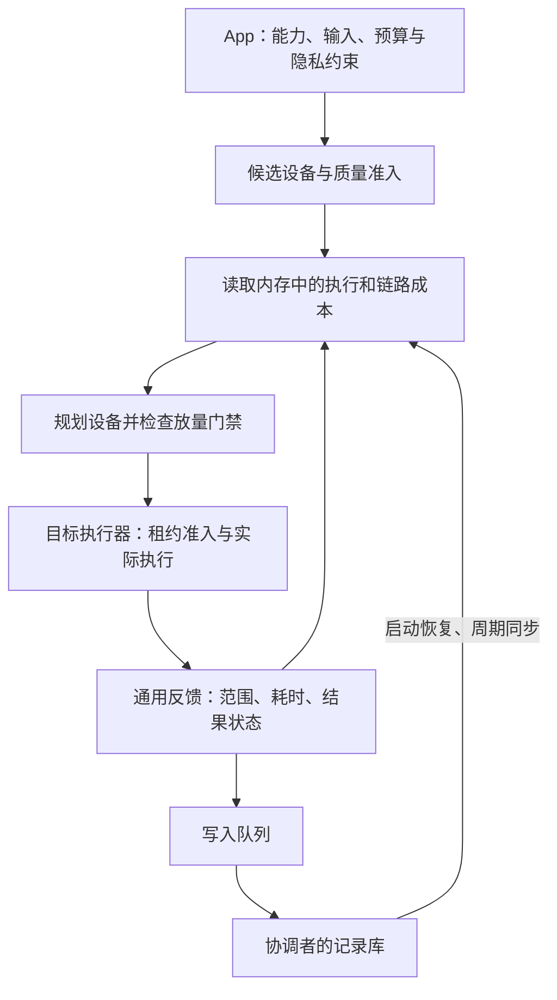

# App 与终端解耦接入协议

日期：2026-10-28。对应分支：`codex/scheduling-data-pipeline`。本页区分已经落地的接入机制与后续协议目标；部署及裁剪质量命令见 [文档 33](33-调度数据管道修复与校准接入.md)。

## 审阅结论与本轮修复

记录对主要工程问题的判断成立。原实现要求近 24 小时成功 30 次，但单个用户与设备每天只有 5 次速度校准机会，正常业务又被样本门槛拦住，接入流程无法自然推进。严格说，UTC 日期边界附近的滚动 24 小时可覆盖两天额度，多个用户也能贡献样本，因此“最多 5 次、永远无法准入”不是对全部场景的精确描述；它仍然暴露了正常单用户接入的门槛冲突，不能依靠换用户或手填统计解决。

| 问题 | 已落地的处理 |
| --- | --- |
| 证据充分性和新鲜度共用一天窗口 | 按能力、设备、执行版本、范围累计近 30 天成功次数；另要求近 24 小时成功过。失败率取 30 天和 24 小时两者中较大值，避免旧成功掩盖近期恶化 |
| 新设备只能等累计满 30 次 | 保留 ACTIVE 门槛，并提供显式、受限的纯任务 CANARY；预算与质量准入仍检查 |
| 质量评测逐图消耗校准额度 | 每日 2 套质量评测，每套 3–5 例；每日另有 5 次速度校准。批次上下文绑定用户、设备和剩余例数，不能无限执行或挪给别的设备 |
| 链路被图片大小分桶拆散 | 用同一网络对、同一方向的不同字节数传输拟合固定时延与带宽；不区分 App、裁剪参数或能力 |
| 规划等待落库和清理 | 耗时估计读取共享内存；执行反馈同步更新内存，再串行落库。启动预热、周期同步、清理各自独立 |
| 手机没有网络标识 | HAR 采集默认网络、承载类型和接口地址前缀的摘要，随执行端心跳上报；失败回到未知网络短 TTL |
| 样本键硬编码裁剪参数 | 通用 `costKey` 只解释契约 `costModel`；裁剪规则放在能力提供方的 `image-crop-contract.ts` |
| 无数据库服务互相看不到样本 | Nest 注入共享成本库；手工构造时可共享同一 Prisma 客户端或显式传入同一个内存库 |

Wilson 失败率置信上界适合表达不确定性，但它大于点估计，少样本时更严格，不能拿来解决“样本少就无法启动”的问题。本轮不把它作为解除门槛的手段。ACTIVE 保持较严格的失败比例，CANARY 使用明确配置的试运行风险上限；任何比例都不是设备未来可靠性的统计保证。

## 从一次 App 调用看系统分工

App 提交需要的能力、输入与约束。框架先找到已安装对应执行器的设备，再结合质量证据、设备状态、计算和传输成本选择位置。执行后产生的记录属于调度框架，下一次规划可以直接使用，不要求 App 另写统计逻辑。



能力描述“做什么”，执行器实现“怎样在某台设备做”。App 复用已有能力时，不需要重新提供执行器或校准图片；新增能力才需要能力提供方提供实现和契约。质量测试数据应覆盖该能力的重要输入情况，不能假设所有任务都是图片，也不能把任意随机字节当作合法语音、模型输入或业务请求。

记录库跟随协调者部署。Node 协调者可以运行在 PC，本地 SQLite 也可以保存反馈；用户内容不会因为记录耗时而自动写进样本表。但当前购物流程仍依赖云端图片存储、模型与检索服务，手机派发仍采用原裁剪协议。本轮没有将整个购物 App 改造成纯局域网应用，也没有将 Node 协调者移植到手机。

## 已实现的能力成本声明

`TaskContractV1.costModel` 是可选公共字段，TypeScript 与 ArkTS 协议定义保持一致。例如文本能力可以声明：

```ts
costModel: {
  version: 'text-cost-v1',
  parameters: [
    { name: 'tokens', bucketWidth: 100 },
    { name: 'qualityLevel' }
  ]
}
```

框架只提取声明的参数：`bucketWidth` 指定数值分档宽度，省略时保留标量值。其余参数，包括文本内容、请求 ID 和裁剪框坐标，不参与分桶。规则版本进入配置摘要，修改规则后不会误用原桶。参数名、数量、类型和档宽会校验。

未声明 `costModel` 时按输入字节数分档，忽略参数，保证换文本或请求 ID 不会无限创建新桶。这是保守的接入默认值，估计精度有限：若模型、质量档、迭代次数等显著影响耗时，能力提供方应声明。输入规模只取制品大小，未额外从任意参数中的文本推算 token；内联内容较多的任务应提供制品规模或专门的规模模型。

裁剪能力用 `targetSize` 和每十点一档的 `jpegQuality`，规则保存在能力模块，通用成本库没有 `image.crop.v1` 判断。旧裁剪维护入口仍引用该能力声明，通用 `dispatch()` 读取 `task.contract.costModel`。非购物文本能力回归验证了：不同请求参数经过通用派发后会自动产生并复用同一成本桶。

## 设备从接入到放量

质量、性能和授权是三类不同证据。质量回答执行器是否符合契约；性能样本回答估计多久、近期是否失败；授权回答是否允许将数据交给该设备。成功测了速度，不等于通过质量评测，也不等于获得数据访问许可。

### ACTIVE

保持 `minimumSamples`（示例配置为 30）、`maximumFailureRate`、非劣批准、质量、允许列表、预算、有效期和 kill switch。计数累计近 30 天，同时检查最近一天的成功记录。每日 5 次速度校准可以跨日积累，不再每天清空有效进度。质量校准和正常执行的成功记录也可以贡献速度证据。

质量证据本身仍有独立有效期。到期后需重新评测；累计满速度样本不会延长质量批准。

### 显式 CANARY

在已有合法 `PLACEMENT_POLICY_JSON` 中设置 `mode: "CANARY"`，并按需要加入：

```json
{
  "canaryRate": 0.05,
  "canaryMinimumSamples": 3,
  "canaryMaximumFailureRate": 0.25
}
```

这是附加字段片段，不能替代完整策略配置。比例取 0–0.1，最少成功数不得低于 3，失败比例上限不得高于 0.25；这些限制属于试运行边界，不是自动推导的最佳生产参数。比例按工作流与设备稳定散列选择，并非并发槽位配额，也不是严格的每秒百分比限流。

此启动路径只允许契约声明 `sideEffectPolicy: "PURE"` 的任务。它可以豁免 ACTIVE 的非劣批准，以便收集实际速度证据；质量、近期成功、实际失败比例、设备/能力允许列表、cohort、kill switch、隐私和规划预算仍检查。不会修改配置中的 `nonInferiorityPassed`，也不会自动转换为 ACTIVE。

CANARY 不强迫选择预计更慢的设备：它作用于规划器已有的远端建议。显式后台校准继续负责探索尚无速度优势的设备。若没有完整成本或合法链路，规划器仍可使用基线。新设备没有可用基线时，框架不会为了“即插即用”忽略约束。

## 网络成本与内存读取

网络传输成本按 `固定时延 + 字节数 × 每字节耗时` 估计。每个方向至少使用三次真实传输，大小可以不同。拟合残差用于抬高固定时延；样本不能支持有效斜率时采用保守的实测每字节成本。上传和下载保持分离，同一网络对下可供不同能力复用。

当前样本仍来自实际执行或校准的传输，没有额外新增主动小包探测器。它已经解除对校准图片大小的依赖，但尚不是全自动网络探测服务。极小样本外推到大文件仍有误差，需要真机测量。

耗时估计在内存里读取，不查数据库，也不等待写入队列。Nest 的设备派发和手机派发共享该内存；跨协调进程每 5 秒增量同步，每分钟补扫近期记录，以恢复延迟提交的数据。单桶最多保留 256 条，缓存有容量限制，未命中时使用先验。启动预热有上限，不承诺所有历史桶都立即驻留。

准入统计仍从数据库查询已提交反馈，以避免用丢失或未提交记录扩大放量。挂起写入不会被 `flush()` 强制串入规划，但在持久化前可能暂时延迟准入。正常工作域仍跟踪反馈写入直至结束，不能声称整次业务请求完全不受数据库耗时影响。

过期清理每小时独立执行一批，最多删除 1000 条超过 30 天的记录，不加入反馈写入队列。停机时停止定时器并等待未完成工作。此轮只移除了成本读取中的数据库等待，规划前同步 descriptor 与手机任务轮询仍需后续优化。

手机网络摘要使用 SDK 的默认网络、承载类型和连接属性 API，宿主需要 `ohos.permission.GET_NETWORK_INFO`，当前 entry 已声明该权限。接口与地址只参与本机哈希，心跳发送摘要。接口依据见 [Huawei 网络连接管理文档](https://developer.huawei.com/consumer/en/doc/harmonyos-references-V3/js-apis-net-connection-0000001333720849-V3)，实现也已对照本机 SDK 类型定义并完成原生构建；Wi-Fi/蜂窝切换效果仍待真机验证。

## 校准包的责任与后续协议

校准包应由能力提供方维护，使用该能力的 App 只引用它。提供方明确测试输入、受信任参考实现或参考输出、指标、阈值、包版本、允许执行的副作用范围；框架负责执行、记录、限额和证据关联。当前固定裁剪清单及 PSNR 评测已经实现，其他能力的校准包注册与评测器插件仍是后续工作。

不能直接把以下便捷建议当作安全默认值：

- 相同模型文件哈希不能覆盖预处理、精度、后端算子和非确定性差异；相同实现的质量证据复用需要完整兼容性与来源验证。
- 第一个注册的执行器不自动成为正确答案，应由能力提供方显式指定参考实现。
- 图片、向量、分类、文本可以提供评测模板，但不同任务的合格标准不同，阈值不能只由输出类型决定。文本编辑距离也不能普遍衡量语义正确性。
- 自动生成输入必须满足 schema、输入范围及可重放规则；业务有副作用时不能自动重放。后台任务还须遵守设备资源、供电、网络和系统后台运行条件。

后续协议按以下边界扩展：

| 对象 | 提供方 | 当前基础与下一步 |
| --- | --- | --- |
| 能力契约 | 能力提供方 | 已有版本、输入输出、副作用及成本参数；待补校准包注册、工作量和质量档语义 |
| 任务实例 | App/SDK | 已有预算、隐私、输入引用；待统一数据位置、截止时间类型、质量下限和结果位置 |
| 执行器描述 | 设备代理 | 已有能力与执行版本；待按能力描述后端、模型、内存、冷热态和驻留状态 |
| 设备状态 | 设备代理 | 已有资源、网络摘要；待补排空时间、前后台和模型驻留列表 |
| 链路记录 | 协调者 | 已有通用真实传输拟合；待增加独立探测及变化事件 |
| 执行反馈 | 框架与执行器 | 已有执行/往返/传输范围与失败记录；待拆队列、模型加载、实际配置与预测误差 |

最终验收应接入一个非购物 App，验证仅新增契约和执行器即可调度。当前已有通用派发与非购物反馈回归，但手机适配器仍专用于裁剪，HAR 执行记录的本地持久化、通用手机执行器注册、自动后台校准与完整本地多设备应用尚未完成。不能将这轮修复表述为完整的即插即用产品已经交付。
