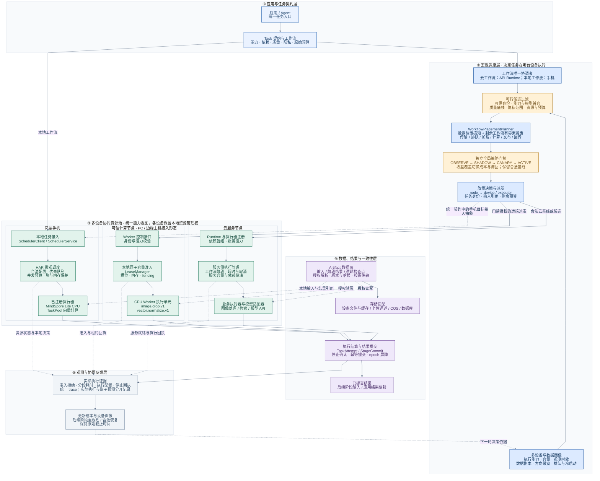
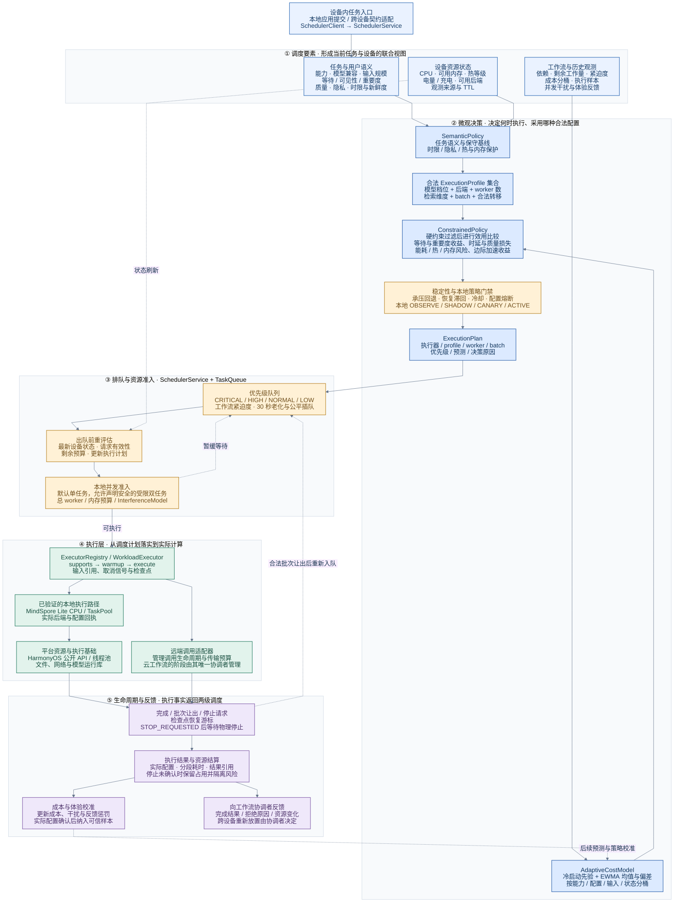
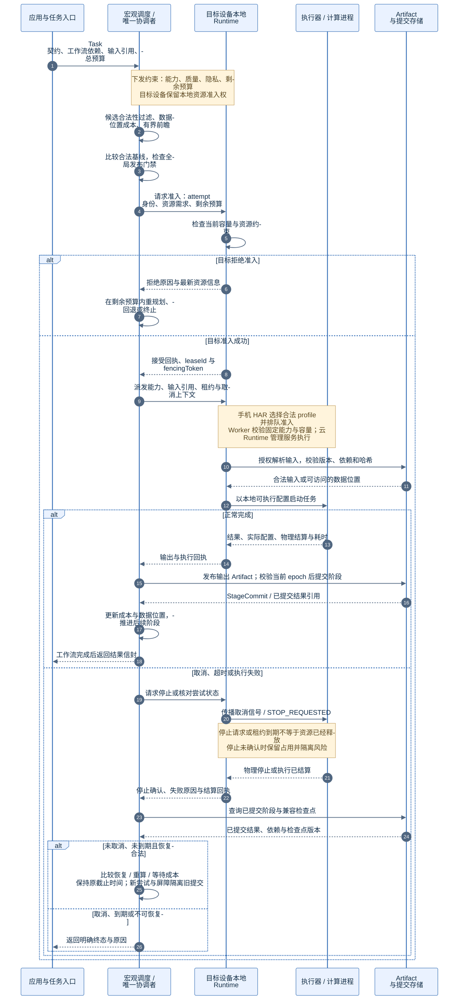

# 智调鸿枢：多设备分层调度架构

本图组依据 harmony-agent 当前源码与架构验收记录整理，按多设备全景、手机设备内调度和宏微观协同三个视角展开。

宏观调度决定工作流阶段在哪台设备执行；微观调度决定任务在选定设备内何时执行、使用哪种合法配置及如何占用资源。两级通过任务契约、剩余预算、输入引用、准入结果和执行回执协同。每个工作流只有一个放置协调者，目标设备可拒绝准入，由协调者重新规划。

图中蓝色为任务与规划，浅橙色为约束与门禁，绿色为本地运行时和执行，紫色为数据与结果。实线表示主要调用或处理路径；虚线表示观测、反馈、数据引用以及明确标注的接入抽象。

字体优先使用微软雅黑，其次苹方、思源黑体和 Arial。导出用于文档时建议使用 SVG；在渲染环境安装相应字体，才能保持中文字体一致。

## 图 1：多设备总体架构

统一资源池通过能力与数据位置组织设备协作。当前服务端远端派发主要接入可信 CPU Worker，云 Runtime 保留合法基线。手机运行独立 HAR，图中的远端手机目标准入连线是契约接入抽象，不表示已完成任意手机目标派发。PC、边缘主机表示 Worker 的部署形态；真实多设备性能验收仍按项目验收记录推进。

## 图 2：单设备微观调度

此图展开手机 HAR 的完整调度实现。Worker 当前使用 LeaseManager 和固定 CPU 能力执行，云 Runtime 采用服务侧执行管理，二者不等同于已经移植整套 HAR。CPU、GPU、NPU 是契约可描述的后端类型；进入实际候选仍需后端可用和执行验证。

## 图 3：宏观与微观调度协同

此图表达跨层协议与职责时序，原子租约以可信 Worker 路径为具体实现依据。图中 Artifact 发布与阶段提交由协调者控制；执行器完成计算不等于结果已成为可供下游使用的提交结果。

## 代码依据与关键边界

- `services/api-server/src/core/runtime/workflow-placement-planner.ts`：候选过滤、方向链路成本、数据副本、有界束搜索、基线与全局发布门禁。默认候选数 8、前瞻节点数 16、束宽 8、规划预算 20 ms。
- `services/api-server/src/core/runtime/device-dispatch.service.ts`：可信设备发现、裁剪任务放置评估、租约申请、执行、查询和停止清理。
- `services/device-worker/lease-manager.mjs`：槽位与内存原子准入、fencing、停止请求和物理结算。
- `apps/harmony/scheduler/src/main/ets/api/SchedulerService.ets`：任务生命周期、队列、执行计划重评估、受限并发、检查点让出和停止确认。
- `apps/harmony/scheduler/src/main/ets/policy/ConstrainedPolicy.ets`：合法配置过滤、效用评分、边际收益、稳定性与本地发布门禁。
- `apps/harmony/scheduler/src/main/ets/policy/SemanticPolicy.ets`、`AdaptiveCostModel.ets`、`WorkflowPlanner.ets`、`InterferenceModel.ets`：语义基线、在线成本、工作流紧迫度和并发干扰。
- `services/api-server/src/core/runtime/workflow-store.service.ts`：工作流、尝试、协调 epoch、阶段提交与持久化恢复。
- `docs/architecture-change-acceptance.md`：当前实现、默认开关与尚待真实设备验证的范围。

当前工作流放置按有序依赖序列比较剩余路径，图中的 DAG / 工作流抽象不表示任意 DAG 已并行最优执行。应用级调度层通过公开平台接口管理任务资源，设备自身的操作系统仍负责底层线程和硬件资源调度。
