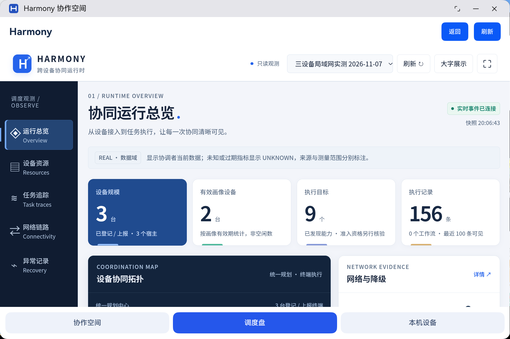
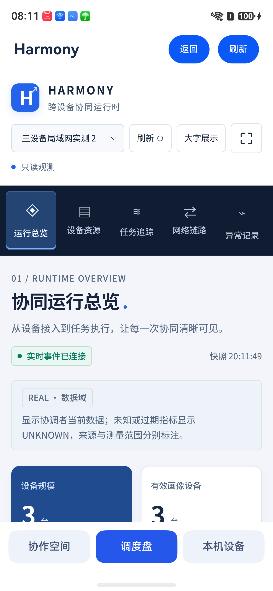
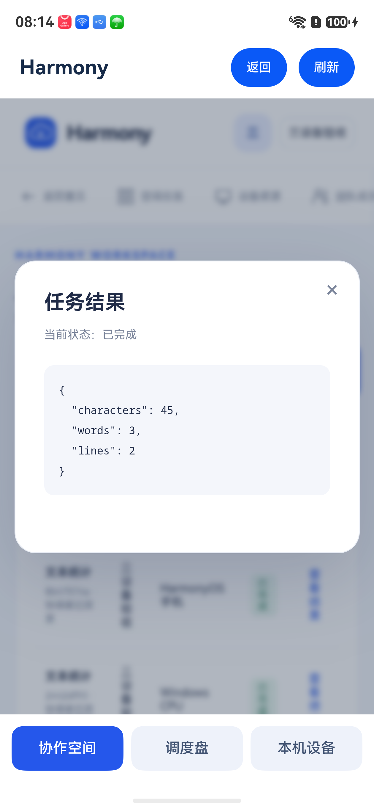

# 鸿蒙应用内协作空间与调度盘 · 2026-11-07

## 变化

此前 Windows 显示网页协作空间，两台鸿蒙设备仅安装原生执行代理；界面不同来自产品入口尚未整合，不是设备型号差异。本轮把 `apps/harmony-agent` 的主界面整合为三个入口：

- **协作空间**：应用内打开现有首页、账号登录、空间创建/加入、成员与任务界面。
- **调度盘**：应用内展示现有只读调度盘及真实事件推送，不另设派发入口。
- **本机设备**：保留原生配对、贡献上限、启停贡献、诊断与结果展示。

通过 ArkWeb 承载现有控制台，原生执行代理继续在同一 UIAbility 中运行。切换应用内栏目不触发后台贡献策略；切到其他应用或锁屏仍遵守原有贡献限制。Web 页面采用原有响应式布局，手机与电脑信息一致，布局按屏幕调整。

已配对设备从本地安装记录读取协调中心地址、空间 ID 和证书指纹。未配对设备可填写公开 HTTPS 地址，或使用设备邀请接入。浏览器账号与设备身份仍分离，首次在应用内打开控制台需登录；协作空间和调度盘使用同一个 Web 容器共享登录状态。设备凭据不注入网页，也不通过 JavaScript 桥暴露。

配对后的局域网自签名证书，仅在请求属于已配对协调中心、错误为不受信任签发者且叶证书 SHA-256 指纹完全匹配时接受。证书变化或未知地址会显示连接说明。实现依据 [ArkWeb 事件接口](https://developer.huawei.com/consumer/en/doc/harmonyos-references/arkts-basic-components-web-events/)，并核对本机 SDK 类型定义。

## 验证结果

- API 24 / HarmonyOS SDK 6.1.1 构建和签名通过，复用既有私有签名配置。
- 连接信息、配对指纹、未配对 HTTPS 地址测试 3/3：`node --test tests/sdk/native-console.test.cjs`。
- 签名 HAP 覆盖安装到鸿蒙电脑与手机，保留配对数据。
- 鸿蒙电脑：实际打开同款首页，使用已有验收账号完成应用内登录，切换调度盘显示真实 REAL 数据及实时连接；切换本机设备显示“已连接 · 前台贡献”，协调者确认该设备在线且活动为 IDLE。返回调度盘无需再次登录。
- 手机：最初因锁屏无法启动；使用者解锁后已实际完成首页显示、应用内账号登录、切换调度盘、任务追踪、任务提交和结果查看。本机设备栏目显示“已连接 · 前台贡献”。
- 从手机应用内经既有 SchedulerSdk 新提交两项文本统计：自动分配由 Windows 执行（`2442df93-f5c3-4864-aca0-6d9a96f3aaa2`）；指定手机执行（`8b47574a-b9db-4b80-95d1-b3cf8e16d311`）。两项均 SUCCEEDED，结果为 45 字符、3 单词、2 行；各一份 committed 回执，资源已结算。
- 自动化文本输入保留了表单原有样例，实际输入为 `Hello Harmony\n让每一份算力，都有所用HarmonyAppPhoneTest。`。已按两项任务持久化的 SDK 输入内容哈希逐项核对，不能将结果按原计划的 19 字符输入描述。证据见 [NATIVE-APP-CONSOLE.json](../../artifacts/acceptance/2026-11-07/NATIVE-APP-CONSOLE.json)。
- 验证收尾三台设备均在线，活动 IDLE，三种 CPU 能力可用；手机在同一应用中查看控制台的同时完成了原生执行。
- 正式 API 22 构建尚未验证。Windows 独立客户端不在本轮新增内容中，Windows 仍使用网页控制台。

HAP 位于本机 `.test/s77-api24-harmony-agent/entry/build/default/outputs/default/entry-default-signed.hap`，SHA-256：`94734e3676ab60e07c11f2d498cc590ab3c7487dac8bd9ccf7919b088c68da8b`。构建日志 `.test/app-console-build.log`。私有签名、账户、设备配置不得整体提交。

## 接续

在两台鸿蒙设备打开“ Harmony 协作空间”，底部三个栏目分别进入控制台、调度盘和本机贡献设置。登录状态在应用内栏目间共享。若桌面图标仍显示旧名 Harmony Agent，以应用窗口标题和底部三个栏目判断更新是否生效。后续仍需单独验收正式 API 22、扫码首次配对、长时间运行与多设备加速；本轮不是性能对照。

以下是鸿蒙电脑实际应用窗口的截图裁剪：

手机实际应用内调度盘与任务结果：

## 2026-11-08：应用内设备接入与空间切换

已增加受当前协调中心约束的设备邀请桥。登录后创建或加入空间，再选择“接入设备 → 生成接入配置 → 将本机加入当前空间”，即可从应用内把鸿蒙电脑或手机的原生代理切换到该空间。成员身份和本机设备仍分两步接入；本轮没有加入扫码入口。桥只返回空间 ID，不暴露持久设备凭据。

按 holder 保存身份、任务账本与共享偏好，兼容旧版单空间数据的一次迁移；设备忙碌时提示稍后重试，旧空间记录保留。底部调度盘使用新配对空间。电脑创建和手机创建的两个三设备流程已实际完成，48/48 项任务通过；Windows 设备接入仍用 CLI。安装包摘要、准确范围及后续限制见[2026-11-08 入组验收报告](../../artifacts/acceptance/2026-11-08/group-join/README.md)。

## 2026-11-08 后续：扫码与 Windows 应用已落地

当前版本已替代上述手动接入流程：手机在“加入空间”选择“扫码加入空间”，电脑粘贴负责人给出的完整接入密钥；登录并加入成员后，应用自动引导确认本机共享，随后配对、启动代理和检查能力。邀请码与设备凭据保持分开，扫码成功不会跳过用户共享确认。没有配置协调中心的鸿蒙应用也提供扫码/密钥入口，本轮实际扫码则发生在已配置应用中。

Windows 使用桌面“ Harmony 协作空间”，无需用户运行 CLI。安装位置 `%LOCALAPPDATA%/Programs/Harmony`，用户状态 `%APPDATA%/Harmony 协作空间`。退出窗口停止本机贡献，重开恢复身份；应用内可打开调度盘。构建说明见 [Windows 应用](../../apps/windows-agent/README.md)。

两轮新空间便捷接入已完成真实摄像头识别、电脑密钥输入、跨空间自动切换及 48/48 任务复验。最终签名 HAP 摘要和范围以 [§94 对应验收报告](../../artifacts/acceptance/2026-11-08/convenient-join/README.md) 为准，本文早期 HAP 摘要和“扫码/Windows CLI 待做”的描述仅属历史记录。
