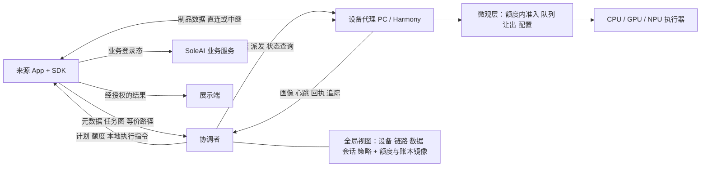

# 跨设备资源协同运行时：实施规格

| 项 | 内容 |
| --- | --- |
| 文档编号 | 36（修订 5，取代修订 1—4） |
| 日期 | 2026-10-30（修订 5） |
| 代码基线 | `codex/scheduling-data-pipeline` @ `5c63ee3` |
| 状态 | 实施基线。本文规定要做什么、怎样验收；截至本修订，v2 代码均未实施 |
| 读者 | 负责实施的编码代理与评审者 |

本修订保留两项明确决定：第二 App 是独立鸿蒙工程，C7a 用真实裁剪/缩略图任务验证 HAR 复用与同机额度，且不依赖 X6；同机额度由协调者统一签发，各进程在额度内准入，不依赖本机跨 App 通信。本轮只修订规格，未实施工作包。重点补齐在线/离线额度交接、持久化恢复、执行身份、计量边界和验收依赖。

---

## 0. 实施代理使用说明

### 0.1 阅读顺序

1. §1 全局规则：每个工作包都必须遵守。
2. §2 术语。
3. §3 现状基线：可复用代码与已确认缺陷。
4. §4—§7 目标设计。
5. §8 验收标准。
6. §10 中当前领取的工作包，以及该工作包引用的章节。

### 0.2 工作方式

1. 一次只领取一个工作包（WP）。开工前确认“依赖”中的 WP 已达到要求的完成级别（第 6 条），并执行 `git status`。
2. 按 WP 的“产出”“要求”“禁止”“验收”执行。
3. 本文没有规定的实现细节：选择满足 §1 的最简单方案，并写进交付说明。
4. 本文与代码事实不符时：先核实代码，在交付说明中报告差异；不得为了符合本文而伪造行为或测试结果。
5. 规则优先级：§1 全局规则 > WP 条款 > 示例。
6. **验收分两类，完成分两级。**
   - 验收条目标注为 **【替身】** 或 **【真实】**：
     - 【替身】：可以在模拟环境中完成，或使用测试替身完成（模拟设备、测试能力、固定 fixture）。
     - 【真实】：必须在真实设备、真实模型或真实服务上完成。
   - WP 的完成分两级：
     - `完成-替身`：全部【替身】条目通过。
     - `完成-真实`：全部条目通过。
   - 依赖默认只要求上游达到 `完成-替身`；需要上游 `完成-真实` 时，写作 `WP-X（真实）`。
   - 禁止用替身完成【真实】条目。
   - 只有【真实】条目的 WP，不能因“没有替身条目”自动取得完成级别。真实实验失败并记录退路，表示实验调查已完成，不表示能力验收通过；采用退路后按对应验收重测。
   - 可选项须明确标为“不启用”，并验证不依赖该项的路径；不得以“未验证”代替必做验收。阶段出口须检查全部必做项，不能仅因最后一个 WP 完成而宣告阶段完成。

### 0.3 交付说明格式

每个 WP 完成时输出：

```text
WP：<编号>
完成级别：完成-替身 / 完成-真实
修改与新增文件：<路径列表>
新增测试：<测试文件与用例名，标注【替身】或【真实】>
已执行命令及结果：<命令 → 通过数/失败数>
未验证项：<例如真机、GPU、网络性能>
自行决定事项：<本文未覆盖、由实施方选择的方案及理由>
与本文不一致之处：<无 / 具体说明>
```

---

## 1. 全局规则

| 编号 | 规则 |
| --- | --- |
| R1 | 遵守仓库根目录 `AGENTS.md`：开工检查 `git status`，保留他人未提交修改，不读取或传播密钥与 `.env` 内容，提交和推送须经用户授权。 |
| R2 | **v1 冻结与复用边界。** `services/api-server` 中现有调度路径、`services/device-worker`、`apps/harmony/entry` 中现有派发页面只允许修复缺陷，不增加功能。v2 代码不得依赖 v1 的业务实现或调度服务（如 `device-dispatch.service.ts`、`macro-scheduler.service.ts`、`phone-dispatch.service.ts`）。复用分两种：（1）无 I/O、无业务语义的纯叶子函数（如 `accumulate`、`canonical`、`costConfiguration`、链路拟合、协议校验函数），**优先提取**到 `packages/scheduler-core`，由 v1 与 v2 共用；v1 改为引用之后，必须通过 §3.3 的回归。（2）需要改变语义的模块（如规划器、准入证据），复制后改写。 |
| R3 | **核心纯净**：`packages/scheduler-core` 禁止依赖 Nest、Prisma、`node:fs`、`node:net`、`node:http(s)`、Harmony Kit；禁止调用 `Date.now`、`performance.now`、`Math.random`、`process.env`。时间、随机数、配置一律由参数传入。 |
| R4 | **核心不含具体名称**：核心生产代码禁止出现 App 名、业务词、具体能力名、具体设备 ID 字面值，例如 `cloud-runtime`、`phone_`、`shopping`、`soleai`、`image.crop`。能力名、设备 ID 只作为数据流入。 |
| R5 | **未知即未知**：采集不到的值记为 `null` 或 `UNKNOWN`，禁止填 0，禁止由型号推算后标为实测。画像中每个动态字段都带 `source`、`sampledAt`、`ttlMs`、`unit`。 |
| R6 | **证据来源真实**：禁止把 `SIMULATED` 数据标为 `REAL`；模拟域数据禁止写入真实域的质量库或性能准入库。 |
| R7 | **先校验后使用**：所有跨进程输入都按 `contracts/scheduling/v2` 的 schema 校验；遇到未知的必需字段或必需扩展，直接拒绝。 |
| R8 | 规划结果只是建议；资源的最终持有以设备端在额度内的原子准入为准。 |
| R9 | **取消不等于释放**：资源在执行实际结算之后才释放。超时、取消、fence 失效都不能提前释放。 |
| R10 | **先持久化再发送**：关键状态变更与待发消息（outbox）在同一事务内写入；agent 在开始执行前持久化 attempt 记录。遥测可以异步批量写入，不得与关键状态混用。 |
| R11 | **投递与执行语义**：消息至少投递一次，可能重复，按 `messageId` 去重；同一持久化执行身份至多启动一次，进程重启不自动重放旧 attempt（§5.5）；fence 或计划版本不匹配的结果禁止提交。 |
| R12 | **安全贯通**：设备凭证、App 实例凭证、调度组和会话授权、制品访问检查覆盖提交、传输、执行、返回全过程。禁止关闭 TLS 校验；ODID 禁止作为凭证。 |
| R13 | 故障恢复按契约的 `sideEffectPolicy` 处理（§6.3）。副作用状态未知时先对账，禁止盲目重试；`NO_REPLAY` 任务禁止自动重放。 |
| R14 | 每个新增的协议字段或画像字段，都必须有一个读取它并据此改变行为的消费者，以及对应测试。没有消费者的字段不得上报。 |
| R15 | 每项功能测试都包含正例，以及拒绝或失败例。 |
| R16 | 性能数字只来自真实测量，并注明设备、系统版本、网络和负载条件。禁止在代码、注释或文档中写入未经测量的收益。 |
| R17 | 在线派发通过长连接事件进行，禁止新增定时轮询式的领取任务。 |
| R18 | 新增依赖须在交付说明中给出理由；本期不新增自建代码生成框架。Prisma Client 等所选工具链必需的生成步骤允许使用，并记录版本与生成命令。 |
| R19 | 平台不确定项先完成 §9 的实验；实验不通过时走表中的退路，禁止绕过平台限制。 |
| R20 | 并行实施时使用独立 Git worktree，并分配互不重叠的文件职责。 |

---

## 2. 术语

| 术语 | 定义 |
| --- | --- |
| 协调者（coordinator） | 调度组的控制中心：负责配对、设备目录、额度签发、规划、派发、恢复。控制面不持久保存业务内容，不持有 App 的业务凭证；同主机的数据中继独立授权、限定缓存期限与容量。 |
| 调度组（group） | 经配对互信的一组设备、用户与 App 实例。设备加入调度组，不会改变数据所有权。 |
| 设备代理（agent） | 运行在贡献资源的设备上：上报画像、执行远程任务、做设备内调度。分为 PC agent 和 Harmony agent。 |
| SDK（scheduler-client） | 嵌入业务 App：提交任务、在额度内执行来源本地任务、接收结果。 |
| 本机进程 | 同一物理设备上使用本系统资源的进程，包括 agent 和各个 SDK 宿主 App。 |
| 能力（capability） | 版本化的“做什么”，例如图像编码。 |
| 契约（contract） | 能力的输入输出 schema、副作用策略、可中断性、成本参数模型、模型兼容要求。 |
| 执行器（executor） | 能力在某个平台、某个后端上的具体实现，带 `executorId` 与版本。 |
| 能力包（capability pack） | 契约 + 各平台执行器标识 + 模型清单 + 质量评测包 + 资源需求。 |
| 资源池（resource pool） | 设备上一类可分配的资源，例如 CPU 槽位、RAM、GPU 槽位、显存、传输并发。 |
| 执行目标（target，`targetId`） | 物理设备 + 执行器 + 后端 + 所用资源池。宏观规划的最小单位。同一台设备可以有多个执行目标。 |
| 额度（allotment） | 协调者签发给某个本机进程的资源上限（资源向量 + 租期 + 额度版本）。同一设备上的各份额度互不重叠，进程只在自己的额度内准入。 |
| 离线额度 | 经同机绑定后为 App 安装实例预留的基础容量，在线与离线均计入整机预算；离线时仅该基础容量允许新本地准入，不能与在线增量额度相加后继续使用。 |
| 资源账本（ledger） | 本机进程维护的、在其额度内“已预留 / 实际占用”的记录，是准入的权威依据。 |
| 准入上限 / 实际占用 / 排空 | 见 §7.2.3。 |
| attempt 记录 | agent 持久化的一次执行尝试的状态（§5.2）。 |
| 制品（artifact） | 带哈希、schema、归属、授权、副本位置的数据对象。 |
| 快照（snapshot） | 规划时使用的只读全局视图，带版本号和各项采样时间。 |
| 租约 / fence | 租约：准入时创建的资源持有。fence 由准入方账本签发，使用 `(deviceId, holderInstanceId, ledgerEpoch, counter)` 标识，在该账本代次内计数单调递增；不同 App 不共享计数器，也不比较大小。 |
| coordinatorEpoch / planRevision | 协调者的代次（重启后递增）；同一工作流计划的版本号。 |
| outbox | 与状态变更同事务写入的待发消息表，支持可恢复的至少一次投递；持续重试且通道可用时最终送达，永久失联或撤销时保留未送达/终止状态。 |
| 宏观层 | 协调者中的规划：选择执行目标、允许的配置范围和传输路径。 |
| 微观层 | 本机进程中的调度：额度内准入、队列、配置选择、让出，保护设备所有者。 |
| 等价路径（alternatives） | App 声明的多条工作流，它们的输出契约与质量目标相同；调度器只能在其中选择一条。 |
| 固定服务节点 | 契约约束必须在某个逻辑服务上执行的节点，例如 SoleAI 业务检索。 |
| span | 追踪中的一个执行区间，带 `spanId`、父 span、依赖 span、传输关联编号。 |
| 运行域 | `REAL`（真实设备）或 `SIMULATED`（模拟环境）。两个域的存储、凭证、报告完全隔离。 |
| 所有者（owner） | 贡献设备的使用者。所有者保护：所有者使用设备时，远程任务停止准入并让出资源。 |
| 来源设备（origin） | 任务发起者所在的设备。 |

---

## 3. 现状基线（`5c63ee3`，已核实）

### 3.1 可复用资产

| 资产 | 位置 | v2 用途 |
| --- | --- | --- |
| 放置规划器：有界束搜索、副本、方向链路、TTL、模型兼容、质量证据 | `services/api-server/src/core/runtime/workflow-placement-planner.ts` | 复制改写为核心规划器初版（WP-A1） |
| 成本累积与链路拟合 | `services/api-server/src/core/runtime/runtime-cost-store.ts`（`accumulate`、`link`、`canonical`）、`capability-cost-model.ts` | 纯函数部分提取共用（R2），其余复制改写（WP-A1） |
| 准入证据计算 | `services/api-server/src/core/runtime/placement-admission-evidence.ts` | 复制改写进核心（WP-A1） |
| v1 协议类型与校验 | `services/api-server/src/core/runtime/scheduling-protocol.ts`、`contracts/scheduling/v1` | 校验函数提取共用；v2 协议的起点（WP-A1、WP-A3） |
| 能力质量注册与裁剪评测 | `capability-quality-registry.ts`、`crop-quality-evaluator.ts`、`src/core/capabilities/` | 能力包质量评测（WP-B11、WP-C4a） |
| 租约、fencing、取消后结算再释放、原子写文件 | `services/device-worker/lease-manager.mjs`、`server.mjs` | PC agent 租约与本地持久化的参考（WP-B4、WP-B6） |
| Worker 微观准入 | `services/device-worker/worker-policy.mjs` | PC agent 微观层初版（WP-B7） |
| Worker 计算实现 | `services/device-worker/compute.mjs`（`image.crop.v1`、`vector.normalize.v1`） | PC agent CPU 执行器（WP-B6） |
| GPU 推理服务（OpenCLIP、YOLO，自动选 CUDA/CPU） | `services/image-worker/app/main.py` | PC GPU 执行引擎（WP-B6） |
| 端侧状态采集 | `apps/harmony/scheduler/src/main/ets/state/HarmonyDeviceStateAdapter.ets`、`DeviceStateController.ets` | Harmony 画像来源（WP-B9） |
| 端侧微观调度 | `apps/harmony/scheduler/src/main/ets/policy/`、`queue/TaskQueue.ets` | Harmony 微观层（WP-B9，映射见 §7.2.6） |
| 网络标识 | `apps/harmony/scheduler/src/main/ets/network/NetworkIdentity.ets`、`NetworkPrefix.ets` | 链路网络 epoch（WP-B5） |
| 协议双端一致性检查方式 | `scripts/test-scheduling-protocol.mjs` | v2 一致性检查参照（WP-A3） |

### 3.2 已确认的缺陷（v2 必须避免，v1 不修）

| 缺陷 | 证据 |
| --- | --- |
| 调度器与 SoleAI 业务后端在同一进程中装配 | `services/api-server/src/modules/runtime/runtime.module.ts:39`、`src/app.module.ts` |
| 手机先上传图片，服务器再决定执行位置 | `apps/harmony/entry/src/main/ets/services/CloudShoppingExecutor.ets:100`，约第 156 行提交 |
| 来源设备不参与宏观比较；输出强制中转到云端 | `macro-scheduler.service.ts:160`、`device-dispatch.service.ts:295` |
| 候选按 `deviceId` 存放，同一设备的第二个适配器被拒绝 | `device-dispatch.service.ts:236`、`:249` |
| 手机只能发布裁剪能力 | `device-directory.service.ts:119` |
| 成本键中没有执行器 / 后端身份 | `runtime-cost-store.ts:14` |
| 成本串行累加；逐节点 await | `workflow-placement-planner.ts` 的 `extend()`；`device-dispatch.service.ts:338` |
| 手机现有模型是文本向量模型，不是图像编码模型 | `apps/harmony/entry/src/main/ets/services/MindSporeEmbeddingEngine.ets:56`（`encode(text)`）、`:60`（分词）、`:96`（仅 CPU） |
| 现有购物检索依赖图片、类别、商品画像、`assetId` | `services/api-server/src/modules/sessions/application/shopping-image-stages.service.ts:184`、`:189`、`:203` |
| 规划使用固定数值估计（“队列长度 × 100ms”、按设备类型乘系数） | `macro-scheduler.service.ts`（`buildCandidate`、`coldStartEstimate`） |
| `architecture:test` 只是串联功能测试，没有依赖规则检查 | 根目录 `package.json` |

### 3.3 回归基线

`npm run api:test:unit -- --runInBand`：41 个套件、326 个测试全部通过。该基线用于证明 v1 未被破坏（R2）；每个修改了 `services/api-server` 或其依赖的共用模块的 WP，都必须重新运行。

---

## 4. 目标架构

### 4.1 组件关系



### 4.2 组件职责与目录

| 组件 | 职责 | 目录 | 技术栈 |
| --- | --- | --- | --- |
| scheduler-core | 纯函数：数据类型、约束过滤、规划、成本估计、准入与恢复状态转换；v1 与 v2 共用的纯叶子函数 | `packages/scheduler-core` | TypeScript，无运行时依赖 |
| v2 协议 | schema、语义说明、错误码、双端测试向量 | `contracts/scheduling/v2` | JSON Schema + Markdown |
| 协调者 | 配对、目录、额度签发、快照、规划、派发、队列、会话、恢复、追踪汇总 | `services/coordinator` | NestJS + Prisma（独立 SQLite 库）+ WebSocket（`ws`） |
| PC agent | 画像、额度内账本、attempt 持久化、微观层、制品端点、CPU 执行器、GPU 引擎管理 | `services/pc-agent` | Node 22 + TypeScript + `ws`；GPU 通过本机 image-worker |
| Harmony HAR v2 | `protocol` / `core`（含 ArkTS 版账本与额度执行模块）/ `client` / `agent` 四个边界 | `apps/harmony/scheduler/src/main/ets/v2/` | ArkTS |
| Harmony agent App | 扫码入网、贡献设置、前台贡献、执行器宿主、结果展示页 | `apps/harmony-agent`（独立工程、独立 bundleName） | ArkTS |
| 第二 App：图片索引工具 | 批量处理图片并写入本地索引 | `apps/harmony-indexer`（独立工程、独立 bundleName） | ArkTS |
| SoleAI App | 通过 SDK 接入 v2，保留 v1 入口 | `apps/harmony/entry` | ArkTS |
| SoleAI 业务服务 | 商品库、向量检索接口、收图检索接口、索引管理 | `services/api-server` | 现有 |
| 能力包 | 契约、执行器标识、模型清单、质量评测包 | `capabilities/<packId>/` | JSON + 评测数据 |
| 模拟环境 | 确定性层 + 多进程层 | `tests/scheduler-lab` | TypeScript |
| 平台与模型实验记录 | 每个实验一份结论 | `docs/experiments/` | Markdown |

### 4.3 部署

- 默认部署：协调者运行在局域网内的 PC 上。可选部署：协调者运行在云端，使用同一协议。
- 协调者与 SoleAI 业务服务是两个独立进程，各自拥有数据库和迁移入口。协调者禁止读写购物会话表。
- 本期不做：多级协调者、平板托管协调者、跨协调者共识。

### 4.4 设计决定（实施时不得违背）

| 编号 | 决定 |
| --- | --- |
| D1 | **能力归提供方**。能力包由 App 团队、平台适配方或第三方提供；核心只调度，不内置具体能力。主体检测、分割、抠图各自定义输入输出，不得合并成一个能力。执行代码随安装包发布；新增模型只适用于已安装引擎支持的格式与算子。 |
| D2 | **五类全局视图 + 额度与账本**：设备画像（能贡献什么）、链路图（怎么传）、数据目录（数据在哪、谁能访问）、协同会话（成员与角色）、策略（谁能用多少）。额度由协调者签发；账本是运行状态，以本机进程为准，协调者只保存镜像，不靠心跳推断。 |
| D3 | **租约生命周期统一，资源规则分开**：计算 / RAM / 显存按资源向量原子准入，GPU 任务也占 CPU、共享内存和传输缓冲；摄像头要在持有系统权限和实际句柄后才确认；屏幕展示租约绑定会话和视图版本；带宽只做软预留（并发、速率、预算）；数据与模型缓存用容量配额加引用计数。 |
| D4 | **同机身份与同机资源互斥分开处理**。身份：同一部手机上的 SDK 宿主 App 与 Harmony agent 归并为同一台物理设备，ODID 只作为关联线索，配合已认证实例的绑定完成归并。互斥：不靠 ODID，靠 §7.2.7 的额度机制——在线时由协调者为每个本机进程签发互不重叠的额度；离线时只能使用预先划分、互不重叠的离线额度。不需要本机跨 App 通信。 |
| D5 | **固定服务节点**：“必须上云”是契约中的位置约束（`serviceId` / `placementConstraint`），不写进设备画像。第一阶段由来源 App 使用自己的业务登录态执行该节点；协调者不接收长期业务凭证。 |
| D6 | **控制与数据分离**：协调者只交换任务图、引用和计划，数据走端到端可达路径。手机不开放监听端口，只主动上传或下载。点对点不可达时使用经授权的中继，中继必须出现在路径和成本中。 |
| D7 | **宏观与微观分工**：宏观层选执行目标和允许的配置集合；微观层在额度和集合内选配置，负责准入、排队、让出；超出集合（换后端、精度、模型）必须重新准入。 |
| D8 | **等价路径由 App 声明**：调度器只在 App 声明的等价路径之间选择，不自行删除或跳过业务阶段。 |
| D9 | **v1 与 v2 隔离**：v1 入口保持可运行；v2 不兼容 v1 设备，不迁移 v1 样本；新旧入口以工作流为单位切换，不同时调度同一任务。代码复用边界见 R2。 |
| D10 | **协议分层冻结**：见 §5.1。冻结后只允许增加可选字段，破坏性变更必须升版本。 |
| D11 | **单协调者**：协调者持久化 epoch、计划与任务状态；设备与协调者失联时，停止接受新的远程任务，本机进程退回离线额度。 |
| D12 | **规划与持久化分工**：`plan(snapshot, request, policy, clock)` 不做任何 I/O；提交认证、持久化、准入、派发在规划之外完成，并经 outbox 保证可靠。 |
| D13 | **执行语义**：消息至少投递一次；以 `attemptId` 为执行身份，同一持久化执行身份至多启动一次，跨实例重放须按恢复规则拒绝或对账；跨 attempt 的重试由协调者按契约决定（§5.5、§6.3）。 |

---

## 5. v2 协议

### 5.1 分层冻结

| 层 | 对象 | 冻结于 |
| --- | --- | --- |
| T1 骨架 | 身份（group、principal、app、appInstance、device、deviceInstance、target）、消息信封、任务实例、等价路径结构、attempt 记录、租约 / 回执 / fence、coordinatorEpoch / planRevision、ArtifactRef 与制品授权、错误码、追踪 span、版本协商 | WP-A3 |
| T2 资源 | 设备画像 v2、资源池、额度、执行器描述、链路记录、能力准入状态、宏微接口消息（§7.3）、能力包清单 | WP-B3 |
| T3 协同与策略 | App 注册、离线额度划分与配额策略 | WP-C2 |
| T3 协同与策略 | 协同会话、展示租约 | WP-D6 |

### 5.2 对象与字段

| 对象 | 必须字段与语义 | 消费者 |
| --- | --- | --- |
| 消息信封 | `messageId`、`type`、`groupId`、`senderInstanceId`、`coordinatorEpoch`、`seq`、`ackOf`、`traceId` | 去重、排序、确认、追踪 |
| App 身份 | `appId`、`appInstanceId`、认证主体、允许的能力与版本 | 授权与配额；自报的 `appId` 不能作为信任依据 |
| 任务实例 | `groupId`、`sessionId`、`originDeviceId`、`resultDestination`、`workflowId` / `nodeId` / `attemptId`、`planRevision`、预算、输入引用、位置约束、质量与隐私策略、优先级类别 | 规划、恢复、结果路由 |
| 等价路径 | `alternativesId`、`outputContract`、`qualityTarget`、`alternatives[]`（每条是一个工作流 DAG） | 规划；输出契约或质量目标不一致时拒绝提交 |
| attempt 记录（执行方持久化） | 认证域、attemptId、持有者/账本代次、planRevision、coordinatorEpoch、执行摘要（输入引用、契约、参数、目标、允许配置）、allotmentId/版本、leaseId、fence、业务幂等键（适用时）、状态（ACCEPTED、RUNNING、SUCCEEDED、FAILED、CANCELLED_SETTLED、YIELDED、SIDE_EFFECT_UNKNOWN）、回执 | 幂等、恢复对账；各状态的资源结算独立记录 |
| 物理设备 | `deviceId`、`deviceInstanceId`、平台、绑定关系、在线状态、采样时间、贡献策略 | 去重、生命周期、共享资源归账 |
| 资源池 | `resourcePoolId`、类型、共享 / 独占、总量、所有者保留量、贡献上限、`sampledAt`、`ttlMs` | 规划预筛、额度签发 |
| 额度 | allotmentId、deviceId、appInstanceId/holderInstanceId、ledgerEpoch、coordinatorEpoch、基础预留 O 与在线增量 E、资源向量、额度版本、租期及计时语义、授权完整性证明、状态（生效/缩额待确认/待结算/已收回） | 本机准入、持久化预算与额度交接；基础预留与进程增量分开绑定 |
| 执行器描述 | `executorId`、版本、能力、后端、资源需求向量、模型 / 预处理 / 精度、兼容声明、冷态与热态、可中断性、`maxNonPreemptibleMs`（可为 `UNKNOWN`） | 候选生成、质量、成本、执行、让出规划 |
| 执行目标 | `targetId`、`deviceId`、`executorId`、后端、所用资源池列表、稳定执行身份 | 规划最小单位、成本与证据作用域 |
| 链路记录 | `from`、`to`、接口与网络 epoch、直连 / 中继、方向、RTT、有效吞吐、是否计费、`sampledAt`、`ttlMs` | 路径选择、传输成本；不得只存整机“网速” |
| 制品目录项 | ArtifactRef、大小、schema、owner 与 App 授权、数据级别、副本位置、状态、有效期 | 传输、校验、复用、回收 |
| 协同会话 | 成员、角色、来源端与展示端、授权范围、会话版本、退出行为 | 跨设备交互、结果路由 |
| 策略 | 管理员 / 用户授权、App 请求、贡献限制、配额、优先级上限、类别保底份额、截止时间 | 有效权限取各方交集；App 清单不能自行授予隐私权限 |
| 追踪 span | 见 §7.7 | 时间线、关键路径、误差定位、验收报告 |

### 5.3 身份与授权

1. 调度组、用户（principal）、App、会话四种身份分开保存、分开授权。
2. 设备加入调度组，不自动获得其他成员数据的访问权。
3. 记账单位是经认证的 `(groupId, principalId, appId)`。App 自报的优先级受组策略上限约束。
4. 设备实例代次（用于废止旧租约）与稳定执行身份（用于复用历史样本）分开。

### 5.4 成本与证据作用域

1. 执行成本按以下维度隔离：能力 / 契约、物理设备、执行器 / 后端、模型与预处理、精度 / 质量档、配置、输入规模。
2. 质量证据覆盖上述所有影响语义的维度。
3. 链路成本按路径、方向、网络 epoch 保存，不按 `appId` 拆分。
4. 涉及私有模型或业务的证据，遵守其访问域。
5. 实际执行的后端与计划不同（例如 GPU 回退到 CPU）时，样本必须记入实际后端的成本桶。

### 5.5 投递与执行语义

1. **控制消息**：长连接只承载控制消息，包括派发、准入回复、进度、取消、让出、回执、状态查询、额度签发与确认、画像变化、credit、追踪批次。
2. **至少投递一次**：消息可能重复到达，接收方按 `messageId` 去重。
3. **执行身份是 `attemptId`**：
   - 同一 `attemptId` 无论经过几条消息（包括不同的 `messageId`）到达，执行方只建立一条 attempt 记录。
   - 重复的派发返回已有状态，不重新执行。
   - 执行方在开始执行前持久化 `ACCEPTED`，执行开始时持久化 `RUNNING`。
   - 幂等记录绑定认证域、持有者及执行摘要（输入、契约版本、参数、目标和允许配置）。相同 attempt 携带不同摘要时拒绝为 `ATTEMPT_CONFLICT`；不能返回另一输入的成功结果。
   - `RUNNING` 必须在调用引擎前完成持久化。崩溃恢复不得再次启动已进入 RUNNING 的 attempt；允许重算时创建新 attempt，业务幂等键跨 attempt 保持稳定。持久化丢失按未知处理，不把更换设备实例当作再次执行旧 attempt 的许可。
4. **fence 的签发与校验**：
   - fence 由执行方账本签发，作用域为持有者实例与账本代次，随 `AdmissionReply` 返回；准入记录同时绑定 `allotmentId`、额度版本和 `leaseId`。不能要求同机多个隔离进程共同维护一个计数器。
   - `ExecutionReceipt` 必须携带同一 fence。
   - 协调者只接受同时满足以下条件的结果：`attemptId` 是当前有效的 attempt，fence 与准入记录一致，`planRevision` 是当前计划版本。
   - 协调者自身的代次使用 `coordinatorEpoch` 与 `planRevision`，不称为 fence。
5. **旧代次的回执**：旧 `coordinatorEpoch` 的回执可以用于恢复时核对实际发生了什么，但不能直接授权提交旧结果；提交前必须与当前计划重新匹配。
6. **发送队列**：每条连接的发送队列都有容量上限；超限时断开连接，重连后先同步状态。
7. **执行方恢复与单写者**：每个本地持久化目录只能由一个活动账本进程写入；SDK 宿主也必须执行 attempt 持久化及恢复。重启后先处理旧引擎/子进程和占用，再发布新 credit；HTTP 断开、代理进程退出不证明外部 GPU 引擎已停止。无法确认停止时保留占用并禁止重复授予容量。
8. **排队任务改派**：先撤销原执行方的未启动 attempt，取得其持久化的未启动/取消结算回执后，才创建新 attempt。`QUEUE_STARVED` 只是通知，不能当作撤销成功；状态未知时按 §6.3 对账。

### 5.6 制品数据通道

1. 制品通过独立的 HTTPS 通道传输，使用短时、限定对象、限定操作的传输令牌。
2. 令牌和签名 URL 不写入全局目录，也不写入日志。
3. 接收方校验大小、哈希、schema 后才使用。
4. 每次传输完成后写一条链路观测：方向、字节数、耗时、网络 epoch、传输关联编号（`transferId`）。

### 5.7 版本协商与扩展

1. 连接建立时协商协议版本；没有共同版本时拒绝连接。
2. 扩展字段格式为 `namespace`、`version`、`payload`、`required`。遇到未知的 `required` 扩展时拒绝；遇到未知的非必需扩展时忽略。

---

## 6. 运行流程

### 6.1 配对入网

1. 协调者生成邀请，内容包括：协调者地址、协调者 TLS 证书指纹、组邀请标识、一次性随机码、有效期。邀请有二维码和配对码两种形式，兑换流程相同。
2. Harmony agent 扫码，或输入配对码；PC agent 输入配对码，或打开配对链接。
3. agent 校验协调者证书指纹，兑换可撤销的设备凭证，建立长连接，上报画像和执行器描述；协调者签发贡献额度。二维码或完整邀请链接提供受用户确认的信任指纹；短配对码本身不等于服务器身份，手输时还需可信地址与指纹确认。未知服务器返回的指纹不能直接信任。X2 验证自签信任导入/固定方案，不能先关闭 TLS 校验再发送兑换凭据。
4. 正常重连不需要重新扫码。设备被撤销、凭证失效、协调者身份改变时，必须重新配对。

### 6.2 一次任务的执行

1. SDK 在本机登记输入（数据留在原处），提交元数据、授权和等价路径。
2. 协调者构建快照，按能力、位置约束、质量、数据授权、可达性过滤候选，再估计每条路径的完整成本，选出计划（带 `planRevision`）。
3. 协调者通过 outbox 发出 `DispatchOffer`（§7.3）。执行方在自己的额度内原子准入，持久化 attempt 记录，回复 `AdmissionReply`（含 `leaseId`、`fence`）。准入失败时重新规划，或回到合法基线。来源本地执行的节点也走同一流程，执行方是 SDK 宿主。
4. 数据按计划路径传输；接收方校验大小和哈希后执行。
5. 结果先原子发布，再更新目录和回执。下游只消费已提交、且与当前计划版本、attempt、fence 匹配的结果；展示端校验会话版本。
6. 各执行方上报追踪 span（§7.7）；资源在实际结算后释放。

### 6.3 故障与恢复

**保证范围**：同一执行方的持久化执行身份至多启动一次；更换进程或设备实例不得自动重放旧 attempt。跨 attempt 的重试按下表决定，业务副作用不宣称恰好发生一次。`ACCEPTED` 但没有 RUNNING 记录的任务，可经对账确认未启动后首次执行；RUNNING 的结果不明时禁止再次启动同一 attempt。

| 情况 | 处理 |
| --- | --- |
| 设备与协调者失联 | 停止新的远程准入；SDK 新准入降到离线基础额度，但所有旧占用仍计入账本，不能在旧占用之外另加一份离线容量；在线增量持续保留为未结算容量 |
| 协调者重启 | `coordinatorEpoch` 递增；对未完成的 attempt 发送 `AttemptStatusQuery`，按回复决定继续、提交或对账，不直接创建新 attempt |
| 回执丢失 | 协调者通过 `AttemptStatusQuery` 查询；执行方返回持久化的状态和回执 |
| 执行方重启（agent 或 SDK 宿主） | 读取持久化记录：ACCEPTED 未开始 → 等待对账；RUNNING → 查询仍可能存活的引擎，无法确定结果时标记 SIDE_EFFECT_UNKNOWN（PURE 视为未完成），不能直接清空占用；SUCCEEDED 未确认 → 重发回执 |
| 设备实例丢失持久化状态（重装、清除数据） | 视为新的设备实例；该设备上旧 attempt 一律按副作用未知处理 |
| 副作用未知或任务失败：`PURE` | 可以按策略创建新 attempt 重新计算 |
| 副作用未知或任务失败：`IDEMPOTENT_WRITE` | 用业务幂等键查询或重试 |
| 副作用未知或任务失败：`TRANSACTIONAL` | 先查询业务提交结果，再决定 |
| 副作用未知或任务失败：`NO_REPLAY` | 停止，等待人工或业务处理；禁止自动重放，禁止退回本地重放 |
| 结果的 fence 或计划版本不匹配 | 拒绝提交；但不能撤销已经发生的副作用（拍照、播放、业务写入） |

### 6.4 降级

1. 协调者离线时：来源 App 在离线基础额度内走本地路径，既有占用先扣除；用户允许访问云端时，仍可直接调用固定业务服务。已经提交的工作流先按 §6.3 核对副作用与 attempt，不能因为断线就无条件另起一次业务操作。
2. 业务服务也不可达时，返回明确的离线或待重试状态，不得声称完整功能可以离线完成。
3. 离线时 agent 的远程贡献额度为 0；仍在结算的远程任务继续占用资源，直到结算完成。

---

## 7. 调度设计

### 7.1 宏观层（协调者）

#### 7.1.1 目标

先满足能力、权限、质量、资源、期限约束，再最小化端到端完成时间；在策略允许的时延范围内，再兼顾终端能耗、网络计费和交互负载。

#### 7.1.2 成本组成

单个节点的估计包括：本地读取与预处理、控制往返、排队、模型加载、计算、制品发布、输入与中间数据传输、结果回传与展示、失败恢复余量。

- 同一台设备上不计网络传输成本，但读取、编解码、进程间复制仍有成本。
- 同一台设备的不同执行器之间可能还有主机与设备之间的数据拷贝。

#### 7.1.3 估计来源的优先级

1. 同条件的实测样本。
2. 本设备的校准样本。
3. 同类执行目标的先验（按设备类别和后端聚合）。
4. 能力包给出的基准。
5. 以上都没有：不得编造数值，只能走已验证的基线，或安排受限校准。

型号、TOPS 等只用于筛选和初始先验，不能代替针对具体模型的校准。

#### 7.1.4 规划算法

| 工作负载 | 算法 |
| --- | --- |
| 串行交互链 | 沿用现有有界搜索（迁入核心），候选身份改为 `targetId` |
| 批量独立任务 | 持久化就绪队列 + 按类别的 credit 推送（§7.4） |
| 含并行分支的 DAG | 维护各节点依赖完成时间、各资源池可用时间、传输竞争，按关键路径估计完工时间；禁止对并行分支的成本简单累加；禁止宣称任意 DAG 下的最优性 |

另外：所有者活动频繁的设备上（按策略统计），避免放置 `maxNonPreemptibleMs` 超过策略上限或为 `UNKNOWN` 的不可中断任务。

#### 7.1.5 路径选择

候选路径包括：直连、经 PC 中继、经协调者所在主机中继。不可达的路径不参与选择。中继要占用中继设备的传输并发资源池。

### 7.2 微观层（设备内调度）

微观层运行在每个本机进程中：agent 处理远程任务，SDK 宿主处理来源本地任务。两者使用同一套账本与额度执行模块（TS 版与 ArkTS 版）。

#### 7.2.1 职责

| 编号 | 职责 |
| --- | --- |
| M1 | 额度内原子准入：按资源向量，对照本进程的账本和额度，接受或拒绝 `DispatchOffer` |
| M2 | 按资源池排队：CPU、GPU、NPU、传输各有队列，一个池忙不阻塞无共享资源依赖的其他池 |
| M3 | 所有者保护：根据所有者活动信号降低准入上限，触发让出（§7.2.3） |
| M4 | 让出：按契约的可中断性暂停、取消或执行完，并及时通知协调者（§7.2.4） |
| M5 | 配置选择：在宏观层允许的集合内，选择线程数、批大小、质量档 |
| M6 | 回报：准入结果、实际配置、分段耗时、各队列的预计排空时间、按类别的 credit |

#### 7.2.2 优先级类别与设备内公平

类别从高到低：

1. `ORIGIN_INTERACTIVE`：本设备用户发起、用户正在等待的任务。
2. `REMOTE_INTERACTIVE`：其他设备的用户正在等待的任务。
3. `REMOTE_BATCH`：后台批量任务。

调度规则：

1. **类别保底份额**：每个类别有策略配置的保底份额（按资源时间计），在有兼容容量、可调度边界和持续就绪任务的服务窗口内兑现；非抢占长任务可能跨越周期，保底欠额累积到后续可调度边界，不承诺每个任意短周期均满足份额。
2. **等待老化**：超过阈值后提升调度权重或虚拟等级，但不改变来源身份、授权和计费类别；远程任务不能因老化取得本地所有者额度。
3. **有界连续服务**：高类别的连续服务次数达到上限，且低类别有就绪任务时，让低类别执行一个任务。
4. 同一类别内，按截止时间先后排序。
5. 以上保证的前提：有兼容的容量；正在运行的不可中断任务能在声明的 `maxNonPreemptibleMs` 内结束。前提不成立时，上报阻塞原因，不承诺有界等待。
6. **与协调者衔接**：执行方按类别上报 credit；协调者对每个类别派发的任务数不超过该类别的 credit（§7.4），避免把批量任务塞进设备队列后长期排不上。任务在设备队列中等待超过策略上限时，上报 `QUEUE_STARVED`，协调者可以把尚未开始执行的任务改派到其他设备。

#### 7.2.3 所有者保护：准入上限、实际占用、排空

1. **容量划分**：每个资源池分为所有者保留量和贡献上限。远程任务只能使用 agent 获得的贡献额度；来源本地任务使用 SDK 宿主获得的额度（§7.2.7）。
2. **每个资源池分别维护三个量**：
   - 准入上限 `admissionLimit`：新准入可以使用的上限，不超过本进程的额度。
   - 实际占用 `occupied`：已准入、尚未结算的任务所占用的量。
   - 排空状态 `draining`：`admissionLimit < occupied` 时为 true。
   - 新准入的条件：`occupied + 需求 ≤ admissionLimit`。
3. **所有者活动信号** `ownerActivity` 由平台适配器提供，取值为 `IDLE`、`ACTIVE`、`UNKNOWN`：
   - PC：其他进程的 CPU 或 GPU 占用超过贡献策略阈值时为 `ACTIVE`；无法读取时为 `UNKNOWN`。
   - Harmony：调度件不在前台、系统温度达到策略上限、电量低于策略下限且未充电时为 `ACTIVE`。
   - `UNKNOWN` 按 `ACTIVE` 处理。
4. **变为 `ACTIVE` 时**：
   - 立即把 agent 的 `admissionLimit` 降到策略最小值（默认 0），停止新的远程准入；
   - 在 `yieldDeadlineMs`（组策略可配置，默认 1000ms）内向协调者发出 `YieldNotice`；
   - 正在运行的任务按 §7.2.4 释放资源；
   - 按资源池核算排空；未确认释放的容量不得重分配。已结算的容量是否可接受新任务由当前准入上限和贡献策略决定；一个池排空不冻结其他无共享依赖的池。ACTIVE 期间停止新远程准入的规则仍优先。
5. **“不超出贡献份额”的含义**：新准入从不超出当前的 `admissionLimit`。上限降低后，已有占用经排空逐步回落，这一过程不视为违规。

#### 7.2.4 让出语义

`YieldNotice` 都必须在 `yieldDeadlineMs` 内发出；实际释放资源的时间按契约的可中断性（HAR 中已有的 `Interruptibility` 枚举）决定：

| 可中断性 | 让出动作 | 何时释放 | 通知内容 |
| --- | --- | --- | --- |
| `CHECKPOINT` | 在下一个可中断边界暂停，持久化检查点引用 | 检查点持久化且执行器确认释放对应资源之后；模型驻留等仍占用的资源继续记账 | `kind=CHECKPOINT`；检查点可移植时，协调者可以在其他目标上恢复 |
| `CANCEL_RESTART` | 取消执行 | 实际结算之后 | `kind=RESTART`；协调者重新规划，只有 `PURE` 任务自动重派 |
| `NON_INTERRUPTIBLE` | 执行到结束 | 执行结束之后 | `kind=DRAINING`，附预计结束时间（来自 `maxNonPreemptibleMs` 或实测；未知时为 `UNKNOWN`） |

超过声明的 `maxNonPreemptibleMs` 仍未释放时，上报 `RELEASE_OVERDUE`，并计入该执行目标的失败统计。

#### 7.2.5 配置选择与批处理

1. 配置只能在 `DispatchOffer.allowedConfigs` 范围内选择；需要越界时，回复拒绝并说明原因，由宏观层重新规划。
2. 运行中发生后端回退（例如 GPU 不可用回退到 CPU）属于越界，必须上报，成本样本记入实际后端（§5.4 第 5 条）。
3. 可选（WP-D7）：GPU 批处理，即把同一执行器的多个任务合并为一批执行。等待窗口不得超过这批任务中最小的剩余期限；每个任务的排队时间单独记录。

#### 7.2.6 现有端侧模块映射（初步，WP-B7 / WP-B9 开工时先核实）

| 现有模块 | v2 中的角色 | 处理 |
| --- | --- | --- |
| `policy/ConstrainedPolicy.ets`、`ProfileContract.ets` | 在允许集合内选择执行配置 | 改写后放入 HAR `v2/agent` |
| `policy/AdaptiveCostModel.ets` | 本机耗时预测；在画像中上报分位数摘要 | 改写，成本桶按 §5.4 的维度 |
| `policy/HysteresisController.ets` | 防止配置来回切换 | 复用 |
| `policy/InterferenceModel.ets` | 同一资源池内任务共置时的减速估计，用于准入 | 复用（WP-D7） |
| `queue/TaskQueue.ets`（`QueueAction`：`PAUSE`、`THROTTLE` 等） | 按资源池、按类别排队的基础 | 改写 |
| `state/HarmonyDeviceStateAdapter.ets`、`DeviceStateController.ets` | 画像与所有者活动信号的来源 | 复用 |
| `placement/PlacementPolicy.ets`、`policy/SemanticPolicy.ets`、`api/SchedulerClient.ets` 的本地 / 云端路由 | v1 与离线降级使用 | v1 保留；v2 由协调者规划 |
| `services/device-worker/worker-policy.mjs` | PC 微观准入 | 改写进 `services/pc-agent` |

#### 7.2.7 同机资源额度

1. 同一物理设备的 agent 与各 SDK 宿主之间不依赖本机跨 App 通信。协调者是该设备预算的唯一签发者；本期设备仅参加一个具有预算签发权的调度组，不能向多个协调者分别申报完整容量。
2. **统一预算**：按每个资源池分别记账。为 App 安装实例预留基础额度 `O_i`；在线可追加增量 `E_i`，在线上限为 `O_i + E_i`。agent 的 `O_i=0`，贡献额度属于在线增量。始终满足 `ΣO_i + ΣE_i(含未结算旧增量) ≤ 设备可调度预算`，并分别遵守所有者/贡献池上限。离线基础额度在线时也保留，不借给其他进程；资源向量须同时检查共享 RAM、显存等约束。
3. **持有者与有效期**：基础额度绑定经认证的 App 安装实例，只允许一个活动账本进程使用；在线增量另绑定 `holderInstanceId`、`ledgerEpoch`、协调者代次、额度 ID 和版本。额度与确认均持久化并可验签。租期按本地单调时钟保守计时，网络等待计入有效期；重启不能凭旧在线授权重置租期。具体计时协议在 T2 冻结并测试延迟/重放。
4. **先缩后放**：协调者先持久化缩额指令，A 持久化新上限并限制后续准入；只有收到绑定当前版本的缩额确认和占用已降至新上限的结算证据后，才能把收回容量签发给 B。普通心跳、静态占用快照或租期到期均不能代替该确认。按资源池完成收回，不必等待无关池排空。
5. **断线与过期**：停止使用在线增量进行新准入；SDK 新准入上限降到 `O_i`，既有任务仍全部计入 occupied，按 `occupied + 需求 ≤ O_i` 判断，不能另加一份离线额度。agent 停止新远程准入。协调者保留未结算在线增量，直到获知实际结算或可信的执行停止证明；未知状态宁可暂时闲置，也不双重签发。
6. **重连与重启**：先同步基础预留、额度版本、账本代次、在途 attempt 和外部引擎占用，再恢复在线增量。协调者重启从持久化预算恢复，不能因 epoch 改变把旧额度清零。SDK 重启先取得本安装实例的单写者权并恢复本地账本；重装、清除数据或绑定变更不能自动继承旧基础额度，需重新绑定并完成旧容量对账。
7. **离线额度调整**：离线基础额度不能在持有者失联时撤回后立即重发。缩减、注销或转让同样须持有者持久化确认并结算，或获得可信停止证明。离线期间无法实时获知远程撤销，授权能力限于原先批准的本地数据和本地任务；敏感操作若要求在线撤销即时生效，则禁止离线执行。
8. **同机未确认**：标记 `IDENTITY_UNRESOLVED`，不按两台独立设备签发完整容量。已有可信绑定的进程可保留原预留；新进程不得取得新增共享额度或新离线额度，直到完成 ODID 辅助关联或用户确认绑定。没有额度时返回明确原因，不绕过 SDK 账本执行。
9. 额度表达本系统内的容量分配与独占授权：可分割资源保证总量不超配，独占资源同一时间只有一个持有者；它不保证 CPU 时间片或物理内存不受操作系统与其他应用影响。所有参与进程须遵守额度，外部负载通过采样、余量及系统能力处理，不宣称实现跨 App 的内核级强制隔离。

### 7.3 宏微接口消息（T2）

| 消息 | 方向 | 必须字段 |
| --- | --- | --- |
| `AllotmentGrant` / `AllotmentAck` | 协调者 ↔ 本机进程 | §5.2 额度身份、版本、计时字段；确认区分已持久化新上限与已结算收回，携带对应资源池 occupied 及结算序号 |
| `DispatchOffer` | 协调者 → 执行方 | `attemptId`、`planRevision`、`coordinatorEpoch`、`targetId`、资源需求向量、`allowedConfigs`、优先级类别、剩余预算、截止时间、输入引用与传输计划、选中原因 |
| `AdmissionReply` | 执行方 → 协调者 | attemptId、ACCEPTED/REJECTED、拒绝原因码、holderInstanceId/ledgerEpoch、allotmentId/版本、leaseId、fence、预计开始等待时长（含来源 MEASURED/PRIOR/UNKNOWN） |
| `ExecutionReceipt` | 执行方 → 协调者 | attemptId、持有者/账本代次、allotmentId/版本、leaseId、fence、planRevision、coordinatorEpoch、结果与资源结算状态、实际后端/模型/配置、分段耗时、输出引用、错误类别 |
| `YieldNotice` | 执行方 → 协调者 | `attemptId`、`kind`（`CHECKPOINT`、`RESTART`、`DRAINING`）、预计释放时间、检查点引用（如有）、原因 |
| `AttemptStatusQuery` / `AttemptStatusReply` | 协调者 ↔ 执行方 | `attemptId`；回复为持久化的 attempt 记录与回执 |
| 心跳附加字段 | 执行方 → 协调者 | 各资源池的 `admissionLimit`、`occupied`、`draining`、预计排空时间（含来源）；`ownerActivity`；贡献状态；按类别的可用 credit |

### 7.4 公平与配额（协调者侧）

1. 批量任务进入持久化就绪队列。执行方通过长连接事件按类别上报 credit；协调者对每个类别推送的任务数不超过该类别的 credit。禁止定时领取（R17）。
2. 分配时考虑：兼容性、数据位置、配额、截止时间、预计完成时间。
3. 按 App 加权轮转。配额按“估计资源时间”计费，任务结算后按实测修正；交互任务和批量任务各有最低服务份额。
4. 设备内的公平由 §7.2.2 保证；协调者侧的公平只覆盖“还未派发”的任务。
5. 防饥饿的等待上限只在以下前提下保证：持续存在兼容容量、任务满足准入、正在运行的不可中断任务能在声明时长内结束、执行能在约定期限内结算。不满足时上报阻塞原因，不承诺有界等待。
6. 预取量不超过可用 credit；失败任务重新入队时，仍遵守幂等规则和数据授权。
7. 本期不迁移正在执行的批量任务，只重新分配尚未开始执行的任务。

### 7.5 能耗与温度

1. 本期以约束方式处理：低电量且未充电、温度等级超过上限、省电模式，都会降低准入上限，或排除该设备。
2. 没有实测能耗时，不把电量下降换算成焦耳，不报告节能数值。
3. 规划的拒绝原因中写明具体触发的是哪项约束。

### 7.6 能力准入状态机与自动校准

```text
设备：UNPAIRED → AUTHENTICATED → ONLINE ↔ OFFLINE；任意已认证状态都可被撤销（REVOKED）
能力（每个执行目标 × 能力）：
  DISCOVERED → VALIDATING → CALIBRATING → CANARY → ACTIVE
  任一状态 → WAITING_(AUTH|MODEL|RESOURCE|WINDOW) → 条件满足后回到原状态
  证据失效或连续失败 → SUSPENDED → 重新进入 VALIDATING
```

1. “全程不手工改配置”指：完成首次配对和贡献授权后，自动推进以上流程。它不包括：自动授予隐私权限、下载任意执行代码、批准没有评测包的能力。
2. 能力提供方在能力包中发布：版本化契约、可信参考实现或参考输出、测试输入、质量阈值、资源上限。
3. 协调者自动检查兼容性，在贡献策略允许的时段和网络条件下，安排独立的质量校准和性能校准。业务流量不是校准的前提。
4. 校准有预算：次数、时长、流量、并发。校准可以取消，进度持久化，可从中断处续跑。
5. **手机端校准只在承载该执行器的宿主 App 处于前台且满足授权与额度时运行**：远程能力是调度件，来源本地能力是 SDK 宿主。不得要求另一个 App 同时处于前台；不满足时进入 `WAITING_WINDOW` 并给出原因。
6. 链路失效时只重测相关链路；模型或后端变化时，只让对应能力的证据失效。
7. 晋级到 CANARY 和 ACTIVE 的规则，由能力包和组策略显式配置，证据满足后自动晋级；失败则暂停，并返回可以操作的原因。
8. 没有可信评测包的能力，保持不可放量状态；可以走人工审批，但不得宣称已支持自动准入。
9. 真实业务派发（包括真机检查点）须处于该能力允许的 CANARY 或 ACTIVE 状态。VALIDATING/CALIBRATING 的评测走独立受限执行许可：仅受信评测包、指定输入、额度与预算，不要求先有业务质量批准，避免校准必须等待自己通过的循环。该许可不能用于普通业务任务。

### 7.7 统一追踪

1. **span 字段**：`traceId`、`spanId`、`parentSpanId`、`dependsOn[]`（依赖的 spanId）、`transferId`（同一次传输在发送端和接收端记录的两个 span 共用）、`workflowId`、`nodeId`、`attemptId`、`targetId`、`deviceInstanceId`、`phase`（`PLAN`、`OFFER`、`ADMIT`、`QUEUE`、`TRANSFER_SEND`、`TRANSFER_RECV`、`LOAD`、`EXECUTE`、`PUBLISH`、`DELIVER`、`YIELD`、`RETRY`）、`durationMs`、`snapshotVersion`、`predictedMs`、`reasonCode`。
2. **计时**：各 span 增加本地 `startMono`、`endMono` 与 `clockDomainId`（绑定进程/启动代次），duration 由同一时钟域相减。端到端根 span 在来源 SDK 中从提交前到收到最终结果计时；来源重启导致根跨度不可恢复时记为未知，不拼接两次启动的单调时钟。不同设备不比较绝对时间；协调者接收时间只作参考。
3. **关系**：
   - 消息之间的因果关系用 `seq` / `ackOf` 表示；
   - 执行区间之间的关系用 `parentSpanId` 与 `dependsOn` 表示；
   - 同一 transferId 的发送/接收记录配对后只选择一个明确口径计量；接收端只覆盖读取时不能冒充完整传输等待。HTTP 可由发起端记录完整请求区间，另一端用于诊断；标明 measurementScope 与 authoritativeSide，缺失或冲突时标记计量不完整，不直接取最大值或拼接绝对时间。
4. **报告内容**分开列出：
   - 端到端延迟：根 span 的时长；
   - 累计工作量：同口径、去掉父子嵌套与传输重复后的叶子 span 之和；分别列出计算、等待、传输，不能把混合总和当作 CPU 工时；
   - 关键路径：沿真实依赖、资源串行等待和汇合关系计算，跨域未知间隙标明估计或缺失，不用“两个分支中计算更长的一个”代替实际关键路径。
5. **“未解释部分”**只在根计时完整、关键链依赖完整、相邻跨度可证明不重叠且无重复计量时，计算端到端延迟减去该链已计量耗时。仅有父子关系不证明相邻跨度顺序。条件不足时输出 `MEASUREMENT_INCOMPLETE`；结果为负则报告计量冲突，不截断为零或调整数据使测试通过。
6. 执行方批量上报 span，经长连接或数据通道传输；上报失败不影响任务执行。
7. 协调者提供查询接口和导出格式，供验收报告与调度盘使用。

---

## 8. 架构验收标准

### 8.1 验收标准表

每项都必须同时包含正例、拒绝或失败例，以及可复现的报告。

| 编号 | 完成标准 | 验证方式 |
| --- | --- | --- |
| AC1 App 解耦 | 核心不导入任何 App、业务模块或具体能力实现；没有按 App 名或能力名选择算法的特判；第二个 App 只需新增清单、适配器和业务代码就能运行 | 依赖与 AST 导入检查（含再导出和动态 import）；接入第二个 App 前后，核心源码的内容摘要不变；运行一个非图像能力 |
| AC2 终端解耦 | 手机、PC、平板使用同一协议语义和一致性测试；核心不根据设备名、`phone_` 前缀、`cloud-runtime` 字面值推导权限或算法 | 任意重命名设备 ID，行为不变；只修改展示用的设备类别，排序不变；云服务的位置约束和资源需求通过声明传入 |
| AC3 宏微联合与执行语义 | 宏观层选择 `targetId` 和允许的配置集合；执行方在额度内原子准入并签发 fence；回传实际后端、模型、配置和分段耗时；越界时拒绝或重新规划；同一持久化执行身份至多启动一次，跨实例重放须按恢复规则拒绝或对账 | 同机 CPU 与 GPU 争用共享内存；执行中后端回退；租约失效；迟到的结果；fence 或计划版本不匹配的结果被拒绝；同一 `attemptId` 以不同 `messageId` 重复投递时返回已有状态；“执行完成、回执未送达”时 agent 重启，回执重发且不重复执行；预测值与实测值记入正确的执行目标和成本桶 |
| AC4 资源完整 | 计算、链路 / 路径、数据副本、供电 / 温度、会话与屏幕展示，都有真正影响决策的消费者 | 其他条件不变，分别改变链路、数据位置、温度、会话成员，断言选择、拒绝或路由发生预期变化；只检查“字段被读取”不算通过 |
| AC5 有界规划与事件派发 | 规划函数只读带版本的内存快照，没有网络、数据库、文件 I/O；在线任务通过长连接事件派发；有搜索预算和有界回退 | 注入一旦调用就抛错的 I/O 端口，验证调用次数为零；虚拟时钟下超出预算时触发回退；在受控主机上报告不同图规模下规划耗时的 p50 / p95；空闲执行方不定时拉取任务 |
| AC6 自动接入与反馈 | 用户完成配对和贡献授权后，受信能力自动完成画像采集、质量与性能校准、受限试运行、反馈更新，不需要修改环境变量或手填证据 | 从空白协调库和新 agent 开始；暂停与继续、重启恢复、证据到期、断路与恢复都可测；缺少模型或质量不合格时给出原因，不会自动进入 ACTIVE |
| AC7 安全与隔离 | 设备认证、App 身份、组和会话授权、制品访问、按 App 配额，贯通提交、传输、执行、返回全过程 | 同组不同 App 未经授权不能读取对方制品；伪造的 `appId` 不能借用配额；凭证撤销后后续操作全部被拒；ODID 相同不扩大数据访问权；过期邀请、非法旧代次执行指令、旧 fence 提交和版本不兼容被拒绝；合法重复消息返回已有状态，旧代次回执仅用于对账 |
| AC8 设备内调度、所有者保护与同机额度 | ① 新准入从不超出当前准入上限；② `ownerActivity` 变为 `ACTIVE` 后立即停止新的远程准入，并在 `yieldDeadlineMs` 内发出 `YieldNotice`；③ 可中断任务在下一个边界或结算后释放，不可中断任务在结束后释放，超出声明时长时上报 `RELEASE_OVERDUE`；④ 未结算容量不重分配，按资源池结算与当前上限决定复用，不冻结无共享依赖的池；⑤ 基础预留与在线增量共同受整机预算约束，失联/到期不回收未结算增量，额度转移先缩后放，重连先对账；同机未确认不新发额度；⑥ 无共享资源依赖的队列互不阻塞，共享 RAM 等资源仍须联合准入；⑦ 前提成立时，设备队列中的低类别任务不会无限等待（保底份额、老化、有界连续服务）；⑧ 配置不超出允许集合；⑨ 预计排空时间带来源上报 | 【替身】模拟环境的确定性用例；【替身】PC agent 加合成负载的集成测试；【真实】Harmony agent 与 SDK 宿主同机运行时的真机检查（WP-B12、WP-C9、WP-D10） |

### 8.2 范围说明

1. 核心检查只针对 `packages/scheduler-core` 的生产代码。能力包、平台适配器、测试 fixture、示例和 v1 代码可以出现具体能力名和设备名。
2. 关键词扫描只是补充手段，不能替代依赖检查和行为测试。CPU、GPU 等通用资源类型和明确的位置约束是合法的协议数据。
3. 设备发现和调度机制统一，但不要求所有平台安装相同的执行器，也不要求所有终端采用相同的后台运行方式。
4. 应用级展示必须有真实的显示端、会话授权、可用状态、投递和展示确认；收到一条 JSON 消息不算完成展示。

### 8.3 验收报告

`npm run acceptance:report` 输出到 `artifacts/acceptance/<日期>/`：每项一个 `AC<n>.json`（用例、【替身】/【真实】类别、结果、环境），外加汇总 `SUMMARY.md`。模拟域和真实域的结果分开列出。

---

## 9. 平台与模型实验

从阶段 A 开始并行进行。每个实验在 `docs/experiments/X<n>-<名称>.md` 中记录：设备 / 系统 / SDK 版本、最小测试入口、步骤、日志摘要、通过与失败条件、对架构的影响、采用的退路。

### 9.1 实验清单

| 编号 | 验证内容 | 通过条件 | 不通过时的退路 |
| --- | --- | --- | --- |
| X1 后台接任务 | 调度件在前台、切到后台、锁屏、被系统回收时，长连接和执行的表现；实际可申请的后台任务类型；任务被挂起后资源如何结算 | 明确哪种状态下可以稳定接任务 | 采用前台贡献模式：切到后台即视为 `ownerActivity=ACTIVE`，撤销 credit、停止新的准入；不得把后台保活作为正确性前提 |
| X2 局域网与 TLS | 手机主动连接 PC；手机之间能否直连；AP 隔离、防火墙、网络切换；HarmonyOS 网络库能否按证书指纹固定自签证书 | 手机可以连接 PC，并能按指纹校验 PC 的证书 | 经授权的 PC 中继，路径成本显式建模；无法安全建立连接时不派发；禁止关闭证书校验 |
| X3 ODID | 两个最小测试工程、同一开发者签名时，是否取得相同 ODID；不同开发者、多用户、重装、调试签名与发布签名的情况 | 同开发者、同设备取值相同，且行为与 SDK 说明一致 | 使用显式绑定和可重置的关联；ODID 不作为凭证或永久主键。WP-C7a 时用正式工程复测 |
| X4 扫码 | API 22 下编译、调用、拒绝权限、取消、坏码、过期码 | 扫码兑换可用 | 改为输入配对码或打开邀请链接，复用同一兑换流程 |
| X5 App 身份 | 调度组如何注册 App 实例；平台签名信息能提供什么证明 | 存在可验证的实例身份机制 | 用户确认注册的实例密钥或凭证；不宣称仅凭 `appId` 能认证软件发布者 |
| X6 跨端图像模型 | 模型转换、算子支持、实际执行后端及回退、冷态与热态耗时、峰值内存、预处理一致性、手机与 PC 输出向量的一致性、检索质量 | 至少一个候选模型在手机和 PC 上都能运行，质量满足事先冻结的门槛 | 换候选模型并建立独立索引；以 CPU 作为可用后端；NPU 不可用不阻塞通用架构 |
| X7 跨工程引用 HAR | `apps/harmony-agent`、`apps/harmony-indexer` 能否通过本地路径引用 `apps/harmony/scheduler` | 两个工程都能构建 | 打包 `.har` 文件后按文件路径引用 |

### 9.2 模型选择规则

1. 候选限定为三类：MobileCLIP 轻量变体、较小的卷积图像编码器、现有 OpenCLIP（作为参考）。
2. 每个候选先在 PC 上跑出参考输出并做转换探针，通过后再上手机，避免同时建设多套完整链路。
3. 先冻结评测集、指标、质量下限、内存上限、可接受时延，再比较候选；另外保留一份验收集。比较开始后不得修改门槛。
4. 同一模型身份可以有不同平台的制品，但转换和量化方式必须写进版本号和质量证据。
5. 移动端模型的名称或论文中的性能，不能作为 MindSpore Lite 或 NPU 兼容的证据。

### 9.3 已从本机 SDK 确认的平台事实

SDK：`E:/DevEco/DevEco Studio/sdk/default`，API 22，HarmonyOS 6.0.2，SDK 6.0.2.130。以下只证明接口存在，不等于真机验收。

| 事实 | 来源 |
| --- | --- |
| `deviceInfo.ODID` 自 API 12 提供；同一开发者的应用在同一设备上取值相同；恢复出厂设置，或卸载该开发者在该设备上的全部应用后重装，会重新生成 | `openharmony/ets/api/@ohos.deviceInfo.d.ts:636` |
| 扫码接口存在 | `hms/ets/api/@hms.core.scan.scanBarcode.d.ts` |
| 后台长时任务包含多设备连接模式（`MULTI_DEVICE_CONNECTION`）；计算保活模式（`TASK_KEEPING`）注明“仅特定设备支持” | `openharmony/ets/api/@ohos.resourceschedule.backgroundTaskManager.d.ts` |

### 9.4 参考资料

- MindSpore Lite 端侧文档（CPU 与麒麟 NPU、模型转换）：https://www.mindspore.cn/lite/docs/en/master/index.html
- 华为后台任务使用规范：https://developer.huawei.com/consumer/cn/doc/doccenter-app-quality/bpta-use-of-background-tasks
- MobileCLIP 官方仓库：https://github.com/apple-aiml-research/ml-mobileclip

---

## 10. 工作包

### 10.1 阶段总览

| 阶段 | 工作包 | 阶段出口 |
| --- | --- | --- |
| A 边界与协议 | A1—A6 | 协调者不带任何购物、COS、模型配置也能启动，并完成合成契约的纯规划；T1 协议双端一致；协调者侧崩溃恢复测试通过；v1 回归通过 |
| B 代理与执行基础 | B1—B12 | 多执行方竞争不超配；重复投递不重复执行；重启或失联后的旧结果无法提交；真机手机与 PC 经能力准入完成“入网 → 执行 → 返回 → 追踪时间线” |
| C SDK 与两个 App | C1—C9 | SoleAI 新旧入口都能运行；真机手机通过 SDK 提交任务；第二个 App 接入时核心零修改；同机额度互不重叠；制品与配额隔离；模型就绪后完成向量检索端到端验收 |
| D 资源策略完善 | D1—D10 | AC1—AC8 报告齐全；本地与远端、缓存与传输、低电量与高温行为测试通过；两个 App 持续竞争不饿死；真实展示端确认与撤销通过 |
| E 性能实验与演示 | E1—E2 | 在冻结的测试集和环境上复现结果 |

平台与模型实验 X1—X7 从阶段 A 开始并行。

### 10.2 依赖关系

依赖默认要求 `完成-替身`；标注“（真实）”的要求 `完成-真实`。

```text
A1 → A2, A3
A3 → A4 → A5 → A6
A3, A5 → B1 → B2 → B3 → B4, B5
B1, B2, B3, B4, B5 → B6
B4, B6 → B7
A6, B1, B4 → B8
A3, B4 → C1
B1, B2, B3, B4, B5, C1, X1, X2, X4, X7 → B9
A3, B1 → B10
B3, B4, B5, B8 → B11
B6（CPU真实）, B9（真实）, B10, B11 → B12
B2, C1, X5 → C2
C1, C2, A6, B4, B5 → C3
B11 → C4a
C4a, X6 → C4b
（无依赖）→ C6；C6 的【真实】条目另需 C4b（真实）
C3, C4a, C6 → C5；C5 的【真实】条目另需 B9（真实）、C4b（真实）、C6（真实）
C3, C4a, X3 → C7a
C7a, C4b → C7b；C7b 的【真实】公平验收另需 D3
C3, C4a → C8
C5（真实）, C7a（真实） → C9
B5, C3 → D1
B7, B10, B11 → D2
B1, B4, B7, C2 → D3
A1, B4, C2, C3, D2, D3 → D4
B3, B7 → D5
B9, C3 → D6
B7, B9 → D7
B11, D2 → D8
D1, D2, D3, D4, D5, D6, D7, D8 → D9 → D10 → E1 → E2；D10 另需 B12（真实）、C9（真实）、D6（真实）；E1 另需 X6、C7b（真实）及实际使用的 GPU 验收
```

说明：

1. 完成 A3 后，B 与 C 可以部分并行；C 的跨设备【真实】验收依赖 B 的真实执行通道。
2. X6 不通过时，只阻塞 C4b、C7b，以及 C5、C6 的【真实】条目；C4a、C8 等工作包不受影响。两类状态分开报告，禁止用合成向量冒充【真实】验收。

### 10.3 阶段 A：边界与协议

#### WP-A1 抽取 scheduler-core

- 依赖：无
- 产出：`packages/scheduler-core/`（`package.json`、`tsconfig.json`、`src/`、`test/`）；根 `package.json` 的 workspaces 增加此包；新增脚本 `core:test`。
- 要求：
  1. 按 R2 提取纯叶子函数（`accumulate`、`canonical`、`costConfiguration`、链路拟合、协议校验函数），v1 改为引用这些共用函数。
  2. 复制改写：`workflow-placement-planner.ts` 的规划与授权、`placement-admission-evidence.ts`。
  3. 候选身份由 `deviceId` 改为 `targetId`，允许同一设备有多个执行目标，并共享设备级资源约束。
  4. 去掉所有 `cloud-runtime` 字面值：基线目标、最终目的地、本机设备都由请求参数给出。
  5. 删除 `coordinator-roundtrip` 等特例；证据来源取值为 `REAL` 或 `SIMULATED`，由注入的运行域策略决定是否接纳。
  6. 遵守 R3、R4。
- 禁止：依赖 v1 的业务实现或调度服务；引入 Nest 或 Prisma。
- 验收：
  - 【替身】`npm run core:test` 通过；迁入算法的原有用例按新接口改写后全部通过；新增“同机两个目标共享内存”的用例。
  - 【替身】v1 改为引用共用函数后，§3.3 回归全部通过。

#### WP-A2 架构依赖检查

- 依赖：A1
- 产出：`scripts/check-architecture.mjs`、`scripts/architecture-rules.json`；新增脚本 `architecture:deps`，并追加进 `architecture:test`。
- 要求：
  1. 用 TypeScript 编译器 API 解析 `packages/scheduler-core/src` 中的全部 import、export、动态 import；违反 R3 的依赖即失败。
  2. 扫描规则文件中的禁止字面值（R4）和禁止调用（R3）。
  3. 检查 `services/coordinator`、`services/pc-agent` 不依赖 v1 的业务实现或调度服务（R2）。
  4. 提供一组违规样例 fixture，用来证明检查确实会失败。
- 验收：【替身】违规 fixture 使脚本失败；当前代码通过检查。

#### WP-A3 v2 协议 T1

- 依赖：A1
- 产出：`contracts/scheduling/v2/`（`schema/*.json`、`SEMANTICS.md`、`ERROR_CODES.md`、`fixtures/valid/`、`fixtures/invalid/`）；核心中的 TypeScript 类型与校验器；HAR 中的 `v2/protocol/` ArkTS 类型与校验器；`scripts/test-scheduling-protocol-v2.mjs`；新增脚本 `protocol:v2:test`。
- 要求：
  1. 覆盖 §5.1 T1 的全部对象。每个字段写明单位、是否必填、缺失时的行为。
  2. `SEMANTICS.md` 写明 §5.5 的投递与执行语义。
  3. 参照 `scripts/test-scheduling-protocol.mjs` 的做法，检查 TypeScript 与 ArkTS 对同一组 fixture 的判定是否一致。
  4. 包含版本协商与扩展规则（§5.7）。
- 验收：【替身】`npm run protocol:v2:test` 通过；每个对象至少 1 个合法 fixture、2 个非法 fixture。

#### WP-A4 协调者骨架

- 依赖：A1、A3
- 产出：`services/coordinator/`（NestJS 应用、独立的 Prisma schema 与 SQLite 库、配置模块、`/v2/health/live` 与 `/v2/health/ready`）；根 workspaces 增加此包；新增脚本 `coordinator:dev`、`coordinator:test`。
- 要求：
  1. 不读取任何购物、COS、模型、Zeabur 配置。
  2. 状态恢复完成之后，`ready` 才返回 true。
  3. 首次启动时生成协调者身份密钥和自签 TLS 证书，存放在协调者数据目录，并加入 `.gitignore`。
- 验收：【替身】只提供协调者自身配置即可启动；`live` / `ready` 测试通过；数据目录不会被 Git 跟踪。

#### WP-A5 协调者持久化、outbox 与恢复

- 依赖：A4
- 产出：Prisma 模型（group、principal、appInstance、device、deviceInstance、target、allotment、credential、invite、workflow、node、attempt、outbox、receipt、traceSpan、costObservation、calibrationJob、capabilityState）；outbox 发送器；启动恢复流程。
- 要求：遵守 R10；恢复时对未完成的 attempt 发送 `AttemptStatusQuery`，按 §6.3 处理，不直接创建新 attempt。
- 验收：
  - 【替身】“写入后、发送前崩溃”：重启后消息最终发出，且只对应一个 attempt。
  - 【替身】“发送后、回执前崩溃”：重启后通过状态查询完成对账，不创建新 attempt。
  - 执行方一侧“至多执行一次”的验收在 WP-B4 完成。

#### WP-A6 快照与规划接口

- 依赖：A1、A5
- 产出：协调者中的 `SnapshotBuilder`（从数据库和内存缓存投影出带版本的快照）；`PlanningService`（调用核心的 `plan(snapshot, request, policy, clock)`）；派发前复核（版本、撤销状态、目标资源）。
- 要求：快照记录 `policyVersion`、各设备的实例与代次、各项采样时间；规划期间零 I/O（D12）。
- 验收：【替身】AC5 的“I/O 端口零调用”用例；虚拟时钟下超出规划预算时返回有界回退。

### 10.4 阶段 B：代理与执行基础

#### WP-B1 长连接与消息语义

- 依赖：A3、A5
- 产出：协调者的 WebSocket 端点 `/v2/channel`；消息信封处理（去重、序号、确认、背压、容量上限）；重连与代次校验。
- 要求：遵守 §5.5 第 1、2、6 条。
- 验收：【替身】重复消息、乱序、断线重连、旧代次消息四类测试。

#### WP-B2 配对与凭证

- 依赖：A4、B1
- 产出：邀请生成（二维码载荷与配对码）；兑换接口；设备凭证的签发、轮换、撤销；TLS 证书指纹固定。
- 要求：遵守 §6.1；邀请一次性有效、有过期时间；撤销后所有后续操作都被拒绝。
- 验收：【替身】过期邀请、重复兑换、伪造指纹、撤销后操作四类拒绝测试。

#### WP-B3 设备画像 v2 与能力注册（冻结 T2）

- 依赖：B1、B2
- 产出：画像、资源池、额度、执行器描述、链路记录、能力准入状态、宏微接口消息（§7.3）、能力包清单的 schema（T2 冻结）；协调者的设备目录服务；每个字段的消费者测试（R14）。
- 要求：字段遵守 R5；画像变化时发送事件，另有心跳兜底；过期字段不参与规划。
- 验收：【替身】`protocol:v2:test` 覆盖 T2；过期值、未知值、非法值的拒绝测试。

#### WP-B4 资源账本、额度、attempt 持久化与 fence

- 依赖：B3
- 产出：
  1. 通用的“账本 + 额度执行”模块（TypeScript 版，供 PC agent、SDK 宿主的 TS 测试和模拟环境使用；ArkTS 版在 WP-C1 实现）：在额度内原子准入、`admissionLimit` / `occupied` / `draining`、fence 签发。
  2. attempt 存储：持久化 attempt 记录（§5.2），响应 `AttemptStatusQuery`。
  3. 协调者侧的额度签发：为 agent 签发贡献额度、续租、“先缩后放”的调整流程（§7.2.7）。
  4. 租约的申请、续期、取消、撤销、释放。
- 要求：
  1. 同一设备的多个执行目标共享资源池；准入是多资源原子操作；遵守 R9。
  2. 租约超时由执行方的单调时钟判定。
  3. PC 端的持久化使用原子写入的本地文件（参照 `services/device-worker/server.mjs` 的写法）。
  4. 额度、fence、attempt 的关联须以单一可恢复事务或日志提交；单个文件 rename 不自动构成多个文件的原子事务。明确崩溃恢复边界与存储损坏时的保守处理，不发布虚假的空闲容量。
- 验收：
  - 【替身】两个执行目标争用共享内存时不超配；取消后引擎仍在运行时资源不释放；fence 不匹配的结果被拒绝。
  - 【替身】同一 `attemptId` 以不同 `messageId` 重复投递时，返回已有状态，不重复执行。
  - 【替身】“执行完成、回执未送达”时执行方重启：回执重发，不重复执行。
  - 【替身】“运行中”重启：状态变为 `SIDE_EFFECT_UNKNOWN` 并上报。
  - 【替身】额度缩小时进入排空，排空完成前不签发给其他持有者。
  - 【替身】A 失联且额度到期、旧任务仍执行时，B 不能取得该未结算容量；离线基础额度始终占预算；重连和协调者重启后总预算不增加。
  - 【替身】同 attempt 换输入/参数时拒绝；RUNNING 持久化后、引擎调用前崩溃不重启旧 attempt；新 attempt 沿用业务幂等键。
  - 【替身】两本机进程 fence 计数相同但命名空间不同不会串用；旧代次额度重放、同机身份未确认、多进程共用同一账本目录均拒绝新增准入。

#### WP-B5 制品数据通道与链路采样

- 依赖：B2、B3
- 产出：PC agent 与协调者上的 HTTPS 制品上传 / 下载端点；传输令牌；中继模式；链路观测记录与拟合。
- 要求：遵守 §5.6 与 D6；链路按（方向、网络 epoch）拟合“固定延迟 + 字节数 × 每字节耗时”，不同大小的样本一起参与拟合。
- 验收：【替身】越权读取、令牌过期、哈希不符均被拒绝；用不同大小样本做链路拟合的测试。

#### WP-B6 PC agent v2

- 依赖：B1、B2、B3、B4、B5
- 产出：`services/pc-agent/`；CPU 执行器（移植 `services/device-worker/compute.mjs` 的 `image.crop.v1`、`vector.normalize.v1`）；GPU 执行器（调用本机 image-worker）；画像采集（CPU、内存；GPU 指标能读则读，读不到为 `UNKNOWN`）。
- 要求：
  1. 只有当 image-worker 报告 CUDA 实际可用且模型已加载时，才注册 GPU 执行目标。
  2. GPU 请求超时不代表 GPU 已停止：要等引擎结算完成，或终止引擎进程后，才释放资源。
  3. `services/device-worker` 保持不变（R2）。
- 验收：
  - 【替身】协议与 GPU 健康状态替身测试；声明无 CUDA 时不发布 GPU 目标。
  - 【真实·CPU】PC 独立进程执行真实裁剪与归一化，返回经校验的输出并完成取消/恢复检查。B12 依赖此项即可，不等待图像模型 X6 或 GPU 环境。
  - 【真实·GPU】有 CUDA 的 PC 上实际模型执行、回执后端和资源记录一致，CPU/GPU 同时可见且共享内存不超配。实际使用 GPU 的后续验收必须通过本项。

#### WP-B7 设备内调度（PC）

- 依赖：B4、B6
- 产出：按资源池、按类别的队列；§7.2.2 的保底份额、老化、有界连续服务；所有者保护（§7.2.3）；让出（§7.2.4）；配置选择；`YieldNotice`；心跳中的三个量、预计排空时间与按类别 credit。
- 要求：从 `worker-policy.mjs` 改写；所有者活动信号按 §7.2.3 第 3 条实现。
- 验收：【替身】AC8 中 ①②③④⑥⑦⑧⑨ 的 PC 侧用例（用合成负载模拟所有者占用，用长时任务模拟不可中断任务）。

#### WP-B8 多终端模拟环境

- 依赖：A6、B1、B4（多进程层还依赖 B6）
- 产出：`tests/scheduler-lab/`；新增脚本 `lab:test`。
  - 确定性层：虚拟时钟、固定随机种子、资源需求与故障脚本，输出可重放的事件轨迹。
  - 多进程层：一个协调者 + 多个模拟执行方进程，使用临时数据库、独立端口和目录，可注入延迟、乱序、断线、重启、传输失败。
- 要求：
  1. 最少配置：来源设备（含 SDK 宿主与 agent 两个本机进程）；同机 CPU / GPU 两个执行目标共享 RAM；低电量 / 高温设备；带宽受限设备；会中途失联的设备。
  2. 使用独立的 `SIMULATED` 运行域；生产启动配置中不得提供“接受模拟证据”的开关（R6）。
  3. 真实 CPU 执行耗时与虚拟硬件标签分开记录。
- 验收：
  - 【替身】以下不变量全部成立：资源不超配；同机额度不重叠；未授权数据不跨域；fence 或计划版本不匹配的结果不提交；依赖未提交时不运行；取消未结算时不释放；同一持久化执行身份至多启动一次，跨实例重放须按恢复规则拒绝或对账；可服务的 App 都有进展。
  - 【替身】确定性层同一种子运行两次，归一化事件轨迹一致；多进程层验证因果不变量，不要求操作系统调度下墙钟时间或独立事件顺序逐字相同。

#### WP-B9 Harmony agent App

- 依赖：B1、B2、B3、B4、B5、C1、X1、X2、X4、X7；真实派发另需 B11
- 产出：`apps/harmony-agent/`（独立工程、独立 bundleName，与 SoleAI 使用同一开发者签名）；HAR 的 `v2/agent/` 模块；扫码或输入配对码入网；贡献设置界面；前台贡献模式；ImageKit 裁剪执行器；使用 C1 的 ArkTS 账本与额度模块；ArkTS 微观层（按 §7.2.6 复用现有模块）；attempt 记录使用关系型数据库（`@ohos.data.relationalStore`）持久化；画像采集。
- 要求：后台不可用时，视为 `ownerActivity=ACTIVE`（以 X1 结论为准）；所有者活动信号按 §7.2.3 实现；手机不开放监听端口。
- 验收：
  - 【替身】HAR 与 HAP 构建通过。
  - 【真实】真机上配对、上报画像、接收并执行一次派发；切到后台后停止新的准入。

#### WP-B10 统一追踪

- 依赖：A3、B1
- 产出：执行方批量上报 span；协调者组装时间线并计算关键路径；查询接口 `/v2/traces/:traceId`；调度盘可读取的导出格式。
- 要求：遵守 §7.7。
- 验收：
  - 【替身】完整串行 fixture 正确计算残差；存在重叠、负差值、缺 span 或来源时钟重启时报告计量不完整/冲突，不强制修成非负数。
  - 【替身】两个同起点并行分支的简单 fixture 取较长路径；加入资源等待与不同到达时刻后按实际依赖重新求路径。累计工作量与端到端时延分别报告。
  - 【替身】同一 transferId 依已声明权威口径计一次；缺失权威跨度或口径不一致时明确标记。

#### WP-B11 能力准入状态机与自动校准（基础）

- 依赖：B3、B4、B5、B8
- 产出：§7.6 的状态机；校准作业调度（预算、取消、续跑）；能力包注册与质量评测执行（参照 `capability-quality-registry.ts`）；按能力包和组策略配置的晋级规则；`image.crop.v1` 能力包作为第一个样例。
- 要求：遵守 §7.6 全部条款，特别是第 5 条（手机端校准只在前台进行）和第 9 条（不得绕过）。
- 验收：【替身】AC6 的全部用例（在模拟环境与 PC agent 上运行）。

#### WP-B12 真机检查点 B

- 依赖：B6（CPU真实）、B9（真实）、B10、B11
- 内容：真实手机（Harmony agent）+ PC（协调者与 PC agent）完成：配对 → 能力经 §7.6 状态机进入 CANARY 或 ACTIVE → 执行 → 结果返回 → 导出追踪时间线。
- 验收：【真实】记录设备型号、系统版本、网络环境，导出时间线；确认使用的能力没有绕过准入；失败项写明原因与退路。

### 10.5 阶段 C：SDK 与两个 App

#### WP-C1 HAR v2 分界

- 依赖：A3、B4
- 产出：`apps/harmony/scheduler/src/main/ets/v2/{protocol,core,client,agent}`；`v2/core` 包含 ArkTS 版的账本与额度执行模块；`Index.ets` 导出 v2 命名空间；v1 导出保持不变。
- 要求：`client` 与 `agent` 互不依赖；`core` 只包含纯逻辑。
  - SDK 宿主和 agent 都由各自平台适配层持久化 attempt、额度与恢复日志；数据库调用不得进入 `core`。同安装实例只允许一个活动账本使用基础额度。
- 验收：
  - 【替身】HAR 构建通过；v1 原有单测通过；把 A2 的检查扩展到 ArkTS 目录的 import 扫描，验证依赖方向。
  - 【替身】ArkTS 账本与 B4 的 TypeScript 账本，对同一组 fixture 判定一致。

#### WP-C2 App 身份、注册、离线额度与基础配额（冻结 T3 的策略部分）

- 依赖：B2、C1、X5
- 产出：App 实例注册（由用户在 agent 或协调者上确认）；App 实例凭证；注册时划分离线额度（§7.2.7 第 4 条）；在线时为 SDK 宿主签发额度；按 `(groupId, principalId, appId)` 设置并发和资源上限。
- 要求：遵守 §5.3 与 §7.2.7；未注册的实例提交任务时被拒绝。
- 验收：
  - 【替身】伪造 `appId`、超出配额、凭证撤销三类拒绝测试。
  - 【替身】两个 App 同机注册时，离线额度之和不超过所有者保留量且互不重叠。

#### WP-C3 SDK 提交接口

- 依赖：C1、C2、A6、B4、B5
- 产出：`submit(workflow | alternatives, options)`、`cancel`、结果回调；来源设备作为候选，本地执行目标由 SDK 宿主在自己的额度内执行（输入不出设备）；`resultDestination`；固定服务节点由 SDK 宿主执行。
- 要求：
  1. 先提交元数据并完成规划，再传输数据（§6.2）。
  2. 等价路径的输出契约或质量目标不一致时，拒绝提交。
  3. 与协调者失联时，只在离线额度内执行本地路径。
- 验收：
  - 【替身】本地更快时选择本地，且追踪显示没有数据外传；远端更快时选择远端；输出契约不一致的路径集合被拒绝。
  - 【替身】SDK 宿主的本地任务不超出其额度；失联后退回离线额度。

#### WP-C4a 基础能力包

- 依赖：B11
- 产出：能力包目录 `capabilities/<packId>/` 的格式与校验；`image.crop.v1`（从 B11 样例迁入）；`text.count.v1`（测试用）。
- 验收：【替身】能力包 schema 校验通过；两个包的质量评测在模拟环境中有通过与失败两种记录。
  - 【真实·裁剪】PC 与 Harmony SDK 宿主运行同一真实图片 fixture；按契约检查裁剪区域、等比缩放、填充、尺寸与 JPEG 输出，冻结允许的像素误差，不要求不同编码器逐字节相同。C7a 使用此项，不依赖图像编码模型。

#### WP-C4b 图像编码能力包

- 依赖：C4a、X6
- 产出：按 X6 选定模型的图像编码能力包：契约、PC 与 Harmony 两端的执行器标识、模型清单（含转换与量化方式）、质量评测包。
- 验收：
  - 【替身】能力包 schema 校验通过。
  - 【真实】PC 与真机两端均运行并通过冻结的质量门槛，才标记完成-真实；不通过时保留报告并继续阻塞依赖真实图像能力的验收。

#### WP-C5 SoleAI v2 接入

- 依赖：C3、C4a、C6；【真实】条目另需 B9（真实）、C4b（真实）、C6（真实）
- 产出：SoleAI 新增 v2 识别入口，与 v1 并存，以工作流为单位切换；声明 §11.2 中的三条等价路径。
- 要求：v1 入口行为不变；业务登录态只在 SoleAI 内部使用。
- 验收：
  - 【替身】v1 回归通过；三条等价路径在模拟环境中各完成至少一次（可以使用测试替身作为编码执行器）。
  - 【真实】三条等价路径在真机上各完成至少一次，使用真实模型和真实索引。

#### WP-C6 SoleAI 服务端接口

- 依赖：无；【真实】条目另需 C4b（真实）
- 产出（均位于 `services/api-server`）：
  1. 向量检索接口（§11.1）。
  2. 收图检索接口：接收图像，用约定模型编码，再检索；输出契约与向量检索接口相同（§11.2 路径 3）。
  3. 独立的索引命名空间；staging 建库后原子切换；索引构建脚本。
- 验收：
  - 【替身】用固定向量和固定图像 fixture 做协议测试；模型或索引不匹配、索引未就绪、正常空结果三种情况能够区分。
  - 【真实】用真实模型建索引后，在 X6 评测集上输出两个接口的检索质量报告。

#### WP-C7a 第二个 App：最小 SDK 接入

- 依赖：C3、C4a、X3；真实缩略图另需 C4a 的真实裁剪验收
- 产出：`apps/harmony-indexer/`（独立工程、独立 bundleName，与 SoleAI 使用同一开发者签名）。最小页面读取随应用打包、复制到本应用沙箱的真实测试图片，或读取用户授权选择的图片；通过 SDK 批量提交 `image.crop.v1` 生成缩略图，显示进度和真实输出。不假设可读取另一 App 的私有目录，不依赖 X6 或图像编码模型。
- 要求：只通过 SDK 和协议调用调度体系；数据与 SoleAI 隔离。
- 验收：
  - 【替身】接入前后核心源码的内容摘要不变（AC1）。
  - 【真实】与 SoleAI 在同一部手机上运行时，ODID 关联正确，两个 App 的额度互不重叠（X3、§7.2.7）。
  - 【真实】使用相同 HAR 制品构建两个独立包；SoleAI 的最小 v2 测试入口与 indexer 都通过 SDK 执行真实裁剪，输出可解码、尺寸/裁剪参数符合契约并通过质量评测。该测试入口仅供架构验收，不替代 C5 的完整图像检索入口。
  - 【真实】分别测试两个 App 交替前台、在途任务切换宿主、额度竞争与重连；后台被系统暂停时如实记录、保留未结算占用。不能假设同屏同时前台或持续后台执行。

#### WP-C7b 第二个 App：图像编码与界面

- 依赖：C7a、C4b；【真实】条目另需 C7a（真实）、C4b（真实），公平验收另需 D3
- 产出：图片索引工具改用图像编码能力，写入本地版本化索引；用户选图界面、进度界面、查询界面；可选的 PC 命令行宿主 `tools/indexer-cli/`。
- 验收：【真实】真机上完成一次批量编码与查询；满足 §7.4 第 5 条前提时，批量期间 SoleAI 交互等待不超过策略上限；前提不成立则报告阻塞，不能算作等待上限验收通过。

#### WP-C8 非图像能力验证

- 依赖：C3、C4a
- 产出：`text.count.v1` 在模拟环境中端到端运行。
- 验收：【替身】核心零修改；协议不依赖图像、商品或向量的 schema。

#### WP-C9 真机检查点 C

- 依赖：C5（真实）、C7a（真实）
- 内容：真机上 SoleAI 通过 SDK 提交 v2 任务；第二个 App 在同一部手机上运行；检查同机额度与所有者保护；导出追踪时间线。
- 验收：【真实】同 B12 的记录要求，外加 AC8 第 ⑤ 项的真机结果。

### 10.6 阶段 D：资源策略完善

#### WP-D1 路径选择与中继

- 依赖：B5、C3
- 产出：直连与中继路径的枚举和成本计算；中继占用中继设备的传输并发资源池。
- 验收：【替身】在模拟环境中设置点对点不可达（模拟 AP 隔离）时选择中继；中继成本出现在计划和追踪中。

#### WP-D2 成本估计升级

- 依赖：B7、B10、B11
- 产出：按 §7.1.3 的估计来源优先级；用在途剩余时间估计替换“队列长度 × 100ms”；记录预测值、实测值、快照版本、拒绝原因。
- 验收：【替身】输出可按分段定位误差的报告（基于 §7.7 的关键路径）；没有样本时走基线或受限校准。

#### WP-D3 就绪队列、按类别 credit 与公平

- 依赖：B1、B4、B7、C2
- 产出：§7.4 的全部机制；与设备内公平（§7.2.2）的衔接（按类别 credit、`QUEUE_STARVED` 改派）。
- 禁止：定时领取任务（R17）。
- 验收：
  - 【替身】两个 App 持续竞争时都有进展。
  - 【替身】批量任务运行期间，交互任务的等待时间不超过策略上限（前提同 §7.4 第 5 条）。
  - 【替身】设备上正在运行不可中断的长任务时，报告阻塞原因，而不是声称满足等待上限。

#### WP-D4 多阶段与并行估计

- 依赖：A1、B4、C2、C3、D2、D3
- 产出：§7.1.4 中“含并行分支的 DAG”的完工时间估计；独立分支并行派发。
- 禁止：宣称最优。
- 验收：
  - 【替身】并行分支按关键路径估计、不累加的测试。
  - 【替身】同机两个 App 并行派发时，在额度内不超配。

#### WP-D5 能耗与温度约束

- 依赖：B3、B7
- 产出：§7.5 的约束及其与准入上限的联动；拒绝原因可见。
- 验收：【替身】AC4 中改变温度、供电状态后选择发生变化的测试。

#### WP-D6 协同会话与屏幕展示（冻结 T3 的会话部分）

- 依赖：B9、C3
- 产出：会话对象；展示租约（绑定会话与视图版本）；Harmony agent 内置“结果展示”页作为展示端。
- 要求：以展示端的确认作为展示成功；旧版本的结果不得覆盖新结果；撤销会话后立即停止投递。
- 验收：
  - 【替身】撤销、退出、版本覆盖三类测试。
  - 【真实】真机展示确认。

#### WP-D7 微观层增强

- 依赖：B7、B9
- 产出：考虑同池任务相互干扰的准入（参照 `InterferenceModel.ets`）；可选的 GPU 批处理（§7.2.5 第 3 条）。
- 验收：
  - 【替身】干扰估计参与准入决策的测试。
  - 【真实·可选】启用批处理时，性能结论只在真实 GPU 上测量后写入（R16）；不启用时记录选择并验证逐任务执行退路，不阻塞必做项验收。

#### WP-D8 校准与学习闭环完善

- 依赖：B11、D2
- 产出：变化检测（执行版本、网络 epoch、性能漂移）触发对应证据失效并重新测量；断路与恢复。
- 验收：【替身】AC6 的补充用例。

#### WP-D9 架构验收报告

- 依赖：D1—D8
- 产出：`npm run acceptance:report`（§8.3）。
- 验收：【替身】AC1—AC8 都有正例和拒绝 / 失败例的结果；【真实】条目汇总 B12、C9 的结果，D10 完成后补全。

#### WP-D10 真机检查点 D

- 依赖：D9、B12（真实）、C9（真实）、D6（真实）
- 内容：手机拍照 → 选定执行端 → SoleAI 服务 → 经授权的展示端；撤销会话、退出展示、温度或电量变化触发时，结果路由和资源释放正确；Harmony 侧的 AC8 全部检查。
- 验收：【真实】同 B12 的记录要求；把结果补进验收报告。

### 10.7 阶段 E：性能实验与演示

#### WP-E1 冻结实验方案

- 依赖：D10（真实）、X6、C7b（真实）；使用 GPU 的实验另需 B6 的【真实·GPU】验收
- 产出：`docs/experiments/E1-实验方案.md`，内容为场景、对照组、指标、目标值、测试集、环境。目标值必须在 X6 与 D9 的实测数据基础上确定。
- 必须覆盖的场景：
  1. 同模型、同质量、同输入、同结果位置下，比较来源手机的最佳本地后端、静态卸载、动态调度。记录完整响应 p50 / p95、失败率、传输字节、质量；冷启动和热启动分组；测试顺序交错。
  2. 改变网络或 PC 负载，观察本地与远端之间的切换；收益不足时不切换；断网时不卡死；输入在本地时不额外经过公网。
  3. 批量独立任务分配给合格设备，同时插入第二个 App 的交互任务；记录总完成时间、吞吐、最长等待、资源上限。
  4. 手机拍照 → 选定执行端 → SoleAI 服务 → 经授权的展示端；撤销会话、退出展示、温度或电量触发时的路由与资源释放。
- 要求：单张图像远端没有优势时，如实报告并验证调度器选择了本地；不得选择性隐藏负收益。

#### WP-E2 演示编排

- 依赖：E1
- 产出：调度盘展示追踪时间线、关键路径和决策原因；脚本化的演示流程；固定的配置和素材。

---

## 11. SoleAI 接入规格

### 11.1 向量检索接口

| 部分 | 约定 |
| --- | --- |
| 请求 | `requestId`；向量，或经授权的 ArtifactRef；完整模型清单与 `indexSpaceId`；`topK`、过滤条件、明确可选的业务上下文 |
| 身份 | 从业务认证会话中取得用户与 App 身份；不信任请求体中自报的 owner；协调者凭证不能代替业务登录态 |
| 模型清单 | `modelId`、版本、权重摘要、`preprocessVersion`、`embeddingKind`、`dimension`、`dtype`、`normalization`；禁止仅凭维度相同就认定兼容 |
| 响应 | 候选商品 ID、分数及其含义、实际索引版本、模型空间、下一页信息（如支持）、服务端处理耗时；返回的是候选检索结果，不等同于完整的商品理解 |
| 校验 | 请求大小上限、维度、有限数值、约定的归一化、索引存在且可用、空间匹配、输入访问权；索引未就绪与正常空结果要能区分 |
| 失败 | 使用版本化错误码表示模型或索引不匹配、授权失败、输入非法、服务不可用；不得静默换用另一个向量空间 |

客户端提交的模型清单只能说明来源，不能证明向量确实由该模型产生；没有可信执行回执时，按用户提供的查询输入处理。向量不视为天然匿名的数据。

### 11.2 等价路径

三条路径的输出契约相同（§11.1 的响应），由 SoleAI 在 v2 入口中声明：

1. 手机编码图像 → SoleAI（SDK 宿主）携带向量调用向量检索接口。
2. 手机把图像发给 PC → PC GPU 编码 → 向量送回手机 → SoleAI 调用向量检索接口。
3. 手机把图像发给 SoleAI 业务服务的收图检索接口 → 服务端用约定模型编码并检索（WP-C6）。

调度器不得删除或跳过分类、商品画像等业务阶段。如果要产出完整的购物结果，要么在端侧产生经过评测的等价类别和画像，要么继续传输这些阶段所需的图像，并把成本如实计入。

### 11.3 索引规则

1. 新索引与现有索引并存，用完整的 `indexSpaceId` 和模型清单路由；不得只改 provider，也不得复用旧索引 ID。
2. 建库写入 staging 版本，完整性和质量验证通过后原子切换；失败时保留当前使用的索引。
3. 业务持久化和 API 补齐当前缺失的模型元数据。

### 11.4 公平基线

“手机本地最佳实现”指在相同任务和质量目标下，实际能运行的最佳后端。先探测 NPU 支持、实际执行后端和 CPU 回退，再确定基线。手机现有的文本向量模型不参与图像任务的对照。

---

## 12. 本期范围与回滚

### 12.1 本期必须完成

单协调者、v2 协议、基础认证与 App 隔离、两个 App 接入、执行目标与共享资源准入、同机额度、执行语义与恢复对账、设备内调度与所有者保护、成本与质量反馈、自动受限校准、就绪队列与两级公平、局域网数据通道与中继、统一追踪、应用级屏幕展示。

### 12.2 只保留设计，不实现

多级协调者、互联网跨网穿透与中继、流式任务协议、跨设备借用摄像头与传感器、精确能耗模型、自动探索算法（如多臂老虎机）、企业多组织治理、硬件远程证明、完整攻击面评估。

### 12.3 回滚

1. v1 源码与旧业务入口保持可独立运行。
2. 新的协调库、成本库、索引命名空间相互独立；v2 不迁移旧样本。
3. 回滚步骤：停止接受 v2 新任务 → 结算在途任务 → 切回 v1 入口；保留恢复记录，不破坏原有业务库和工作区文件。
